<h1 align="center">
  <picture>
    <source media="(prefers-color-scheme: dark)" srcset="docs/brand/overture-logo-dark.svg">
    
  </picture>
</h1>

<p align="center">
  <strong>Your AI coding agents ask. You answer from one web page.<br>
  Overture keeps the answers and warns you when the code changes under them.</strong>
</p>

<p align="center">
  
  
  
  
  
</p>

<picture>
  <source media="(prefers-color-scheme: light)" srcset="docs/screenshots/overview-light.png">
  
</picture>

## What is it?

When you run AI coding agents (for example several Claude Code sessions),
they keep needing **decisions** from you. Which database should we use? How
many retries? Which region? Today each agent stops and waits in its own
terminal. Your answer disappears when the session ends.

**Overture gathers every one of those questions into a single inbox**, open
in a browser on your laptop or your phone, docked beside the project
dashboard you already have.

1. **An agent asks.** It lists the options, marks the one it recommends (★),
   and shows the code that matters.
2. **You answer.** Tap an option, or walk a batch from the keyboard. Lock
   when you are sure.
3. **Every agent remembers it.** Locked answers (**rulings**) are saved into
   your project's own git history. If the code they relied on later changes,
   the ruling is flagged **stale**, so you never rely on a decision whose
   evidence has moved.

<picture>
  <source media="(prefers-color-scheme: light)" srcset="docs/screenshots/question-light.png">
  
</picture>

It runs **on your own machine behind your own login**, and nothing goes to a
third-party service. The console is one Python process, one browser SPA,
and a Claude Code plugin, all under one MIT licence.

## Who is it for?

- **Solo developers running several AI agents**, tired of babysitting terminals.
- **Tech leads** who want a written record of *why* the code is the way it is.
- **UX-leaning teams** who want to iterate on components, keep the versions
  that worked, and merge the chosen one through a real pull request.
- **Anyone juggling several projects.** One portfolio page shows what is
  waiting for you across all of them.

## Try it

You need Claude Code and a Cloudflare account (the free tier is enough: it
provides the login page that protects your inbox).

    /plugin marketplace add MikeHeid/overture
    /plugin install overture@overture
    /overture:console-onboard

The last command walks you through the rest, in your project. Full details
under [Install](#install).

**Already running Overture for another project?** Join this one to the same
server: [docs/JOIN.md](docs/JOIN.md).

## Feature map

| Area | What ships today |
|---|---|
| **The loop** | Inbox of agent questions · one-tap answer and lock · round forms with keyboard shortcuts · lock-all · live redraw |
| **Rulings** | Locked answers stored in git · `valid_if` conditions · stale detection · **What changed?** diff · re-anchor / withdraw / keep / replace |
| **Lessons** (1.33–1.34) | Your reason for withdrawing or un-tracking a ruling is kept · new sessions are told · a new question that looks like a settled one shows **📎 related past rulings** · `agent.py lessons` / `lesson-match` |
| **UX View** (1.32 headline) | Full-screen component modal · versions and sizes · Generate · Save as component (opens a PR) · Claude Design link · design-system picker · Scripts switch |
| **Tickets** | Per-item tasks / bugs / research / grilling · dependency graph · board across every item with blocking shown |
| **Visibility** | Feed with screenshot filter · Favorites · PRs tab with inline Merge · cross-project priority ribbon · Chat per item |
| **Dashboard** | Scaffolds `docs/console/page.html` · syncs an `items-tree` block · stages via `page-snapshot` · publishes on **Use this page** |
| **Project map** | Tree of every item, coloured by state, boxed by lane · chip filters · lane colours published to the host page's CSS |
| **Screenshots** | Before/after agent screenshots in the Feed · attachable owner images · GIFs · PNG/JPEG/WebP, SVG refused |
| **Deliberation** | Up to three advisor seats · Roar panels · Refine / Drill · Next step ▾ on every locked answer |
| **Multi-agent / multi-project** | Named sessions · one steward · portfolio federation · Machine role (steward / worker) · active-agents fold |
| **Keyboard** | `?` for shortcuts · `g <letter>` to hop tabs · `j`/`k` row walk · **Ctrl+K** command palette |
| **Hosting** | `server.py daemon` / `service install` / `status` / `health` · systemd user units · health probe · readiness probe |
| **Security** | Cloudflare Access gate · per-request CSP nonce · CSRF double-submit · atomic state writes · sandboxed iframes · parser-based HTML allowlist |

## Words you'll see

| Word | Plain meaning |
|---|---|
| **Question** | Something an agent needs you to decide, with options and a recommended pick (★). |
| **Lock** | "I'm sure." A locked answer becomes a lasting rule that every agent follows. |
| **Ruling** | A locked answer. |
| **Stale** | The code a ruling relied on has changed. Take another look. |
| **Lesson** | The reason you gave when you withdrew a ruling or stopped checking it. Agents read it so they don't ask the same thing again. |
| **Steward** | The one agent session that collects your answers and writes them into the project. |
| **Round** | A batch of related questions you answer in one go. |
| **Seats** | Optional advisor agents (security, UX, devil's advocate, …) that weigh in before you decide. They never decide for you. |
| **Lane** | The slice of your project an item belongs to (API, UX, Infra, …), colour-coded on the map. |
| **Ticket** | A small unit of work on an item: a task, bug, research, or grilling note. |
| **UX item** | An item marked `"ux": true` in `.overture.json`; UX View opens on these. |

## Where it's going

| Stage | What it means for you | Status |
|---|---|---|
| **Wave 1: one person, many agents** | Inbox, rulings, stale, multi-project, automation | ✅ Shipped (v0.7 → v1.32) |
| **Wave 2: faster setup, stronger rules** | Install under 10 min without Cloudflare; a broken ruling can block a bad merge | 🟡 ~20% |
| **Wave 3: teams** | Several people with roles; every decision records who made it | 🟠 ~10% |
| **Wave 4: an open standard** | Other agent tools (not just Claude) can ask and read rulings | ⚪ ~5% |

The detailed roadmap, with five development lanes and the reasoning behind
them, is in [docs/STRATEGY.md](docs/STRATEGY.md). That document also covers
what makes Overture hard to copy and why it could change how teams build
with AI.

---

This README describes the kit as it is today. [CHANGELOG.md](CHANGELOG.md)
says what each release added. Everything below is the full reference.

## Install

Two routes. Both end at `/overture:console-onboard`.

### A. Straight from this repository (no download)

In Claude Desktop's **Code** tab or in `claude`:

    /plugin marketplace add MikeHeid/overture
    /plugin install overture@overture

Then, in your project:

    /overture:console-onboard

Updates land with:

    /plugin marketplace update overture
    /plugin update overture@overture

### B. From a release zip

Get **`overture-<version>.zip`** from
[Releases](https://github.com/MikeHeid/overture/releases). Unzip it
somewhere it can stay (it makes an `overture/` folder). Then:

    /plugin marketplace add ~/overture
    /plugin install overture@overture-local
    /overture:console-onboard

Updates: delete `~/overture/`, unzip the new release zip in its place,
then:

    /plugin marketplace update overture-local
    /plugin update overture@overture-local

A one-liner for scripts, including other Claude sessions:

    rm -rf ~/overture && \
      gh release download --repo MikeHeid/overture --pattern 'overture-*.zip' \
        --dir /tmp --clobber && \
      unzip -q /tmp/overture-*.zip -d ~ && rm /tmp/overture-*.zip

Then run the two `/plugin` commands above and restart the session.

### Upgrade the agent server on each onboarded project

Updating the plugin only refreshes the files on disk; the running Python
server does not pick them up until it restarts. For every project that was
onboarded, run the installer with `--start` to copy the fresh kit to
`~/.local/share/overture/kit/` and restart the systemd user units:

    bash ~/overture/plugins/overture/kit/deploy/install.sh \
      --project <path to project> --start

(When using route A, the path is the plugin cache instead; the install
script's path is printed by `onboard.py show` on the project.)

After the restart, verify from the project's machine:

    curl -s http://127.0.0.1:$(grep ^CONSOLE_PORT .overture/console.env | cut -d= -f2)/health
    # → {"ok": true, "version": "<the version you just installed>", ...}

The first Claude session in each project after the upgrade prints a short
banner naming the new version and the commands most useful at that moment
(`items-push`, `items-watch`, `scaffold-dashboard`, `sync-dashboard`,
`page-snapshot`, `prs-push`, `inbox`).

| Guide | For |
|---|---|
| [docs/USER-GUIDE.md](docs/USER-GUIDE.md) | Start here: what the console is, the pinned install, your day and the agents' day, and tips for spending fewer tokens. |
| [INSTALL.md](INSTALL.md) | Installing the plugin and onboarding a project. |
| [docs/JOIN.md](docs/JOIN.md) | Joining another project to the main Overture server (one server, many projects). |
| [docs/MIGRATION.md](docs/MIGRATION.md) | Upgrading. Covers moving a vendored kit onto one pinned install, and the one-off steps each release needs. |
| [docs/CLOUDFLARE.md](plugin/kit/docs/CLOUDFLARE.md) | The Access application, the tunnel and DNS. |
| [docs/ADAPTER.md](plugin/kit/docs/ADAPTER.md) | Connecting the console to your project's work items and decision log. |
| [docs/DEPLOY.md](plugin/kit/docs/DEPLOY.md) | Installing, upgrading and rolling back the systemd services. |
| [docs/RUNBOOK.md](plugin/kit/docs/RUNBOOK.md) | Symptoms, checks and fixes, starting with the loopback `/health` check. |

## Hosting

One server, `server.py --all`, hosts every project on the machine. Run it
however suits the host (1.32):

    <py> <kit>/server.py daemon start|stop         # detached, with a pid file and a log
    <py> <kit>/server.py service install --start   # a systemd user unit (Linux, WSL)
    <py> <kit>/server.py status                    # which mode, pid, each project's port
    <py> <kit>/server.py health                    # agent door, version skew, linger; clears stale files

`status` and `health` only read; a daemon and a service refuse to run
together, each naming the other. `server.py --all` in the foreground is
unchanged. macOS launchd support is on the roadmap.

**Machine role (1.32).** A plugin setting named **Machine role** (`steward`
or `worker`), and the CLI `agent.py role worker|steward|clear`, mark a
machine where no session may be the steward — useful when the steward runs
on a home server and laptops only *work*. On a `worker` the fold refuses,
`watch`/`synced` refuse, and `/overture:as <steward>` is refused by name.
If the plugin setting and the registry disagree, `worker` wins. See
[docs/JOIN.md](docs/JOIN.md).

## Name the session, bootstrap the dashboard

**Set the agent id for a Claude session** — in Claude Code:

    /overture:as my-agent-name

The name is recorded against this session in `STATE/sessions.jsonl`. Every
`agent.py` call the session makes signs with it, questions and messages are
attributed to it, and the SessionStart banner knows which session is which.
`OVERTURE_AGENT=my-agent-name` in the shell env is a machine-wide fallback;
`/overture:as` wins for that session.

**Bootstrap the dashboard** — in a terminal on the project's machine:

    # Writes docs/console/page.html with Header / Items / Rollout / Engine / Spec
    # sections and injects a matching board() into .overture/adapter.py.
    agent.py --state <STATE> scaffold-dashboard --project .

    # Insert a <details data-ck-item="X"> stub for every item not yet on the
    # page, nested under its parent. Idempotent; hand-edits inside each node
    # survive re-syncs.
    agent.py --state <STATE> items-push --adapter .overture/adapter.py \
      --sync-dashboard docs/console/page.html

    # Commit, snapshot, press "Use this page" in the console.
    git add -A && git commit -m "dashboard: scaffold + sync"
    agent.py --state <STATE> page-snapshot --path docs/console/page.html

    # Keep the live values fresh:
    agent.py --state <STATE> items-watch --adapter .overture/adapter.py

**Make it more beautiful.** The console inherits CSS custom properties from
the host page's `:root`. Define any of these to re-skin the whole kit (an
unlayered host `:root` beats the kit's `@layer console-fallbacks`):

    :root {
      --c-bg: #...;  --c-surface: #...;  --c-surface-alt: #...;
      --c-fg: #...;  --c-fg-muted: #...;
      --c-border: #...;  --c-border-light: #...;
      --c-accent: #...;  --c-accent-fg: #...;
      --c-open: #...;    --c-open-bg: #...;
      --c-claimed: #...; --c-claimed-bg: #...;
      --c-built: #...;   --c-built-bg: #...;
      --c-blocked: #...; --c-blocked-bg: #...;
      --c-deferred: #...; --c-deferred-bg: #...;
      --radius-sm: 6px;  --radius-md: 10px;
    }
    @media (prefers-color-scheme: dark) { :root:not([data-theme="light"]) { ... } }

The 0.9.11 fallback palette is Primer-aligned (`#0969da` accent on light,
`#58a6ff` on dark) and ships `color-scheme` so native scrollbars match.
Icons are the vendored Lucide set, ISC-licensed. Then:

- Add deep links from the item view to your dashboard by setting
  `sections` in `.overture.json`:
  `{"sections": {"AB-2": ["#features/rollout", "#features/timeline"]}}`.
  The item view renders chips linking to each anchor.
- Add in-place state badges by marking any `<section data-ck-item="X">`
  on the dashboard. The console injects an `X 2 1 3 4` badge, each count
  behind its state's icon (awaiting you, unlocked, stale, locked),
  in-place, updated on every live wake; clicking it opens the panel on X.

## Hooks the plugin ships

The plugin runs three hooks in every Claude session on your machine. All
three act only in projects that `agent.py register` has entered in your
user-level registry (`~/.config/overture/projects.json`); in any other
project they print nothing and exit 0.

| Hook event | File | What it does |
|---|---|---|
| `SessionStart` (startup/resume/clear/compact/fork) | `plugin/hooks/session_start.py` | Reads the doorbell for this project's console and prints what the owner sent while no session was watching: questions, process requests, chat replies, scan requests, visual requests, each with its seq and the command to handle it. Names how many lessons (1.33) the owner has recorded, when there are any. On first run after an install or an upgrade, prints a banner naming the running kit version and the commands most useful at that moment. |
| `UserPromptSubmit` | `plugin/hooks/name_session.py` | Picks up `/overture:as NAME` and records the mapping `session_id → agent name` in `STATE/sessions.jsonl` (atomic rewrite). The next `agent.py` call reads the name from this file. |
| `PreToolUse` (matcher: `AskUserQuestion`) | `plugin/hooks/ask_guard.py` | On a non-steward session in a project that names a steward, refuses `AskUserQuestion` so the question goes to the owner through the console instead of a transient prompt. |

All three are stdlib-only, read-only outside their known files, and never
run anything from the repository. See the module docstrings for the trust
model.

## What you can do

### The inbox loop — answer, lock, round

- **Answer and lock.** Each question shows its options, the ★ and whose
  recommendation it is, and evidence rows. Evidence shows the cited lines
  as they are now, and says whether they changed since the question was
  asked. Your own words on an answer travel with it. Locking turns an
  answer into a ruling. A round's questions open as one form: ←/→ move,
  1–9 pick, **Lock all & process**.

  

- **One-tap lock.** **Lock this answer** sends the lock immediately. If
  the server refuses (e.g. a condition is no longer true), the card shows
  the reason and the Lock button comes back.
- **Lock several at once.** When an item has more than one answered,
  unlocked question, **Lock all N answers…** shows every answer it is
  about to lock, locks them in order, and stops at the first refusal,
  naming it.

  

- **A round moves on by itself.** Pick a single-choice option and the
  form moves to the next question still without a pick, saying so. It
  stays put for multiple choice, for a question you are writing words
  on, and for ↑/↓ through the options. It never moves onto the Lock page.

  

- **Answer these together.** Loose questions on one item, asked by one
  named agent session within five minutes of each other, are grouped in
  the inbox and open as one form. Unnamed sessions are never grouped,
  because nothing shows they are one agent's.
- **Send to agent.** Once you have answered something, a bar under the
  panel header shows "N answered · M left" and sends the agent the same
  "process them" signal as before. It goes once sent and comes back with
  the next answer.

  

- **Locked questions roll up** to one line (question, pick, state). Click
  or press Enter to open one. Open and stale questions stay whole. The
  slides and fades run only when your system does not ask for reduced
  motion.

  

### Keep rulings honest as the code moves

A question says what must stay true for its answer to stand (`valid_if`):
cited text (an `excerpt`), a whole file (`file_sha256`), or an item's
status. When that stops holding, the answer reads **stale** and **What
changed?** names which check failed, with a diff of the cited text against
the file as it is now.


- **Still holds: re-lock…** keeps your answer and re-checks it against the
  files as they are now.
- **`agent.py reanchor`** (the steward runs it, `--dry-run` first) turns a
  stale whole-file hash into an excerpt only with evidence: the question
  names a line range in that file, the steward's pushed history holds the
  version it was locked against, and those lines are still in the file
  exactly once. Anything else stays stale, with the reason listed.
- **Withdraw…**: the ruling no longer applies, and you give a reason.
- **Keep, stop checking…**: the ruling stands, but is no longer checked
  against the files.
- **Confirm a proposed anchor.** The steward proposes new lines for the
  ruling to rest on, the server reads them itself, and nothing changes
  until you press Confirm.
- **Replace.** A new question is linked to the stale one. The old ruling
  stands until you lock the new answer.

Only the owner can do any of these, and only on a stale answer. Nothing is
deleted: each act is recorded in a file beside the store, and the fold
records the outcome in your project. New questions are refused a whole-file
hash where an excerpt fits, which is what made most rulings go stale.

### Lessons: what you settled stays settled (1.33–1.34)

When you **Withdraw…** a ruling or **Keep, stop checking…** it, the reason
you give becomes a **lesson**. Lessons are how the project remembers *why*
something was dropped, so the next agent doesn't bring it back.

- **Every new session is told.** The SessionStart hook adds one line when
  lessons exist: how many, and the command to read them. It is silent when
  there are none.
- **Related past rulings on the question card.** When an agent asks
  something that looks like a ruling you already withdrew or stopped
  checking *on the same item*, the card shows **📎 N related past rulings —
  read before answering**. Open it to see the date, the ruling's id,
  whether you withdrew it or stopped checking, and the start of your
  reason. Questions you have already settled never show it.
- **Agents can check before they ask.** `agent.py lesson-match "TEXT"
  --item ITEM` prints the matching lessons and exits 0 (matches), 1
  (none) or 2 (the lessons file cannot be read), so a session can
  rephrase, or cite your reason, before it posts.
- **Read or commit them.** `agent.py lessons` prints every lesson as
  Markdown, newest first; `--fold PATH` writes the file atomically into
  your project so it travels with the code.

Matching is local and simple (shared three-letter fragments, accents and
case ignored), so it catches close rewordings, not every paraphrase. A
lesson's text never leaves your machine: the page receives at most a
400-character preview, and peers never see it.

### Design UI components in UX View (1.32)

On a UI/UX item (one marked `"ux": true` in `.overture.json`'s lane
settings), **◫ UX View** (or the `u` key) opens a full-screen workspace
over the item's HTML mock-ups. See each version in a sandbox at Mobile,
Tablet, Desktop or Fit width, step through versions with ◂ ▸ (or `[` and
`]`), and press **Generate** for another. **Save as component** asks the
steward to land the version as `components/<item>.md` by pull request; a
replaced component is kept in `components/.history/`.


Settings, in the same window, hold the rest:

- **Claude Design link.** Link the item to its Claude Design project
  (`https://claude.ai/design/p/<id>`). The console never opens or fetches
  it; the agent reads the design with your login. A link you are typing in
  no longer disappears when the console refreshes (1.32 fix).
- **Design-system artifacts.** An agent lists the design's artifacts
  (`agent.py design-inventory`). You filter, tick up to 10, and mark each
  **inspire** (borrow the look) or **swap** (build the new version from
  that artifact); **Generate** carries your picks. A swap is always a new
  version, never an overwrite. Without a list, **Ask an agent to list it**
  posts the request on the item.
- **Scripts (this version).** Off by default. An agent may store a
  scripted source beside the script-free version (`agent.py
  component-source`, write-once); only your switch lets it run, in a
  sealed frame with `allow-scripts` only (no same-origin, no forms, no
  popups, no top navigation) under `default-src 'none'; connect-src
  'none'`. The modal shows "⚡ Scripts on", and a save with it on lands
  the scripted source with `scripts: true`.


### Deliberate before answering

- **Pick advisor seats.** On an open question, pick one to three seats
  (DevOps, UX, adversarial, security, architect, analyst, or one you
  name). They reply with a ★ and their reasons, and never answer or lock
  for you. The cost is shown first, at about 100k tokens a seat.

  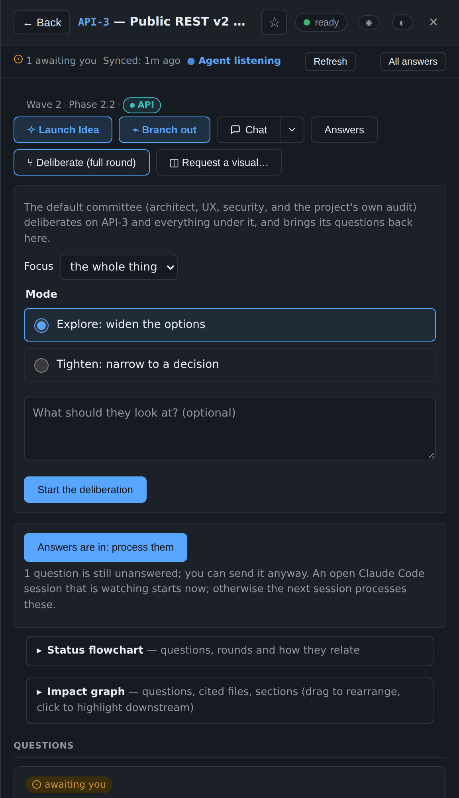

- **Next step ▾** beside every locked answer:
  - **Follow up**: chosen seats look at that answer again.
  - **Roar**: a three-round panel, at most once per lock.
  - **Refine** or **Drill**: runs the skill your project names, by default
    the plugin's own `overture:refine` and `overture:drill`.

  Each step comes back as questions for you to lock. Nothing is written
  into the project before you lock.

  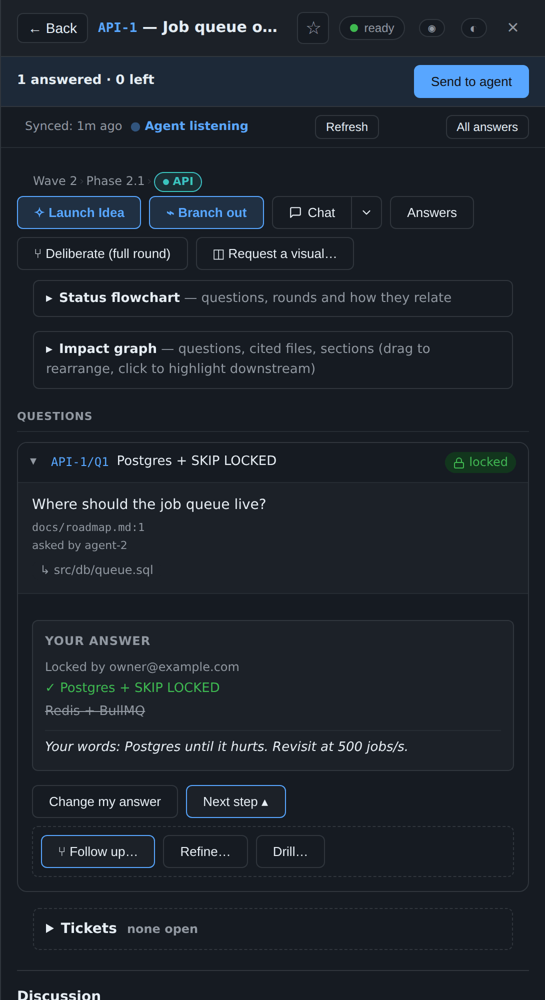

- **Branch out / Grill with agent.** The 💬 Chat ▾ menu on an item has
  **Grill** (adversarial agent questions on your pitch) and **Branch out**
  (open-ended drill-in). Grill questions carry a ⚡ **GRILL-ORIGIN** chip
  so you can tell them apart from questions an agent raised on its own.

### Track work as tickets

Tickets are small units of work that belong to an item: a **task**, a
**bug**, a **research** question, or a **grilling** note. You create them
on an item's panel; Launch Idea and Branch Out create them for you.

- **Blocking.** A ticket can be blocked by other tickets. Circular
  blocking is refused by name. When a blocker closes, everything it
  blocked unblocks.
- **The Tickets tab** (`g k`) is a board across every item, with Open,
  Blocked and Closed columns and a filter by kind. Each card names its
  item, opens it with a click, and says what blocks it by title.
- **What blocks what** draws the chains as a diagram, grouped by item.
  There for the whole project on the Tickets tab, and for one item on
  that item's panel.


Only you create and close tickets. Agents cannot write them yet; that
waits on the capability gate.

### See what agents changed, as screenshots

When an agent changes something you can see, it posts a **before** and an
**after** screenshot on the item:

    agent.py asset UI-1 --file after.png --caption "Tabs with icons" --kind after --pr 214

They show up in the **Feed**, where a before and after appear side by side
and the **Screenshots** filter shows only them, and in a **Screenshots**
fold on the item. Click one to open a full-size viewer, and step through
the others with ◂ ▸ or the arrow keys.


**Attach your own too (1.32).** In an item's Discussion box, **Attach
image** (or paste an image) puts your picture on that item, shown as "you",
beside the agents' screenshots. Rate-limited separately from an agent's
budget.


- **Formats:** PNG, JPEG, WebP or GIF. The format is decided from the
  file's own bytes, never its name, and SVG is refused because it can
  carry script.
- **Size limits:** 2 MiB for a still image, 8 MiB for a GIF, 8000 px on
  a side.
- **Storage:** files are kept in the server's state directory, never in
  your project.
- **When space runs short** (100 per item, 3000 or 300 MiB per project),
  the oldest screenshots that aren't starred or linked to a PR are
  removed. The Feed says so.
- **Your controls:** star a screenshot to keep it, or delete it (press
  twice).
- **Reduced motion:** with reduced motion turned on, a GIF waits for you
  to press play.

### Visuals and diagrams

- **Request a visual** on an item. The agent answers with a Mermaid
  diagram (rendered inside a sandboxed frame — the vendored lib runs in
  an opaque origin and cannot touch the console's cookies, storage or
  network; **View source** still shows the raw `.mmd`), or with an HTML
  mock shown the same way, scripts off entirely.

  

- **A short chime when a visual arrives**, the drawn item surfaces at the
  top of the Inbox under **New visuals**, and the Feed row says "Visual
  drawn". The badge on the inbox button and the Feed tab counts it too,
  until you look.
- **Save SVG** on every chart and Mermaid visual. The rendered SVG is sent
  back to the parent and downloaded as a plain file; nothing goes back to
  the server.
- **Status flowchart on every item.** Each item view carries a collapsible
  **Status flowchart** that the server builds from your questions and
  rounds: the item at the left, open/stale/locked questions coloured,
  rounds as their own shape, dotted edges where a newer question
  supersedes an older one or a round follows up on an earlier one. Lazy
  (nothing loads until you expand it); renders inside the same sandboxed
  Mermaid frame. **Click a node** to jump straight to that question.

  

### Project map, lanes, and the dashboard

- **Project map** at the top of the Inbox: a tree of every item, parent
  to child, drawn left to right.
  - Each node is coloured by its own questions' roll-up (open > stale >
    answered-but-unlocked > locked), with a short tally.
  - Items are grouped in one box per **lane**, its border in the lane's
    colour.
  - Click an item to open it.
  - A chip row narrows the map to one state; ancestors stay drawn muted,
    so the tree is still a tree.
  - It loads lazily, like the per-item chart.
- **Lane colours.** A lane is the `lane-…` part of an item's section
  (`wave-2/phase-2.2/lane-api`). An item without one inherits its
  parent's.
  - **Where it shows:** a chip coloured by the lane, on inbox and
    Priority rows (with a matching left edge) and as a "Wave 2 › Phase
    2.2 › API" trail at the top of the item.
  - **Automatic.** Drawn from 8 colours that read at 3:1 or better in
    light and dark; two lanes share one only past 8.
  - **To pin a colour or a label,** add it to `.overture.json`:
    `"lanes": {"lane-api": {"color": "blue", "label": "API"}}`. Palette
    names only: blue, teal, green, amber, orange, red, purple or pink.
    `"ux": true` marks a lane's items as UX components for UX View and
    the console-ux skill.
  - **On your dashboard,** each item's `<details>` and each
    `data-ck-item` block gets `data-ck-lane` and `data-ck-lane-color`,
    and console.css publishes `--ck-lane-<colour>`, so your page can
    colour its own lane blocks to match.
- **Your dashboard, published by you.** The console can sit inside your
  project's own dashboard page. An agent stages a page from a merged
  commit (`agent.py page-snapshot`). The console shows it as a proposal
  with its ref, commit, size and a sandboxed preview. It is served only
  after you press **Use this page**. No agent can publish; the "reviewed"
  label is shown as the agent's claim, because the server cannot check it.
  The published page's own `<script>` tags run again under the per-request
  CSP nonce (1.32), **pinned by exact SHA-256**.

### See what's happening

- **The page updates itself**, no reload. A box you're typing in is never
  redrawn under you.
- The **Inbox** shows what waits for you, with an unread count. The
  **Feed** shows every question, answer, lock and reply, newest first,
  filterable by kind (chat, visuals, questions, screenshots, merges) and
  item.

  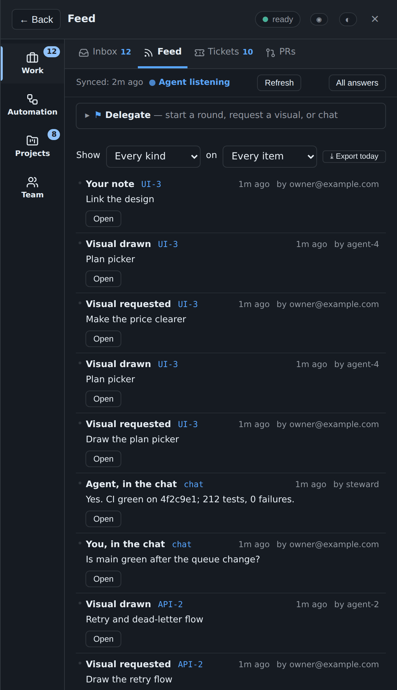

- The status bar says whether an agent session is listening right now.
  Optionally, a footer shows your Claude usage for the 5-hour and 7-day
  windows.
- **Status chip.** A pill in the panel's top-right reflects
  `/api/status`: version, agent socket, waiters/caps, chat quota, cron
  tick age, peer freshness. Click opens a drawer; **Operator shift →**
  opens the weekly report.
- **Operator Shift view.** Today / This week / This month: rulings
  locked, items advanced, median time-to-answer, merged PRs tied to a
  ruling, closed issues tied to a ruling, Living rulings still waiting.
  Composed as Markdown with Copy. The screenshot-for-cofounder surface.
- **Several agents, one console.** Sessions can be named (`/overture:as
  agent-6`). One of them, the **steward** named in your own registry, is
  the only one that processes your requests and folds your answers. The
  others post their questions to your inbox instead of asking you
  directly. Active-agents fold on each item panel reads
  `cursor.working_by` and lists who is currently holding a mark on this
  item.
- The **PRs** tab shows each pull request as its own card. The left edge
  shows its state: blue open, amber checks running, red checks failing,
  grey draft, purple merged. Lists the project's open pull requests, then
  those merged or closed in the last 30 days (`--days` changes it), with
  checks, draft and merged badges, a link to each on GitHub, and an
  **Open** button for any item or question a title or branch names. The
  steward pushes the list (`agent.py prs-push`), and the tab says when it
  last did.

  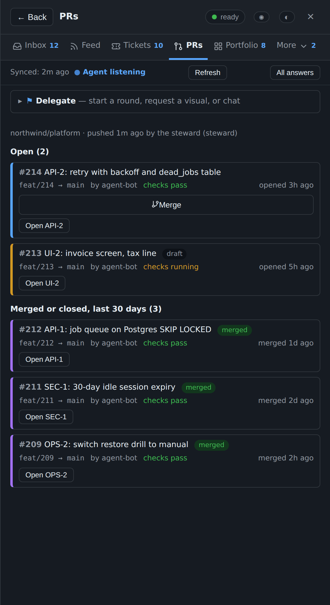

- **Merge from the PR tab.** An open, ready, passing pull request has a
  **Merge** button. It asks first ("Merge #214 into main?", with a link
  to the diff), then sends your request on the reserved `@prs` thread.
  The steward's own session merges with its own `gh`, pinned to the
  commit you saw (`agent.py pr-merge --project WORKTREE --request ID`).
  The console never merges anything and holds no GitHub token. If the
  pull request changed since you looked, or the request is over 24 hours
  old, nothing is merged and the steward says why.

  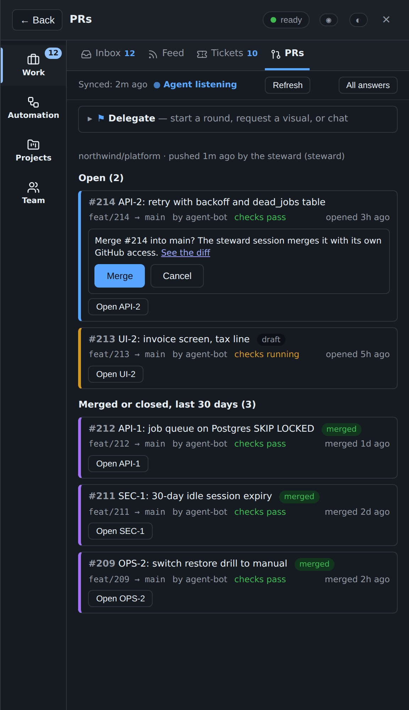

- **Rulings → PRs and Rulings → Issues.** When a tracked PR or issue
  title (and issue body) mentions a ruling's qid like `A/Q7`, each
  matching PR/issue appears as a chip under the locked ruling. Merged PRs
  render filled green ("Shipped: #142"); closed issues as filled grey.
  Chips carry the author (`#142 by @alice`) so you can tell a drive-by
  mention from a trusted one.
- **The Favorite tab** lists everything you starred, grouped by item.

  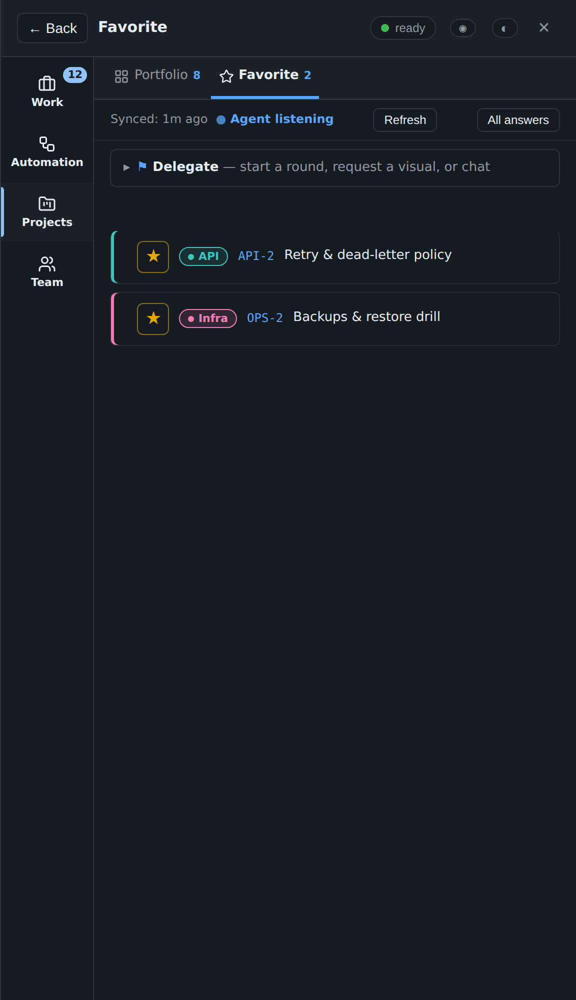

- **Chat**, for a message not tied to a question. Wakes the watching
  session. On an item, **💬 Chat ▾** jumps to that item's discussion. Its
  menu offers **Branch out**, **Grill**, **Advise** (deliberate) and
  **Delegate**, each already scoped to the item.

  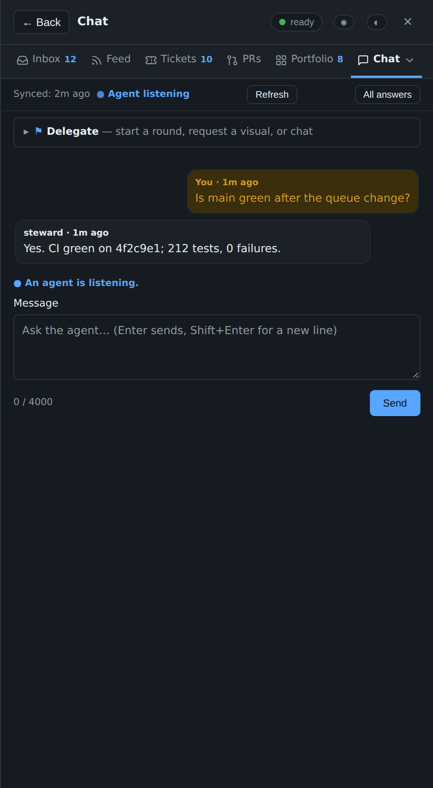

  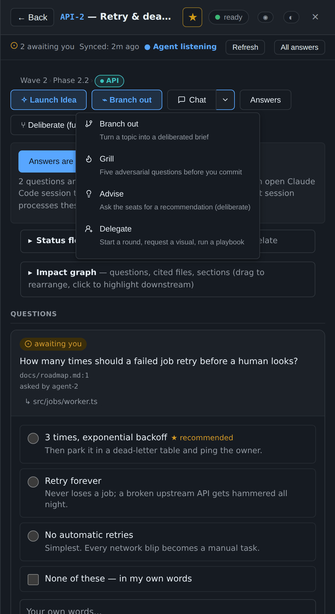

- **Cross-project priority ribbon.** The Inbox opens with up to six of
  the oldest awaiting questions across every console (self + each
  portfolio peer), each with a traffic-light dot (yellow < 1h, orange <
  24h, red > 24h). Click a row to jump — local items open their panel;
  peer rows open the peer in a new tab.

  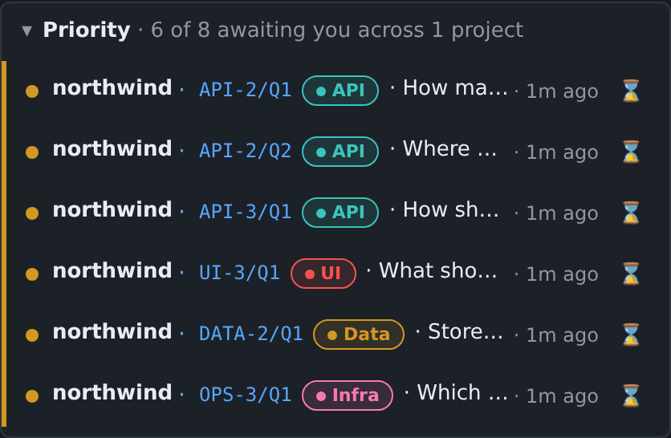

- **Command palette.** Press **Ctrl+K** / **Cmd+K** on any page to open
  a search box over items, questions, playbooks, peers, tabs and actions.
  Type a few characters, press Enter: jumps to an item, runs a playbook,
  opens a peer in a new tab, hops a tab.

  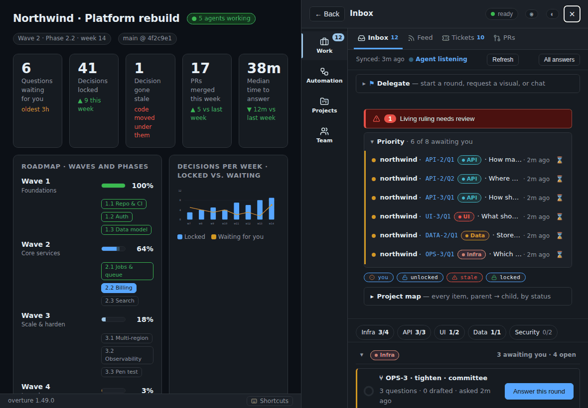

- **Keyboard shortcuts.** Press `?`, or the **⌨ Shortcuts** button in
  the footer, for the full list. `g i / f / k / p / s / o / c` hop to the
  Inbox / Feed / Tickets / PRs / Favorite / Portfolio / Chat tab; `g b`
  closes the panel; `.` focuses the Delegate bar; `j / k` walk the rows;
  Enter / Space opens the focused row. Shortcuts never fire in a text
  input.

  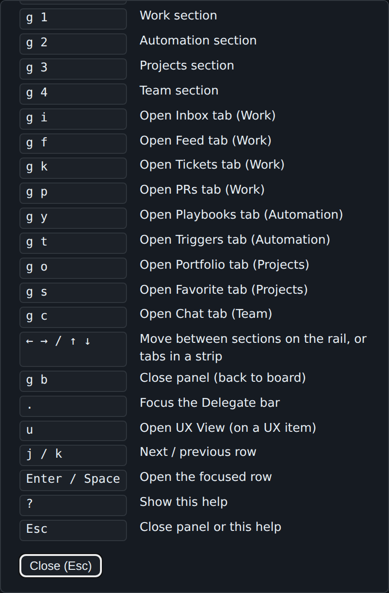

- **The Portfolio tab** lists every other console you have configured
  with its state tallies (`2 you`, `1 unlocked`, `1 stale`, `9 locked`,
  each with its state icon), last-activity, and a click that opens it in
  a new tab. A bell button opts in to desktop notifications so a sibling's
  new `?you` or `!stale` reaches you even when the tab is in the
  background; a Snooze button sets a 1-hour DND lid. Peers are declared
  in `.overture/portfolio.json`; the Cloudflare Access service-token
  secrets live in `STATE/portfolio-secrets/<peer>.json` (`agent.py
  portfolio-token` prints the layout). The home server does the
  cross-origin calls, so the browser never sees a peer's secret.
- A **Back** control sits at the top of every item view, so **discuss**
  from the dashboard always has a one-tap way home.
- **Direction stays visible.** Each item in the Inbox carries a
  collapsible "N answered on this item" under its open questions, showing
  the last few locked rulings. Items whose questions are all locked
  within the last day stay on the list under **Recently answered**, so
  you can see what was asked and answered without leaving the Inbox.

## How it fits together

```
 browser ──Access login──▶ Cloudflare ──tunnel──▶ 127.0.0.1:PORT  server.py
                                                     │ checks the Access JWT (team keys + AUD)
                                                     ▼
                                              state dir: store + doorbell
                                                     ▲
 Claude session ── SessionStart hook reads the doorbell (registered projects only)
                └─ skills: console-process / console-fork / console-fold / console-ask / console-visual / console-ux ── agent.py
```

- **`server.py`** serves the console inside your published dashboard
  page. Every request without a valid Access token is refused, loopback
  included. **It runs no project code and no git.** Your work items
  arrive by `agent.py items-push`, git history by `agent.py
  history-push`, pull requests by `agent.py prs-push` (`gh` runs in the
  steward, never in the server), and the page by `agent.py
  page-snapshot`. The steward runs all four in its own process, and
  each sends data the server checks against a closed schema.
- **`agent.py`** is the agent's side. Its commands:

  | Purpose | Commands |
  |---|---|
  | Reading | `inbox`, `todo`, `view`, `answers` (capped at 64 KiB, with a narrower command named when a read is too big), `health` |
  | Asking and answering | `ask`, `reply`, `working`, `synced`, `watch` |
  | Deliberation | `fork-context`, `transcript`, `visual`, `visual-export`, `next-step`, `costs` |
  | Stale answers | `check`, `reanchor`, `propose-anchor` |
  | Pushing data | `items-push`, `items-watch`, `history-push`, `prs-push`, `page-snapshot`, `asset`, `component-source`, `design-inventory` |
  | Owner only | `register`, `steward`, `role`, `server add`, `server token rotate`, `pr-merge` |

  `--as NAME` names the session.
- **`fold.py`** writes locked answers, and what became of them, into
  your project through its adapter, in the steward's process.
- **`plugin/`** holds the Claude Code plugin: the hooks, the skills, and
  the committee agents. Skills include `roar`, `refine`, `drill`,
  `deliberate`, `grill-me`, `console-ux` and the console-* workflow
  skills.
- **`onboard.py`** and **`deploy/`** onboard a project and install the
  services. `onboard.py verify` does an end-to-end reachability check.

### What a project token protects

One console server can host several projects. Each project's agents
reach it with that project's own token. The token is kept in
`~/.config/overture/tokens/NAME` (mode 0600, outside every repository);
`server.json` holds only its hash. `agent.py` picks the project from the
directory it runs in. `agent.py server token rotate NAME` (which you run)
refuses the old token from the next request.

- **What it stops:** cross-talk and mistakes. A wrong `--state`, a skill
  bug, or an agent carrying another project's habits cannot read or
  write another project's console through the kit.
- **What it does not stop:** an agent running as the same OS user that
  sets out to cross over. It can read `tokens/` and the state directories
  directly. Real isolation needs a sandbox or a separate user.
- **An old per-project server is a way around it.** While one still
  listens on `STATE/agent.sock`, that socket answers without a token.
  Stop it before relying on the token.

## Windows + WSL2 (optional)

The server, the tunnel and the systemd units are POSIX; a convenient
layout on a Windows host is to run them in WSL2 while a Claude Code
session lives on either side. A few traps worth knowing:

- **CRLF.** `git config core.autocrlf=true` on Windows gives every file
  in the plugin cache CRLF endings. `install.sh` then fails at once
  (`set: pipefail: invalid option name`), and systemd unit files with a
  `\r` silently misbehave. Install the kit from a copy stripped of CR
  (`sed -i 's/\r$//'` on each `*.sh`, `*.in`, `*.py`, `*.js`, `*.css`,
  `*.html`) or clone with `core.autocrlf=false`.
- **Default branch.** `page-snapshot --from-ref origin/main` is the
  default and fails on a repository whose default is anything else. Pass
  `--from-ref HEAD --unreviewed` while bootstrapping, or point
  `--from-ref` at your actual branch.
- **Page path.** `onboard.py` defaults the page to
  `.overture/page.html`, which `page-snapshot` refuses (leading dot).
  Move the page under `docs/console/page.html` or similar.
- **Items.** The server never runs your adapter. After onboarding, run
  `agent.py --state STATE items-push --adapter PATH` once (and whenever
  the item list changes); until then `ask` on any item but `PROJECT` is
  refused.
- **Reaching the server from Windows.** The agent socket lives in WSL
  and Windows cannot open a WSL2 Unix socket. Options: run the
  agent-side session inside WSL (`wsl -e bash` wrapper), or use the
  one-server HTTP door with a project token on loopback.
- **Linger.** Systemd user units stop when WSL shuts down. Run
  `loginctl enable-linger $USER` in WSL; a Windows process that keeps
  WSL alive still helps when nothing else holds it.
- **Platform guard (1.26+).** `server.py` refuses to start on non-POSIX
  rather than corrupting state under a half-working runtime.

## Trust

The security model has been through parallel review passes (code,
security, python, typescript, adversarial) across the 1.22 → 1.33 arc,
most recently the three-reviewer pass that became 1.33.1. Every HIGH
finding is closed; the current state:

- **The plugin's hook runs in every project you open**, but acts only
  in projects listed in `~/.config/overture/projects.json`, which only
  `agent.py register` and `agent.py steward` write. A cloned repository's
  `.overture.json` is never trusted by itself, and cannot name a steward.
- **Anything an agent can write** — the adapter, `.git/config`, the
  dashboard file in the working tree — is never run or read by the
  server.
- **The kit never opens `~/.cloudflared/cert.pem` or a tunnel
  credentials file.** It checks that the file exists, and nothing more.
- **Nothing onboarding writes is a secret.** The AUD tag and team
  domain are what tokens are *checked against*; no token can be made
  from them.
- **Owner-door CSP** (1.31, tightened 1.33.1): `frame-ancestors 'none';
  object-src 'none'; base-uri 'none'; frame-src 'self'; img-src 'self'
  data:; connect-src 'self'; script-src 'nonce-<per-request>'`. The
  inline console script runs under a per-request nonce; a DOM-injected
  `<script>` without the nonce is refused by the browser. A CSRF header
  that is not plain ASCII gets a 403, not a dropped connection.
- **CSRF double-submit** (1.27): every POST under `/api/*` must echo the
  boot-scoped token in `X-Overture-CSRF`. `POST /api/csrf-rotate` (1.31)
  invalidates all open pages without a restart.
- **COOP same-origin + COEP require-corp**: the owner window is
  cross-origin-isolated.
- **HTML sanitizer** (1.31): parser-based allowlist rewriter via
  `html.parser.HTMLParser`. Not the primary control (the sandboxed
  iframe is), but closes the parser-differential bypass class.
- **Spawn semaphore** (1.28): `MAX_WORKING_GLOBAL=64` and
  `MAX_WORKING_PER_ITEM=8` enforced under `_working_lock` before every
  write.
- **State files** go through `atfile.write_at` (dir fd + `O_NOFOLLOW` +
  `O_EXCL` temp + fsync + rename). Nothing follows symlinks; concurrent
  writes race on a per-file lock, not on a shared `.tmp`.
- **Ticket id entropy:** `secrets.token_urlsafe(8)` (≈64 bits).
- **Agent-door `/playbook`** writes `by="agent"` (1.30.1): an
  agent-authored playbook cannot forge owner-only intents.
- **Lessons** (1.33): written only by the owner's own Withdraw / Keep
  acts, stored under STATE with the same atomic writes, capped by count
  and size so they can never block a later lesson. The page gets a count
  and short previews; the full text is only for `agent.py` on your
  machine. `--fold` refuses to follow a symlink at its target.
- **Grill provenance badge**: questions written in response to a
  `/message intent=grill` carry a ⚡ chip so you can tell them apart from
  questions an agent raised on its own.

## Development

    python3 -m venv .venv && .venv/bin/pip install -r plugin/kit/requirements.txt
    .venv/bin/python test_kit.py && .venv/bin/python test_server.py && .venv/bin/python test_onboard.py
    .venv/bin/python test_build.py
    .venv/bin/pip install playwright && .venv/bin/playwright install chromium
    OVERTURE_BROWSER=1 .venv/bin/python test_browser.py

Three `test_kit.py` compatibility tests start older released kits, so
they need the `v0.8.7` and `v0.8.8` tags; in a shallow or tag-less clone
run `git fetch --tags` first, or they fail and name the missing tag.

`test_server.py`'s syscall tests need `strace`, and FAIL when it is
missing, so they cannot quietly not run. On a machine without it, set
`OVERTURE_NO_STRACE=1` to skip them, and each is then reported, by
name, as not run.

To refresh the README screenshots after a UI change (needs Playwright
and Chromium):

    python3 docs/demo/screenshots.py

The script starts the real console server in-process, with a throwaway
key standing in for Cloudflare Access. It publishes
`docs/demo/showcase.html`, an example dashboard with waves, phases and
lanes, as the project page. It seeds questions, rulings, a stale
ruling, a round, a visual, chat and PRs through the same doors agents
and the owner use. Then it captures every capability in this README:
stills in `docs/screenshots/feature-*.png`, hero shots in dark and
light, and short GIFs (`anim-*.gif`) of the interactive ones.

To build the release zip:

    python3 build_zip.py --deny-file ~/my-deployment-values.txt

It runs `claude plugin validate --strict` on the result. The deny file
lists strings from your own deployment (hostnames, AUD tags, team
domain, home path), and the build refuses if any of them appears in the
zip.

## Changelog & release notes

Every release is tagged `vX.Y.Z` with notes in [CHANGELOG.md](CHANGELOG.md)
and a signed zip on [Releases](https://github.com/MikeHeid/overture/releases).
Highlights of the 1.x arc:

- **1.34 — Lesson match**: related past rulings on the question card,
  `agent.py lesson-match`. **1.34.1** brings this README up to date and
  caches lessons between page polls. **1.34.2**: upkeep (dependency
  pins, a test that failed inside Claude Code). **1.34.3**: lessons
  hardening from the 1.34 review. **1.34.4**: an opened 📎 chip stays
  open when the page refreshes. **1.34.5**: so do the console's other
  folds; `lesson-match` output hardened like the folded file.
- **1.33 — Lessons**: withdraw / keep reasons kept as lessons, the
  SessionStart line, `agent.py lessons [--fold]`. **1.33.1**: review
  fixes (lesson size caps, sanitizer, CSP, CSRF).
- **1.32 — View**: UX View modal, design-system picker, Scripts switch,
  Merge from PR tab, Machine role, lane colours, screenshots in Feed,
  owner-attached images, `server.py daemon|service|status|health`,
  Lucide icons.
- **1.31 — Hardening**: parser-based HTML sanitizer, per-request CSP
  nonce, `/api/csrf-rotate`, backlink author labels, grill provenance.
- **1.30 — Shift**: Operator Shift modal, agent-mediated grill (`intent:
  grill`).
- **1.29 — Prototype**: visual variant chips, HTML sanitization.
- **1.28 — Active**: real spawn semaphore, active-agents fold.
- **1.27 — Shipped as**: `issues-push`, Rulings → Issues backlinks,
  CSRF double-submit, COEP require-corp.
- **1.26 — Deliberate**: Launch Idea pane, Branch Out wizard, tickets
  module, `grill-me` skill, COOP, platform guard.
- **1.25 — Legible**: Living Rulings badge, Playbooks + Triggers tabs,
  Rulings → PRs backlinks, portfolio upgrade seam.
- **1.24 — Welcoming**: first-run hero, focus trap+return on secondary
  modals, dock drag + resize, textarea labels, inbox rows as buttons.
- **1.23 — Visible truth**: toast surface, danger buttons, `/api/status`,
  `/ready`, contrast fixes.
- **1.22 — Mobile polish**: `@media (max-width: 640px)` block.

## License

MIT. See [LICENSE](LICENSE). The bundled Lucide icons are ISC-licensed
(`plugin/kit/overture/vendor/LUCIDE-LICENSE.txt`).
