<h1 align="center">
  <picture>
    <source media="(prefers-color-scheme: dark)" srcset="docs/brand/overture-logo-dark.svg">
    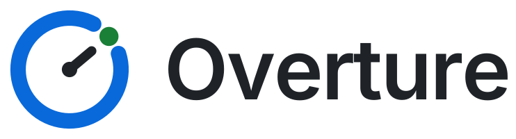
  </picture>
</h1>

<p align="center">
  <strong>Your AI coding agents ask. You answer from one web page.<br>
  Overture keeps the answers and warns you when the code changes under them.</strong>
</p>

<p align="center">
  
  
  
  
  
</p>

<picture>
  <source media="(prefers-color-scheme: light)" srcset="docs/screenshots/overview-light.png">
  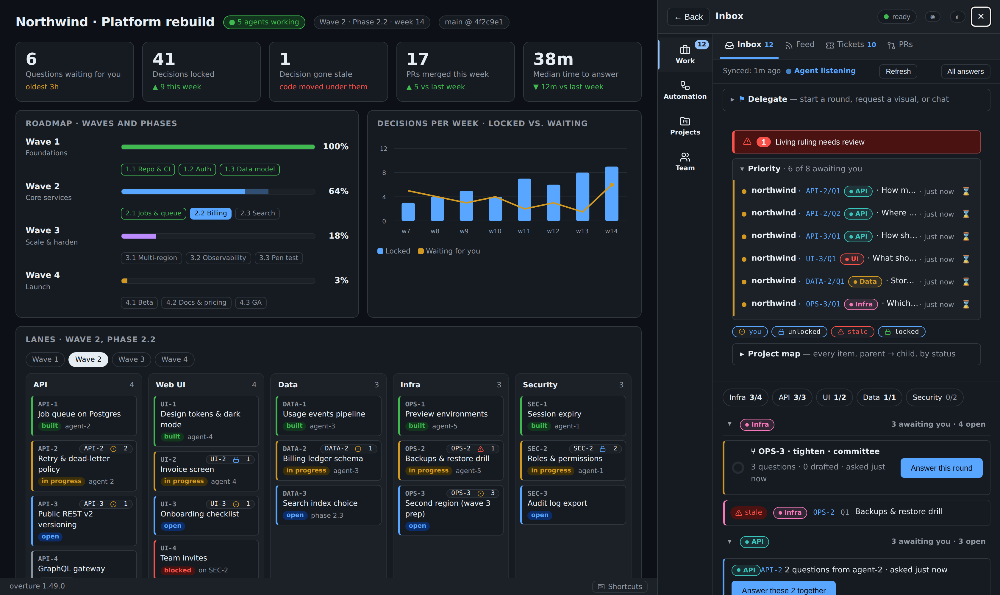
</picture>

## What is it?

When you run AI coding agents (for example several Claude Code sessions),
they keep needing **decisions** from you. Which database should we use? How
many retries? Which region? Today each agent stops and waits in its own
terminal. Your answer disappears when the session ends.

**Overture gathers every one of those questions into a single inbox**, open
in a browser on your laptop or your phone, docked beside the project
dashboard you already have.

1. **An agent asks.** It lists the options, marks the one it recommends (★),
   and shows the code that matters.
2. **You answer.** Tap an option, or walk a batch from the keyboard. Lock
   when you are sure.
3. **Every agent remembers it.** Locked answers (**rulings**) are saved into
   your project's own git history. If the code they relied on later changes,
   the ruling is flagged **stale**, so you never rely on a decision whose
   evidence has moved.

<picture>
  <source media="(prefers-color-scheme: light)" srcset="docs/screenshots/question-light.png">
  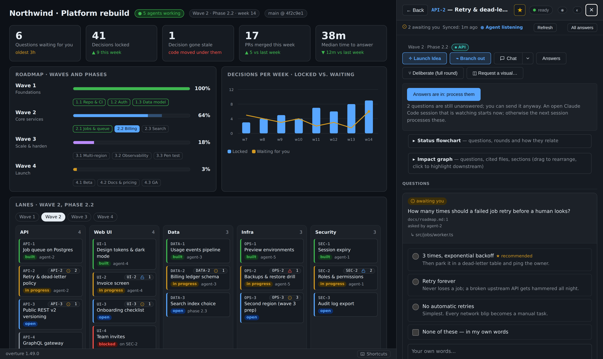
</picture>

It runs **on your own machine behind your own login**, and nothing goes to a
third-party service. The console is one Python process, one browser SPA,
and a Claude Code plugin, all under one MIT licence.

## Who is it for?

- **Solo developers running several AI agents**, tired of babysitting terminals.
- **Tech leads** who want a written record of *why* the code is the way it is.
- **Small teams** who share one console: each person has a role, each
  decision records who made it, and the riskiest areas need two people.
- **UX-leaning teams** who want to iterate on components, keep the versions
  that worked, and merge the chosen one through a real pull request.
- **Anyone juggling several projects.** One portfolio page shows what is
  waiting for you across all of them.

## Try it

You need Claude Code. For the login in front of your inbox, pick one: a
Cloudflare account (the free tier is enough), or no account at all, with
one-time sign-in links on this machine, your Tailscale tailnet or your
ZeroTier network (1.46, 1.47).

    /plugin marketplace add MikeHeid/overture
    /plugin install overture@overture
    /overture:console-onboard

The last command asks how you will reach the console and walks you through
the rest, in your project. Full details under [Install](#install).

**Already running Overture for another project?** Join this one to the same
server: [docs/JOIN.md](docs/JOIN.md).

## Feature map

Each area links to its own page, with the full reference and screenshots.

| Area | What ships today | Read more |
|---|---|---|
| **The loop** | Inbox of agent questions · one-tap answer and lock · round forms with keyboard shortcuts · lock-all · live redraw · snooze · filter chips · deep links · drafts that follow you | [Inbox and rulings](docs/features/inbox-and-rulings.md) |
| **Rulings** | Locked answers stored in git · `valid_if` conditions · stale detection · **What changed?** diff · re-anchor / withdraw / keep / replace · scan for a resolve · export today's rulings | [Inbox and rulings](docs/features/inbox-and-rulings.md#keep-rulings-honest-as-the-code-moves) |
| **Lessons** (1.33–1.34) | Your reason for withdrawing a ruling is kept · new sessions are told · **📎 related past rulings** on a look-alike question · `agent.py lessons` / `lesson-match` | [Lessons](docs/features/inbox-and-rulings.md#lessons-what-you-settled-stays-settled-133134) |
| **Teams and roles** (1.38–1.42) | Who decided, on every lock · owner / member (by area) / viewer roles · **People** tab · routing ("For you") · directors · role log | [Roles and people](docs/features/roles-and-people.md) |
| **Two-key locks** (1.43) | Areas where a lock counts only once a second person confirms it · "Locked by A, confirmed by B" | [Two-key locks](docs/features/two-key-locks.md) |
| **Settings and notifications** (1.44–1.45) | Limits, lane labels and colours, two-key areas and short names, set in the console · a digest of waiting questions to a Slack-style channel, with quiet hours | [Settings and notifications](docs/features/notifications-and-settings.md) |
| **Sign-in links and networks** (1.46–1.47) | Cloudflare Access, or one-time sign-in links with no Cloudflare · signed-in browsers listed and revoked under People · `--listen` on a ZeroTier or Tailscale address · onboarding that asks how you reach the console | [Sign-in and networks](docs/features/sign-in-and-networks.md) |
| **Automation** | **⚑ Delegate** bar · playbooks with `when` branching and Preview · webhook and cron triggers · trigger log and Replay · impact graph | [Automation](docs/features/automation.md) |
| **MCP** (1.35) | An MCP server, so Cursor, Codex, Copilot and other MCP clients ask and read rulings like Claude Code | [MCP and CI](docs/features/mcp-and-ci.md) |
| **CI** (1.36–1.37) | `rulecheck.py` and a GitHub Action fail a pull request that breaks a locked ruling, with no server · `--strict` | [MCP and CI](docs/features/mcp-and-ci.md#block-a-merge-that-breaks-a-ruling-ci-136) |
| **UX View** (1.32) | Full-screen component modal · versions and sizes · Generate · Save as component (opens a PR) · Claude Design link · design-system picker · Scripts switch | [UX View](docs/features/ux-view.md) |
| **Deliberation** | Up to three advisor seats · Roar panels · Refine / Drill · Next step ▾ on every locked answer · Launch Idea · Branch out · Grill with agent | [Deliberation](docs/features/deliberation.md) |
| **Tickets** | Per-item tasks / bugs / research / grilling · dependency graph · board across every item with blocking shown | [Tickets, screenshots and visuals](docs/features/tickets-screenshots-visuals.md) |
| **Screenshots and visuals** | Before/after agent screenshots in the Feed · owner images · GIFs · Mermaid and HTML visuals in a sandbox · status flowchart per item · variants | [Tickets, screenshots and visuals](docs/features/tickets-screenshots-visuals.md#see-what-agents-changed-as-screenshots) |
| **Dashboard** | Scaffolds `docs/console/page.html` · syncs an `items-tree` block · numbered refs · stages via `page-snapshot` · publishes on **Use this page** | [Dashboard and map](docs/features/dashboard-and-map.md) |
| **Project map** | Tree of every item, coloured by state, boxed by lane · chip filters · lane colours published to the host page's CSS | [Dashboard and map](docs/features/dashboard-and-map.md#project-map-lanes-and-the-dashboard) |
| **Visibility** | Feed with screenshot filter · Favorites · PRs tab with inline Merge · cross-project priority ribbon · Chat per item · Portfolio · Operator Shift report · themes and skins | [Finding your way around](docs/features/navigation.md) |
| **Sections and phones** (1.48) | Work, Automation, Projects and Team, each with its own tabs, on a rail · a badge per section · full screen on a phone with a bottom bar · motion that respects reduced motion | [Finding your way around](docs/features/navigation.md#tabs-themes-and-reports) |
| **Pop-outs and a calmer Inbox** (1.49) | Flowcharts, graphs, visuals, rounds, long rulings and screenshots pop out beside the console, three at a time, with Pin · the Inbox grouped by lane, with an outline · `j`/`k` through the unanswered questions · a sticky Mine | [Finding your way around](docs/features/navigation.md#pop-outs-149) |
| **Keyboard** | `?` for shortcuts · `g <letter>` to hop tabs · `g 1`–`g 4` for sections · `j`/`k` next or previous unanswered question · **Ctrl+K** command palette with full-text search | [Finding your way around](docs/features/navigation.md#tabs-themes-and-reports) |
| **Multi-agent / multi-project** | Named sessions · one steward · portfolio federation · Machine role (steward / worker) · active-agents fold · project tokens | [Hosting](docs/features/hosting.md) |
| **Hosting** | `server.py daemon` / `service install` / `status` / `health` · systemd user units · health and readiness probes · Windows + WSL2 | [Hosting](docs/features/hosting.md) |
| **Security** | Cloudflare Access or sign-in links · per-request CSP nonce · CSRF double-submit · atomic state writes · sandboxed iframes · parser-based HTML allowlist | [Trust](#trust) |

## Features

### The inbox and rulings

Every question your agents ask lands in one Inbox. Answer with a tap or from
the keyboard, lock it into a ruling, or lock a whole round at once. A ruling
names what must stay true for it to stand; when the cited code changes, it
turns **stale**, and **What changed?** shows the diff so you can re-lock,
withdraw, keep or replace it. The reason you give for dropping one is kept as
a **lesson**, so the next agent does not ask again.


→ [docs/features/inbox-and-rulings.md](docs/features/inbox-and-rulings.md)

### Roles and people

Several people can share one console. Each lock records the login that made
it, an administrator gives everyone else a role on the **People** tab
(member of some areas, or viewer), each question says who it is for, and
**Role changes** lists every change.

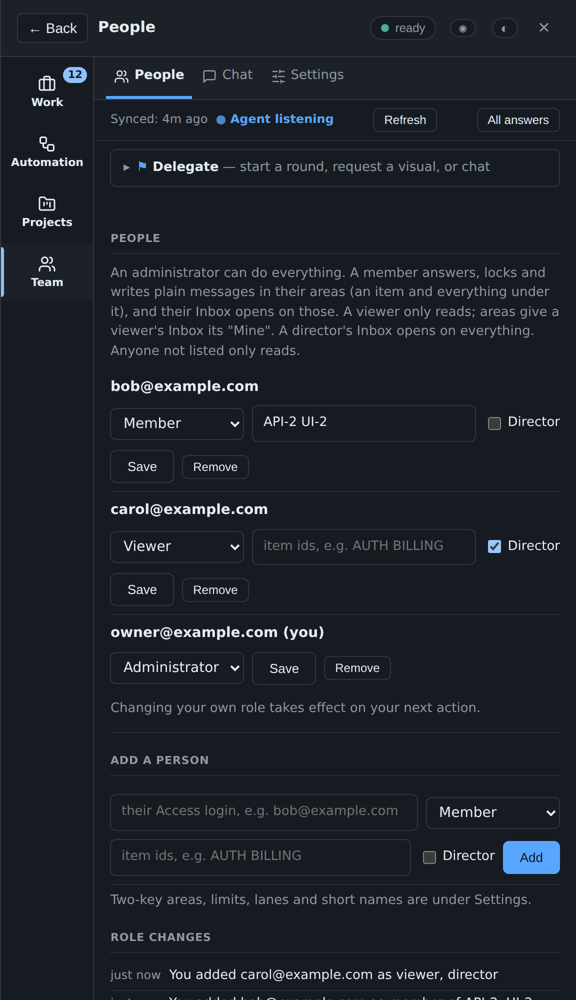

→ [docs/features/roles-and-people.md](docs/features/roles-and-people.md)

### Two-key locks

In the areas an administrator names, one person may not lock alone: a lock
waits until a second login confirms it, and only then is it a ruling.

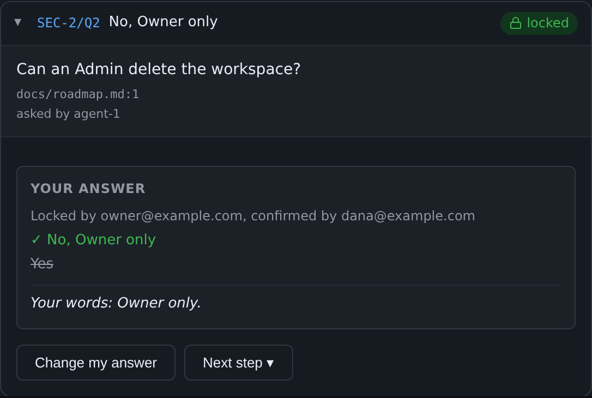

→ [docs/features/two-key-locks.md](docs/features/two-key-locks.md)

### Settings and notifications

Administrators and directors set the project's limits, lane labels and
colours, two-key areas and short names in the console. The console can also
post a digest of waiting questions to Slack, Mattermost or Discord, at most
every N minutes and never in quiet hours. It never posts a question's text.

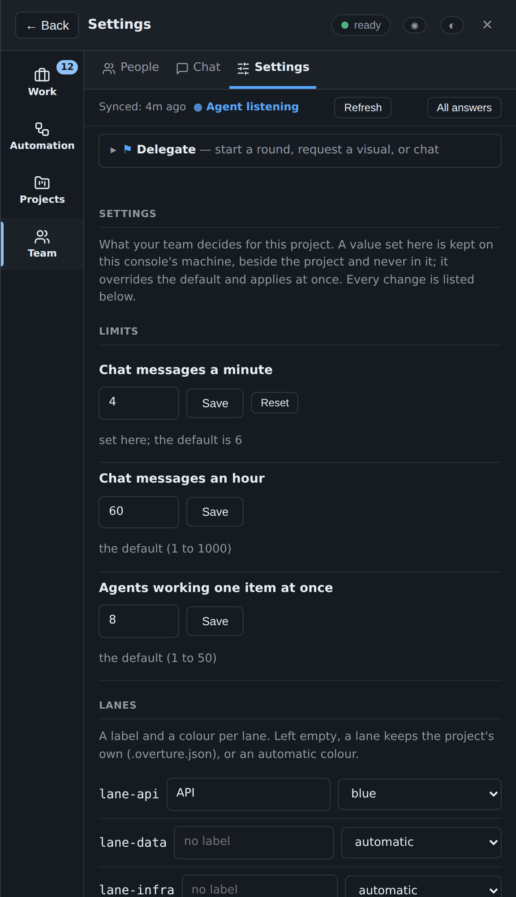

→ [docs/features/notifications-and-settings.md](docs/features/notifications-and-settings.md)

### Sign-in links and networks

A console sits behind Cloudflare Access, or (1.46) runs with no Cloudflare at
all: `agent.py invite EMAIL` prints a one-time link, the browser that opens
it stays signed in, and **People** lists and revokes signed-in browsers. Your
network decides who can reach the console: this machine only, Tailscale
through `tailscale serve`, or (1.47) `--listen ADDR` on the console's own
ZeroTier or Tailscale address beside 127.0.0.1, never `0.0.0.0`. Sign in once
per address you use. With `--listen` the origin is plain `http://ADDR:PORT`,
so use `tailscale serve` (https) **without** `--listen`, never both. On a
machine other people log in to, read the cookie notes first.
`/overture:console-onboard` asks which way you will reach the console and
writes the rest.

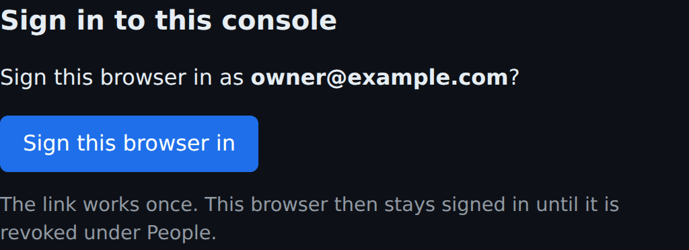

→ [docs/features/sign-in-and-networks.md](docs/features/sign-in-and-networks.md)

### Automation

The **⚑ Delegate** bar starts a round, a visual or a chat from anywhere. A
playbook codifies several steps, each with an optional `when` condition, and
**Preview** says which would run and why the rest would not. Webhook and cron
triggers fire playbooks without you; the Triggers tab logs each firing and
replays one. Playbooks run from the console: a Claude session that asks to
run one is told so, before anything runs (1.47).

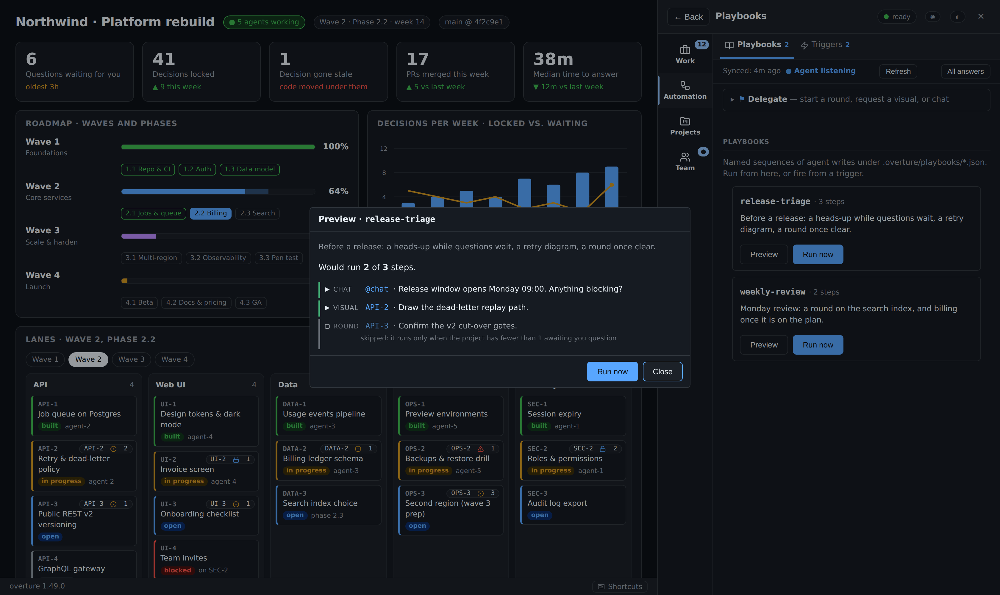

→ [docs/features/automation.md](docs/features/automation.md)

### MCP and CI

Agents other than Claude Code (Cursor, Codex, Copilot) ask and read rulings
through an MCP server. In CI, a GitHub Action fails a pull request that
breaks a locked ruling, with no console server needed:

```yaml
on: pull_request
permissions: {contents: read, pull-requests: write}
jobs:
  rulings:
    runs-on: ubuntu-latest
    steps:
      - uses: actions/checkout@v4
        with: {fetch-depth: 0}
      - uses: MikeHeid/overture@v1.49.0
```

→ [docs/features/mcp-and-ci.md](docs/features/mcp-and-ci.md)

### UX View

On a UI item, **◫ UX View** opens a full-screen workspace over its HTML
mock-ups: see each version at phone, tablet or desktop width, generate
another, and save the one you want as a component by pull request.

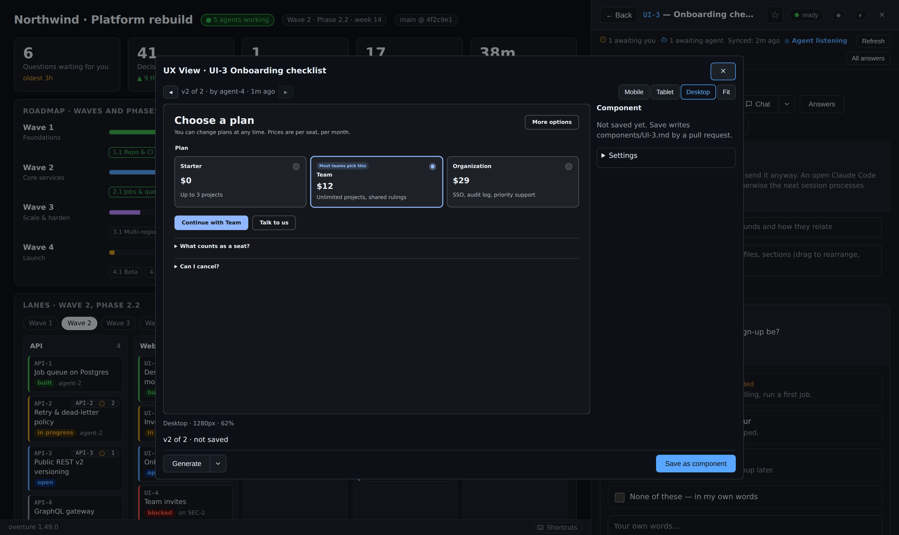

→ [docs/features/ux-view.md](docs/features/ux-view.md)

### Deliberation, Launch Idea and Branch out

Before you answer, pick up to three advisor seats (security, UX, devil's
advocate and others) to weigh in; they never decide for you. After you lock,
**Next step ▾** follows up, refines or drills. **Launch Idea** turns a pitch
into grilled questions and tickets, and **Branch out** drills into a topic.

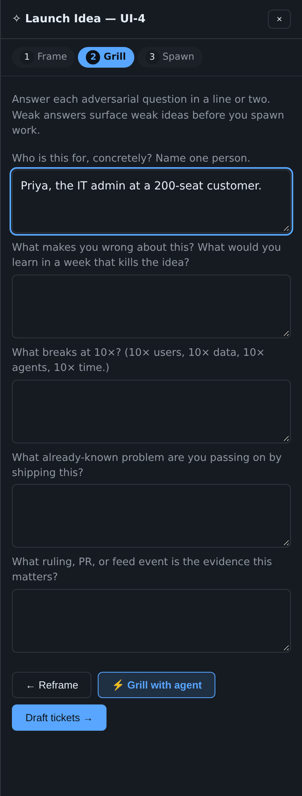

→ [docs/features/deliberation.md](docs/features/deliberation.md)

### Tickets, screenshots and visuals

Tickets are small units of work on an item, with blocking and a board across
every item. Agents post before-and-after screenshots that appear in the
Feed, and answer a request for a visual with a Mermaid diagram or an HTML
mock, shown in a sandboxed frame.


→ [docs/features/tickets-screenshots-visuals.md](docs/features/tickets-screenshots-visuals.md)

### Dashboard, project map and lanes

The console docks inside your project's own dashboard page, which an agent
scaffolds and stages and only you publish. The project map draws every item
as a tree, coloured by state and boxed by lane, and the Portfolio shows your
other consoles.

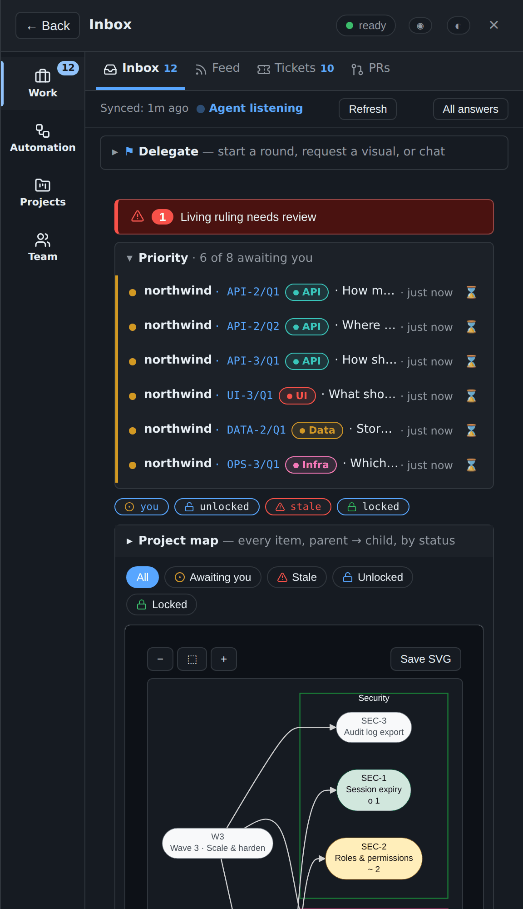

→ [docs/features/dashboard-and-map.md](docs/features/dashboard-and-map.md)

### Finding your way around

The page updates itself. The tabs sit in four sections on a rail (1.48):
**Work** (Inbox, Feed, Tickets, PRs with Merge), **Automation** (Playbooks,
Triggers), **Projects** (Portfolio, Favorite) and **Team** (People, Chat,
Settings), and `g 1`–`g 4` jump between them. On a wide screen a flowchart,
a graph, a visual, a round, a long ruling or a screenshot pops out beside the
console, over the dashboard, three at a time (1.49). The Inbox groups its
questions by lane, with an outline to jump between them, and `j`/`k` walk the
unanswered ones. On a phone the console takes the whole screen, with the
sections in a bottom bar. **Ctrl+K** searches everything, `?` lists the
shortcuts, and **Operator Shift** reports the week as Markdown.

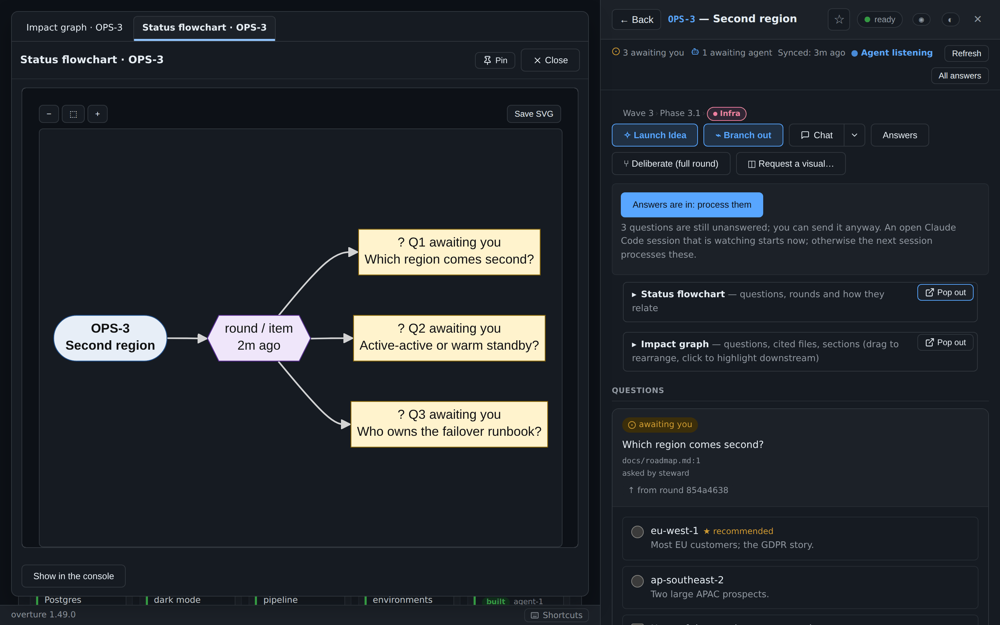

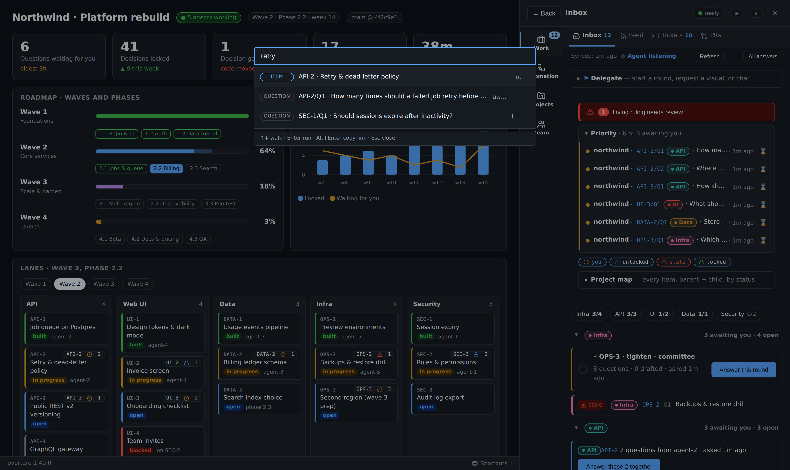

→ [docs/features/navigation.md](docs/features/navigation.md)

### Hosting

One server hosts every project on the machine, as a daemon or a systemd user
unit, with `status` and `health` to check it. Each project's agents use their
own token. Windows hosts run it in WSL2.

    <py> <kit>/server.py service install --start   # a systemd user unit (Linux, WSL)
    <py> <kit>/server.py status                    # which mode, pid, each project's port

→ [docs/features/hosting.md](docs/features/hosting.md)

## Words you'll see

| Word | Plain meaning |
|---|---|
| **Question** | Something an agent needs you to decide, with options and a recommended pick (★). |
| **Lock** | "I'm sure." A locked answer becomes a lasting rule that every agent follows. |
| **Ruling** | A locked answer. |
| **Stale** | The code a ruling relied on has changed. Take another look. |
| **Lesson** | The reason you gave when you withdrew a ruling or stopped checking it. Agents read it so they don't ask the same thing again. |
| **Steward** | The one agent session that collects your answers and writes them into the project. |
| **Round** | A batch of related questions you answer in one go. |
| **Seats** | Optional advisor agents (security, UX, devil's advocate, …) that weigh in before you decide. They never decide for you. |
| **Lane** | The slice of your project an item belongs to (API, UX, Infra, …), colour-coded on the map. |
| **Ticket** | A small unit of work on an item: a task, bug, research, or grilling note. |
| **UX item** | An item marked `"ux": true` in `.overture.json`; UX View opens on these. |
| **Playbook** | A saved list of steps (a round, a visual, a chat) that you, a webhook or the clock can run. |
| **Administrator** | The owner role: the login that may manage People and everything else. |
| **Sign-in link** | A one-time link, made by `agent.py invite`, that signs one browser in to a console with no Cloudflare. |

## Where it's going

| Stage | What it means for you | Status |
|---|---|---|
| **Wave 1: one person, many agents** | Inbox, rulings, stale, multi-project, automation | ✅ Shipped (v0.7 → v1.32) |
| **Wave 2: faster setup, stronger rules** | Install under 10 min without Cloudflare; a broken ruling can block a bad merge | 🟡 ~60%: CI ruling check (1.36), sign-in links without Cloudflare (1.46), ZeroTier/Tailscale `--listen` and onboarding without Cloudflare (1.47) |
| **Wave 3: teams** | Several people with roles; every decision records who made it | 🟠 ~65%: who decided (1.38), roles (1.39), People (1.40), routing (1.41), role log (1.42), two-key locks (1.43), settings (1.44), notifications (1.45) |
| **Wave 4: an open standard** | Other agent tools (not just Claude) can ask and read rulings | 🟠 ~25%: MCP server (1.35) |

The detailed roadmap, with five development lanes and the reasoning behind
them, is in [docs/STRATEGY.md](docs/STRATEGY.md). That document also covers
what makes Overture hard to copy and why it could change how teams build
with AI.

---

This README is the overview of the kit as it is today; each area's page under
[docs/features/](docs/features/) is the full reference. [CHANGELOG.md](CHANGELOG.md)
says what each release added.

## Install

Two routes. Both end at `/overture:console-onboard`.

### A. Straight from this repository (no download)

In Claude Desktop's **Code** tab or in `claude`:

    /plugin marketplace add MikeHeid/overture
    /plugin install overture@overture

Then, in your project:

    /overture:console-onboard

Updates land with:

    /plugin marketplace update overture
    /plugin update overture@overture

### B. From a release zip

Get **`overture-<version>.zip`** from
[Releases](https://github.com/MikeHeid/overture/releases). Unzip it
somewhere it can stay (it makes an `overture/` folder). Then:

    /plugin marketplace add ~/overture
    /plugin install overture@overture-local
    /overture:console-onboard

Updates: delete `~/overture/`, unzip the new release zip in its place,
then:

    /plugin marketplace update overture-local
    /plugin update overture@overture-local

A one-liner for scripts, including other Claude sessions:

    rm -rf ~/overture && \
      gh release download --repo MikeHeid/overture --pattern 'overture-*.zip' \
        --dir /tmp --clobber && \
      unzip -q /tmp/overture-*.zip -d ~ && rm /tmp/overture-*.zip

Then run the two `/plugin` commands above and restart the session.

### Without Cloudflare

Onboarding asks first how you will reach the console: Cloudflare, Tailscale,
ZeroTier, or this machine only. Without Cloudflare it writes a sign-in-link
console, and you make the first link yourself, in your own terminal:

    agent.py --state STATE invite you@example.com --origin http://127.0.0.1:4793

The full steps, `--listen` on ZeroTier or Tailscale, ZeroTier inside WSL,
and the cookie notes are in
[Sign-in and networks](docs/features/sign-in-and-networks.md#install-without-cloudflare-146-147).

### Upgrade

Updating the plugin only refreshes the files on disk; restart each onboarded
project's server with `install.sh --project <path> --start`, then check
`/health`. The steps are in
[Hosting](docs/features/hosting.md#upgrade-the-agent-server-on-each-onboarded-project).

| Guide | For |
|---|---|
| [docs/USER-GUIDE.md](docs/USER-GUIDE.md) | Start here: what the console is, the pinned install, your day and the agents' day, and tips for spending fewer tokens. |
| [INSTALL.md](INSTALL.md) | Installing the plugin and onboarding a project. |
| [docs/JOIN.md](docs/JOIN.md) | Joining another project to the main Overture server (one server, many projects). |
| [docs/MIGRATION.md](docs/MIGRATION.md) | Upgrading. Covers moving a vendored kit onto one pinned install, and the one-off steps each release needs. |
| [docs/CLOUDFLARE.md](plugin/kit/docs/CLOUDFLARE.md) | The Access application, the tunnel and DNS. |
| [docs/ADAPTER.md](plugin/kit/docs/ADAPTER.md) | Connecting the console to your project's work items and decision log. |
| [docs/DEPLOY.md](plugin/kit/docs/DEPLOY.md) | Installing, upgrading and rolling back the systemd services. |
| [docs/RUNBOOK.md](plugin/kit/docs/RUNBOOK.md) | Symptoms, checks and fixes, starting with the loopback `/health` check. |

## Hooks the plugin ships

The plugin registers four hook scripts (`plugin/hooks/hooks.json`), and
Claude Code runs them in every session on your machine. Three of them act
only in projects that `agent.py register` has entered in your user-level
registry (`~/.config/overture/projects.json`); in any other project they
print nothing and exit 0. The fourth, `install_notice.py`, is the
exception: it prints its banner once per plugin version in whichever
project you open first.

| Hook event | File | Where it acts | What it does |
|---|---|---|---|
| `SessionStart` (startup/resume/clear/compact/fork) | `plugin/hooks/install_notice.py` | **Every project**, once per installed plugin version | Prints the Overture banner and the next step: on a first install, `/overture:console-onboard` and the JOIN guide; after an upgrade, the `install.sh --start` and `systemctl --user restart` commands that move a running server onto the new kit. Then it writes the flag file `${XDG_STATE_HOME:-~/.local/state}/overture/install-notice-seen-<VERSION>` and stays silent until the next version. It reads no project state; the flag is the only file it writes. |
| `SessionStart` (same matcher) | `plugin/hooks/session_start.py` | Registered projects only | Reads the doorbell for this project's console and prints what the owner sent while no session was watching: questions, and the owner's requests (process, fork, chat replies, scan, visual, UX save and link, PR merge), each with its seq and the command to handle it. Names how many lessons (1.33) the owner has recorded, when there are any, and says when the shared server is down. The first time this project's state sees a new kit version it adds a short list of useful `agent.py` commands and records the version in `STATE/last_seen_kit_version`. It also appends `export OVERTURE_SESSION=<session id>` to Claude Code's `CLAUDE_ENV_FILE`. |
| `UserPromptSubmit` | `plugin/hooks/name_session.py` | Registered projects only | Picks up `/overture:as NAME` and records the mapping `session_id → agent name` in `STATE/sessions.jsonl` (atomic rewrite). The next `agent.py` call reads the name from this file. Every other prompt is ignored. |
| `PreToolUse` (matcher: `AskUserQuestion`) | `plugin/hooks/ask_guard.py` | Registered projects that name a steward | On a non-steward session, and on the steward's own session when this machine's role is `worker`, refuses `AskUserQuestion` so the question goes to the owner through the console instead of a transient prompt. It fails open: any error lets the call through. |

All four are stdlib-only, write only the files named above, and never
run anything from the repository. See the module docstrings for the trust
model. How the server, `agent.py`, the fold and the skills fit together is in
[Hosting](docs/features/hosting.md#how-it-fits-together).

## Trust

The security model has been through parallel review passes (code,
security, python, typescript, adversarial) across the 1.22 → 1.47 arc.
Every HIGH finding is closed; the current state:

- **The plugin's hooks run in every project you open.** Three act only
  in projects listed in `~/.config/overture/projects.json`, which only
  `agent.py register` and `agent.py steward` write. The fourth,
  `install_notice.py`, prints a banner once per plugin version in any
  project and writes one flag file under `~/.local/state/overture/`; it
  reads nothing from the project. A cloned repository's
  `.overture.json` is never trusted by itself, and cannot name a steward.
- **Anything an agent can write** — the adapter, `.git/config`, the
  dashboard file in the working tree — is never run or read by the
  server.
- **The kit never opens `~/.cloudflared/cert.pem` or a tunnel
  credentials file.** It checks that the file exists, and nothing more.
- **Nothing onboarding writes is a secret.** The AUD tag and team
  domain are what tokens are *checked against*; no token can be made
  from them.
- **Sign-in links** (1.46, 1.47): a link works once, within 24 hours, and
  only you can make one; only hashes of invites and cookies are kept. The
  console listens on 127.0.0.1 and, with `--listen`, on one ZeroTier or
  Tailscale address, never `0.0.0.0`; a request on that address must name
  it in its Host. See
  [Sign-in and networks](docs/features/sign-in-and-networks.md) for the
  cookie's limits.
- **Owner-door CSP** (1.31, tightened 1.33.1): `frame-ancestors 'none';
  object-src 'none'; base-uri 'none'; frame-src 'self'; img-src 'self'
  data:; connect-src 'self'; script-src 'nonce-<per-request>'`. The
  inline console script runs under a per-request nonce; a DOM-injected
  `<script>` without the nonce is refused by the browser. A CSRF header
  that is not plain ASCII gets a 403, not a dropped connection.
- **CSRF double-submit** (1.27): every POST under `/api/*` must echo the
  boot-scoped token in `X-Overture-CSRF`. `POST /api/csrf-rotate` (1.31)
  invalidates all open pages without a restart.
- **COOP same-origin + COEP require-corp**: the owner window is
  cross-origin-isolated.
- **HTML sanitizer** (1.31): parser-based allowlist rewriter via
  `html.parser.HTMLParser`. Not the primary control (the sandboxed
  iframe is), but closes the parser-differential bypass class.
- **Spawn semaphore** (1.28): `MAX_WORKING_GLOBAL=64` and
  `MAX_WORKING_PER_ITEM=8` enforced under `_working_lock` before every
  write.
- **State files** go through `atfile.write_at` (dir fd + `O_NOFOLLOW` +
  `O_EXCL` temp + fsync + rename). Nothing follows symlinks; concurrent
  writes race on a per-file lock, not on a shared `.tmp`.
- **Ticket id entropy:** `secrets.token_urlsafe(8)` (≈64 bits).
- **Agent-door `/playbook`** writes `by="agent"` (1.30.1): an
  agent-authored playbook cannot forge owner-only intents. Since every
  step is an owner intent, 1.47 refuses a session's playbook outright,
  before any step runs, and says to use the console's Playbooks tab.
- **Lessons** (1.33): written only by the owner's own Withdraw / Keep
  acts, stored under STATE with the same atomic writes, capped by count
  and size so they can never block a later lesson. The page gets a count
  and short previews; the full text is only for `agent.py` on your
  machine. `--fold` refuses to follow a symlink at its target.
- **Grill provenance badge**: questions written in response to a
  `/message intent=grill` carry a ⚡ chip so you can tell them apart from
  questions an agent raised on its own.

## Development

    python3 -m venv .venv && .venv/bin/pip install -r plugin/kit/requirements.txt
    .venv/bin/python test_kit.py && .venv/bin/python test_server.py && .venv/bin/python test_onboard.py
    .venv/bin/python test_mcp.py && .venv/bin/python test_rulecheck.py
    .venv/bin/python test_build.py && .venv/bin/python test_vendor.py
    .venv/bin/pip install playwright && .venv/bin/playwright install chromium
    OVERTURE_BROWSER=1 .venv/bin/python test_browser.py

Three `test_kit.py` compatibility tests start older released kits, so
they need the `v0.8.7` and `v0.8.8` tags; in a shallow or tag-less clone
run `git fetch --tags` first, or they fail and name the missing tag.

`test_server.py`'s syscall tests need `strace`, and FAIL when it is
missing, so they cannot quietly not run. On a machine without it, set
`OVERTURE_NO_STRACE=1` to skip them, and each is then reported, by
name, as not run.

To refresh the screenshots after a UI change (needs Playwright, Chromium
and Pillow):

    python3 docs/demo/screenshots.py

The script starts the real console server in-process, with a throwaway
key standing in for Cloudflare Access, and a second console with sign-in
links for the sign-in shots. It publishes `docs/demo/showcase.html`, an
example dashboard with waves, phases and lanes, as the project page. It
seeds questions, rulings, a stale ruling, a round, a visual, chat, PRs,
roles, playbooks and triggers through the same doors agents and the owner
use. Then it captures every capability in this README and the feature
pages: stills in `docs/screenshots/feature-*.png`, hero shots in dark and
light, and short GIFs (`anim-*.gif`) of the interactive ones. Only demo
data appears: the Northwind project and `@example.com` logins.

To build the release zip:

    python3 build_zip.py --deny-file ~/my-deployment-values.txt

It runs `claude plugin validate --strict` on the result. The deny file
lists strings from your own deployment (hostnames, AUD tags, team
domain, home path), and the build refuses if any of them appears in the
zip. The zip carries the plugin and INSTALL.md; this README and
`docs/features/` are read here on GitHub.

## Changelog

Every release is tagged `vX.Y.Z` with notes in [CHANGELOG.md](CHANGELOG.md)
and a signed zip on [Releases](https://github.com/MikeHeid/overture/releases).
The latest three:

- **1.47 — ZeroTier and Tailscale**: `--listen` puts a link-mode console on
  its ZeroTier or Tailscale address too, and onboarding asks how you reach it.
- **1.46 — Sign-in links**: run a console with no Cloudflare: `agent.py
  invite EMAIL` makes a one-time link, People lists and revokes browsers.
- **1.45 — Notifications**: a digest of waiting questions to your team's
  Slack-style channel, with quiet hours; never a question's text.

## License

MIT. See [LICENSE](LICENSE). The bundled Lucide icons are ISC-licensed
(`plugin/kit/overture/vendor/LUCIDE-LICENSE.txt`).
