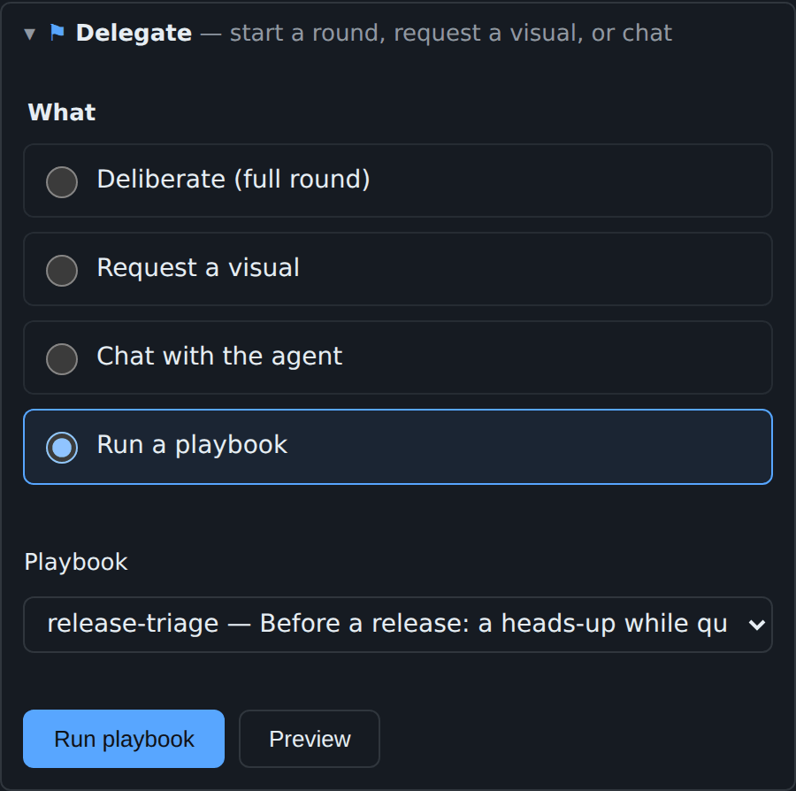
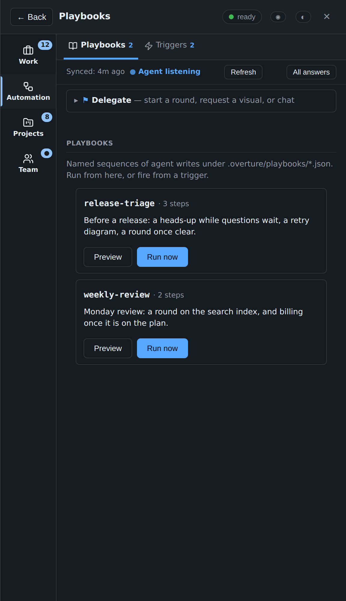
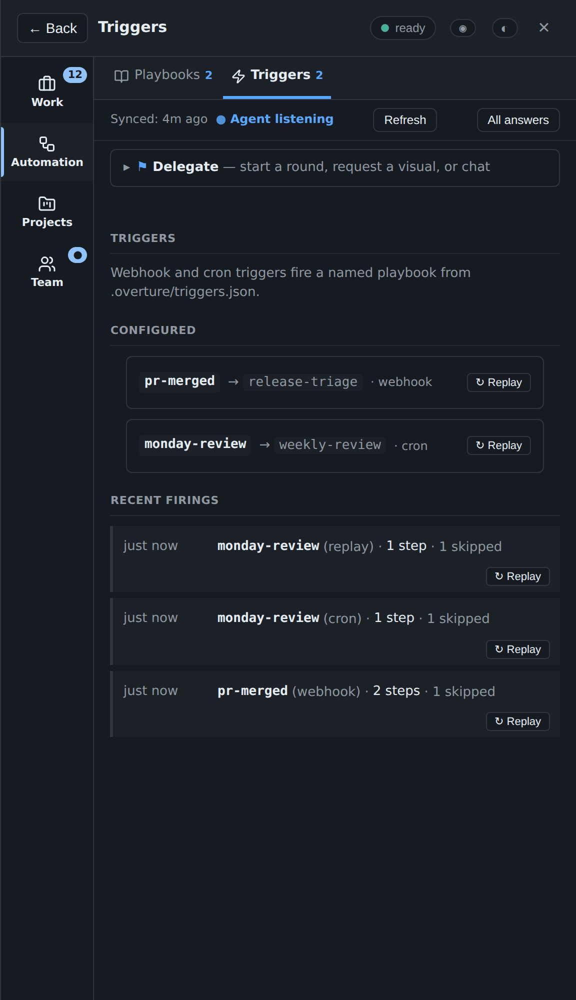
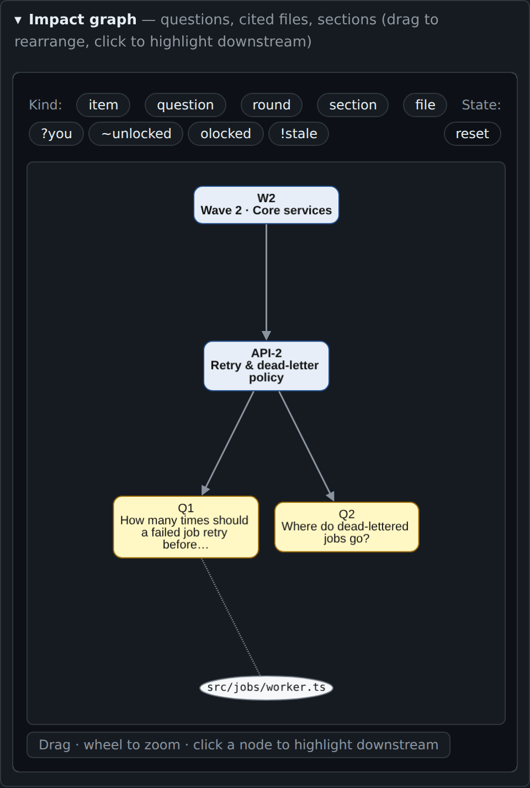
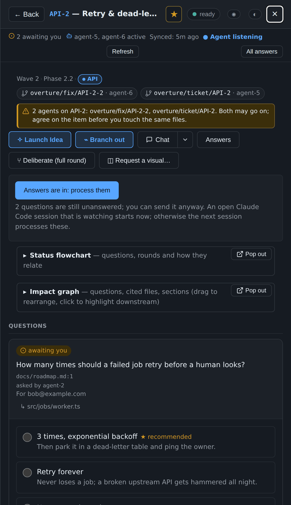

# Automation: Delegate, playbooks, triggers and agent worktrees

[← Back to README](../../README.md)

Start agent work from anywhere, codify it as a playbook, and let a webhook or the clock fire it.

Everything on this page ends in the same place: owner requests on the
console (a round, a visual, a chat message), which the steward's `watch`
picks up like any request you make by hand. No new kind of agent work is
involved, and nothing here runs code on the console's machine.

## Delegate (0.10)

The **⚑ Delegate** bar sits above the tabs, so you can start work
without opening an item first. Pick what to do:

- **Deliberate (full round)** on an item, with a mode (explore or
  tighten) and a focus;
- **Request a visual** on an item (the brief is required);
- **Chat with the agent** (goes to the Chat thread);
- **Run a playbook**, with **Preview** beside **Run playbook**.

Press `.` to jump to the bar. On an item, **💬 Chat ▾ → Delegate** opens
it with that item already picked. A skipped playbook step is named under
the button, with its reason in words (1.47), such as "it runs only when
the project has at least 1 awaiting you question".

## Playbooks (0.11, 0.20, 1.3)

A playbook is a JSON file, `.overture/playbooks/<name>.json`, in your
project. Its file name is its name: 1 to 64 characters of lowercase
letters, digits, `_` and `-`, starting with a letter or a digit (so never
with `_` or `-`).

    {
      "description": "Before a release: a heads-up while questions wait, a retry diagram, a round once clear.",
      "steps": [
        {"kind": "chat", "text": "Release window opens Monday 09:00. Anything blocking?",
         "when": {"kind": "project_has_state", "state": "awaiting_you", "min": 1}},
        {"kind": "visual", "item": "API-2", "text": "Draw the dead-letter replay path."},
        {"kind": "round", "item": "API-3", "mode": "tighten", "text": "Confirm the v2 cut-over gates.",
         "when": {"kind": "not", "of": {"kind": "project_has_state", "state": "awaiting_you", "min": 1}}}
      ]
    }

- **Steps** (1 to 24) run in order. `round` takes an `item`, a `mode`
  (`explore`, the default, or `tighten`) and an optional `focus`;
  `visual` takes an `item` and a brief in `text`; `chat` goes to the Chat
  thread. A step on an item that is not in your item list is skipped,
  named, and the others still run.
- **`when`** (0.20) makes a step conditional, from a closed set:
  `project_has_state` and `item_has_state` (at least `min` questions in
  `awaiting_you`, `unlocked`, `locked` or `stale`), `item_exists`,
  `has_section` (a section configured in `.overture.json`), and `not`
  around another (nested at most three deep). There is no expression
  language, so a bad condition fails when the file is read, not when it
  fires.
- **Limits.** A file is at most 32 KiB and a description 400
  characters; at most 128 playbooks are read. A malformed file is
  skipped, so one bad playbook never hides the rest.

The **Playbooks** tab (`g y`, in the Automation section) lists each playbook with its
description and step count, **Preview** and **Run now**. The command
palette lists them too; Enter runs one.

**Preview (1.3)** shows, without writing anything, which steps would run
now and why each other one would be skipped, with **Run now** at the
bottom. Since 1.47 each reason is a sentence built from the step's `when`:
"it runs only when the project has fewer than 1 awaiting you question",
"it runs only when item BILL-1 is in the item list", and so on (before, a
`not` read `not(ok)`).

**Playbooks run from the console, not from a Claude session (1.47).**
Every step (a round, a visual, a chat) is sent as you, and since 1.30.1 a
session may not write as you. So `/overture:playbook <name>`, `agent.py
playbook <name>` and the agent socket's `/playbook` refuse up front,
before any step runs, and say where to go instead:

    not run: release-triage: playbooks run from the console's Playbooks tab, not from a Claude
    session: every step (a round, a visual, a chat) is sent as the owner, and a session may not
    write as the owner. Open the console, choose the Playbooks tab, and press the playbook's Run
    now button.

`agent.py playbook` exits 1. Through 1.46 a session's playbook ran each
step into a refusal and came back with every step skipped.

## Triggers (0.12, 0.15, 0.16, 0.27)

A trigger fires a playbook without you. Triggers live in
`.overture/triggers.json`, read when the server starts (a malformed one
stops the start, named):

    {"triggers": {
      "pr-merged":     {"playbook": "release-triage", "token_sha256": "<sha256 of the token, hex>"},
      "monday-review": {"playbook": "weekly-review",  "cron": "0 9 * * MON"}
    }}

A trigger has a webhook, a schedule, or both.

### Webhook triggers

`agent.py trigger-token` prints a new token and its SHA-256. Put the hash
in `triggers.json` and give the token to the sender, which calls
`POST /api/trigger/<name>` with `Authorization: Bearer <token>` (or
`X-Console-Trigger-Token`). The server keeps only the hash and compares
in constant time. Behind Cloudflare the call first passes Access with a
service token. A trigger fires at most once every 10 seconds; a webhook
call to a schedule-only trigger is refused. GitHub signs its webhooks
with HMAC rather than a bearer token, so it needs a small bridge.

**Sign-in links (1.46).** A console that runs with `--auth link` lets in
only signed-in browsers, so it refuses every external trigger call: a
webhook has no device cookie. Keep webhook triggers on a console behind
Cloudflare. Schedules and Replay still work.

### Scheduled triggers

`cron` is five fields, minute hour day-of-month month day-of-week, with
`*`, `*/n`, ranges, lists and `a-b/n`; `JAN`–`DEC`, `SUN`–`SAT`, and 7 for
Sunday. The server checks each minute and fires each matching trigger
once in that minute, even if the clock jumps back.

### The trigger log and Replay

The **Triggers** tab (`g t`, in the Automation section) lists each trigger with its
playbook and kinds, and the most recent firings: when, which trigger,
webhook, cron or replay, how many steps ran and were skipped, and any
error. While triggers exist, a **Triggers** fold on the Inbox tab shows
the same, with **⌕** to preview a trigger's playbook (1.47: only on the
Inbox; the Triggers tab holds the full list, and on the other tabs it was
noise). **↻ Replay** fires a
trigger now; it skips the token and the rate limit, because you are
already signed in, and is logged as `replay`. The server keeps the last
100 firings in memory, so a restart clears the log.

## Impact graph (0.14, 0.17)

Each item with questions has an **Impact graph** fold beside its Status
flowchart: the item and its parents, its questions and rounds, the
dashboard sections it maps to, and the files its questions cite. Click a
node to highlight everything downstream; a question or item node opens
that card. Drag nodes and zoom with the wheel. Chips above it narrow the
graph by kind (item, question, round, section, file) and by state. It is
drawn in the same sandboxed frame as the charts, from at most 120 nodes.

## Agent worktrees (1.50)

Work that changes files happens in the agent's **own worktree**, never in
your checkout and never on `main`, and the console shows where each agent
works. The owner's decisions are in
[OPEN-DECISIONS.md](../proposals/OPEN-DECISIONS.md#agent-worktrees-decided-2026-10-16)
(W1 to W4).

**Where they live (W1).** `~/.overture/worktrees/<project>-<hash>/<branch>`,
in the Linux home: outside the repository, one place to list and prune.
`<project>` is the console's project name (the one server's name for it, else
the registered project folder's name) and `<hash>` the first 8 hex of the
sha256 of the main checkout's real path, so two repositories in folders of
the same name never share one. A home that resolves under `/mnt/` (a Windows
drive from WSL, where git is slow) is refused, and so is a worktrees or
project folder that a symlink leads onto `/mnt/` or out of your home.

**What gets one (W2).** Anything that changes files: agent work on a ticket,
a visual, a UX save, a playbook step that writes, a fold, a round whose
outcome changes code, a fix. The writing skills start with

    agent.py --state STATE worktree new --kind KIND --item ITEM

which fetches `origin`, makes the branch `overture/<kind>/<item>` from
`origin/main` (from the remote's default branch when there is no `main`, and
it says so), prints the path, and marks the item worked on with that branch.
`KIND` is one of `ticket`, `visual`, `ux`, `playbook`, `round` and `fix`. It
needs the session's agent name, the same one `agent.py working` uses
(`agent.py --as agent-5 ...`, `OVERTURE_AGENT`, or `/overture:as` in the
session), and refuses without one, saying so: unnamed sessions share one set
of marks, so they would share one worktree. Run again by the same agent for
the same item and kind, it gives the same worktree back, unless that
worktree's PR has merged or closed: then it makes a fresh `-N` one and says
the old one waits for prune. The agent works, commits, pushes and opens its
PR from there. Chat, deliberation and grilling change no files and stay
where they are.

**Two agents on one item (W4).** A second agent gets the next branch,
`overture/ticket/API-3-2`, and is told when it starts: `worktree new` names
the other agent and branch and still succeeds. The item, its tickets (the
Tickets fold and the open cards in the Tickets tab, never a closed one) and
the PR row of either branch show a chip per branch with the agent's name, and
a warning: "2 agents on API-3: overture/fix/API-3-2, overture/ticket/API-3".
It warns, never blocks; a screen reader hears it once, when it first appears.
On a phone a long branch stays on one line with an ellipsis; the chip's
title and accessible name are the whole text. The console learns a branch
from the agent's `working` mark: the branch and the worktree folder's name
only, never a path, and the server refuses anything else by name. Members and
viewers see the branches as they see the marks.

**Pruning (W3).** `agent.py worktree prune [--dry-run]` never removes a
worktree with uncommitted changes, and never one with a commit that is on no
remote. Its PR state comes from one `gh pr list` for the repository (every
state, the newest 200, with each PR's head commit).

- **Landed:** the PR merged and its head commit is the worktree's `HEAD`.
  A squash merge deletes the head branch, but the PR keeps its head on the
  remote, so the work is safe: the worktree is removed, and its local branch
  deleted only if it still points at that commit (`git update-ref -d`,
  never `branch -D`).
- **Merged at another commit** (work after the merge, or a fork's branch that
  shares the name): kept, and `prune` says which two commits differ.
- **Closed without merging:** removed only when every commit is on a remote
  ref, its branch then with `git branch -d` (which keeps one git thinks
  unmerged).
- **Open, no PR, unknown:** kept, with the reason. One with no PR for 14 days
  is **stale**: listed, never removed.

Right before each removal it looks again, under the registry's lock, and
keeps a worktree written into meanwhile. It acts only on paths under the
project's own folder. It never forces and never deletes a remote branch.
Without `gh` it keeps everything and says so.

The steward's `watch` runs the same prune after its first heartbeat (you see
"listening" first) and only when no signal is waiting: at most once per 10
minutes (the time kept in its state folder), with that one `gh` call, and for
at most 60 seconds, after which it stops and takes up there on its next
cycle. The owner sees a quiet "1 stale worktree" note at the top of the PR
tab, and the same count on the tab's "pushed" line, with each branch and its
age (owners only, and only while the steward's heartbeat is under a day old).
`agent.py worktree list [--json]` shows each worktree's branch, item, kind,
agent, age, last commit, ahead and behind, uncommitted changes, unpushed
commits, PR and stale.

**Setting one up: `worktree_setup`.** git does not carry untracked
dependencies (a virtualenv, `node_modules`). A project can name one command
in `.overture.json`, as an argv list, never a shell string:

    {"worktree_setup": ["make", "deps"]}

**Overture never runs it.** `worktree new` reads the key from the new
worktree's own copy, checks its shape, and prints it as a suggested next
command: "This project suggests a setup step; run it yourself in the
worktree: cd ... && make deps" (in `--json`, `setup.argv` and
`setup.command`). The agent runs it through its own Bash tool, so your
permission prompt sees it like any other command. The copy comes from
`origin/main`, which any merged PR can change, so running it unasked would
hand that PR your account. Unset, nothing is suggested, and `.venv` is never
copied or linked for you.

**The boundary.** The server starts no git (CONSOLE-kit/Q24): `worktree`
runs in the agent's own process, through the same seam as every other git
call (git and `gh` only; the kit starts no other program for it), and the
server only stores and shows the branch it is told. The registry beside the
worktrees (`.registry.json`) is written atomically and never trusted over
`git worktree list`.

**Going back to 1.49.** A 1.49 server ignores the branches stored beside the
marks (the marks still show, without them) and the stale list in the
heartbeat. A 1.50 `agent.py` talking to a 1.49 server, which refuses a mark
with a branch, sends the mark again without it and says so, so the item still
shows "agent active". The worktrees stay on disk; remove one with
`git worktree remove <path>` from the project's checkout.
