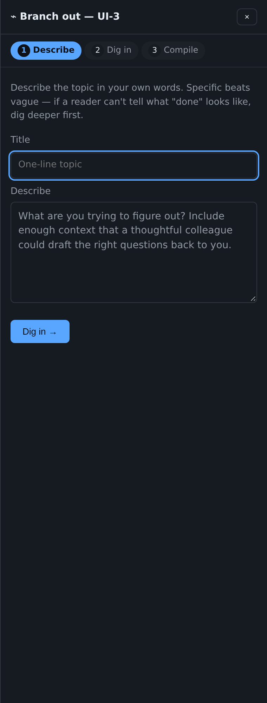

# Deliberation, Launch Idea and Branch out

[← Back to README](../../README.md)

Get advice before you answer, and turn an idea into questions and tickets.

## Deliberate before answering

- **Pick advisor seats.** On an open question, pick one to three seats
  (DevOps, UX, adversarial, security, architect, analyst, or one you
  name). They reply with a ★ and their reasons, and never answer or lock
  for you. The cost is shown first, at about 100k tokens a seat.

  

- **Next step ▾** beside every locked answer:
  - **Follow up**: chosen seats look at that answer again.
  - **Roar**: a three-round panel, at most once per lock.
  - **Refine** or **Drill**: runs the skill your project names, by default
    the plugin's own `overture:refine` and `overture:drill`.

  Each step comes back as questions for you to lock. Nothing is written
  into the project before you lock.

  

- **Branch out / Grill with agent.** The 💬 Chat ▾ menu on an item has
  **Grill** (adversarial agent questions on your pitch) and **Branch out**
  (open-ended drill-in). Grill questions carry a ⚡ **GRILL-ORIGIN** chip
  so you can tell them apart from questions an agent raised on its own.

  

## Launch Idea (1.26, 1.30)

**✧ Launch Idea** on every item opens a pane beside the item that walks
an idea through three steps:

1. **Frame**: a one-line title and a pitch. The pitch is saved as a
   draft, so a refresh never loses it.
2. **Grill**: five adversarial questions to answer in a line or two:
   who it is for, what would prove you wrong, what breaks at 10×, what
   known problem you pass on, and what evidence says it matters.
   **⚡ Grill with agent** sends your title and pitch to the agents
   instead (a message with intent `grill`). The `grill-me` skill writes
   adversarial questions back into your Inbox, each marked ⚡
   **grill-origin**, and every one you lock becomes a ruling. Only the
   owner's door can send a grill request, so an agent cannot ask one of
   itself.
3. **Spawn**: tickets drafted from your answers (a grilling note, a
   research ticket, a task). Tick the ones you want, edit them, and
   **Spawn selected** creates them under the item and opens its Tickets
   fold.

**Grill** in the item's **💬 Chat ▾** menu opens Launch Idea at step 2.

## Branch out (1.26)

**⌁ Branch out**, a sibling of Launch Idea in the same pane, turns a
topic into a brief in three steps: **Describe**, **Dig in** (six
questions to answer: audience, goals, constraints, format, style and
tone, examples) and **Compile**. The compiled Markdown brief becomes a
**research ticket** on the item, a **deliberate round** for the seats,
or text you **Copy**. Only one of Launch Idea and Branch out is open at
a time.

