# The inbox and rulings

[← Back to README](../../README.md)

Answer what your agents ask, lock it into a ruling, and keep each ruling honest as the code moves.

## The inbox loop — answer, lock, round

- **Answer and lock.** Each question shows its options, the ★ and whose
  recommendation it is, and evidence rows. Evidence shows the cited lines
  as they are now, and says whether they changed since the question was
  asked. Your own words on an answer travel with it. Locking turns an
  answer into a ruling. A round's questions open as one form: ←/→ move,
  1–9 pick, **Lock all & process**.

  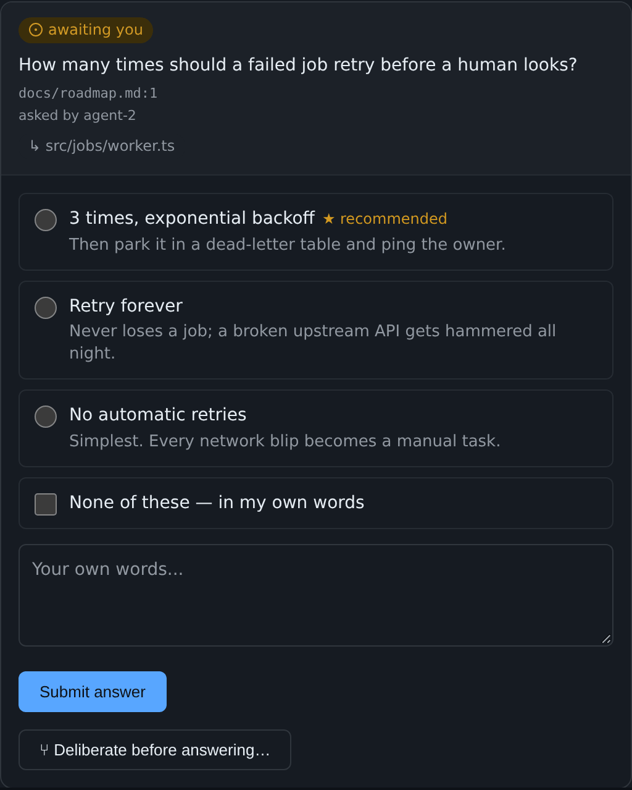

- **One-tap lock.** **Lock this answer** sends the lock immediately. If
  the server refuses (e.g. a condition is no longer true), the card shows
  the reason and the Lock button comes back.
- **Lock several at once.** When an item has more than one answered,
  unlocked question, **Lock all N answers…** shows every answer it is
  about to lock, locks them in order, and stops at the first refusal,
  naming it.

  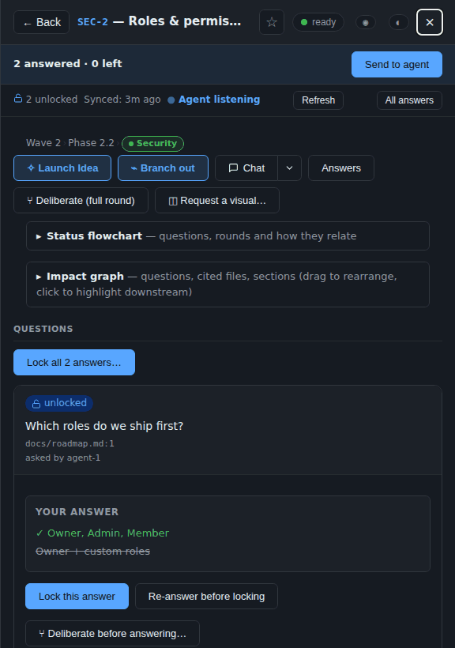

- **A round moves on by itself.** Pick a single-choice option and the
  form moves to the next question still without a pick, saying so. It
  stays put for multiple choice, for a question you are writing words
  on, and for ↑/↓ through the options. It never moves onto the Lock page.

  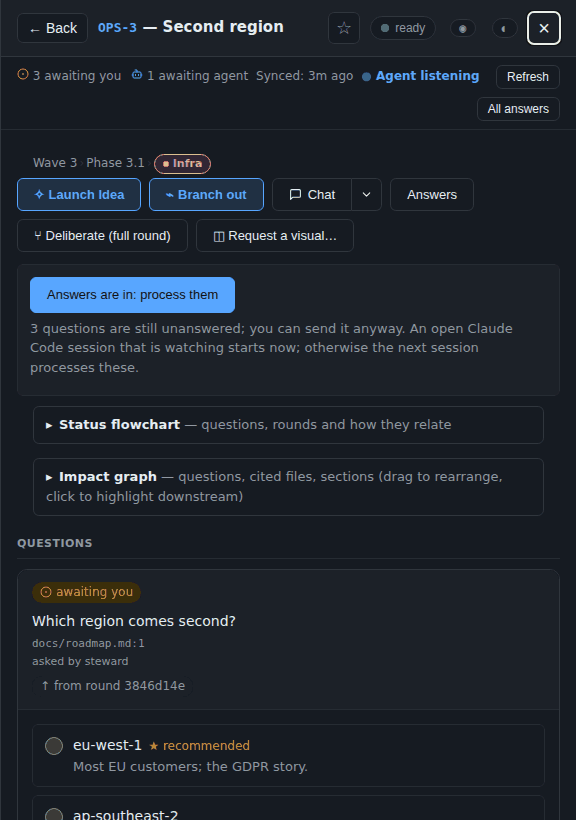

- **Answer these together.** Loose questions on one item, asked by one
  named agent session within five minutes of each other, are grouped in
  the inbox and open as one form. Unnamed sessions are never grouped,
  because nothing shows they are one agent's.
- **Send to agent.** Once you have answered something, a bar under the
  panel header shows "N answered · M left" and sends the agent the same
  "process them" signal as before. It goes once sent and comes back with
  the next answer.

  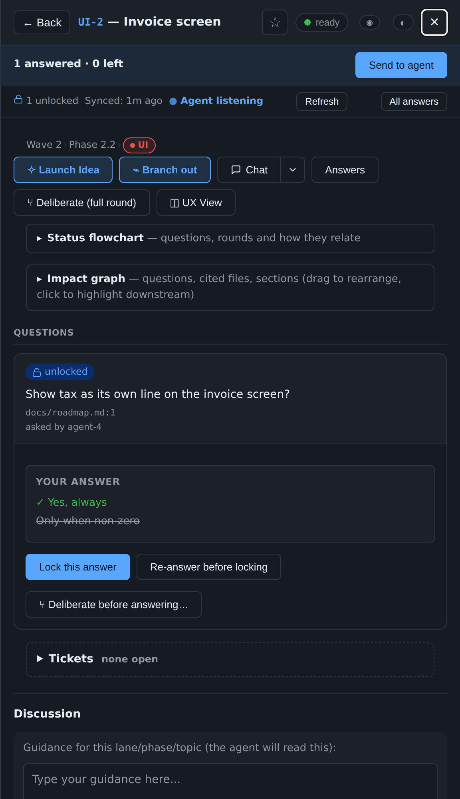

- **Locked questions roll up** to one line (question, pick, state). Click
  or press Enter to open one. Open and stale questions stay whole. The
  slides and fades run only when your system does not ask for reduced
  motion.

  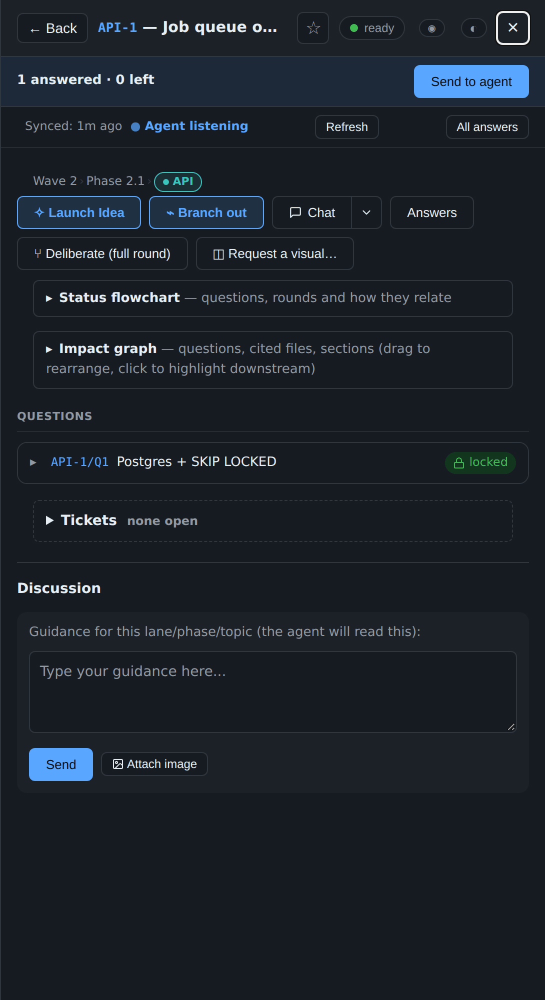

## Around the Inbox

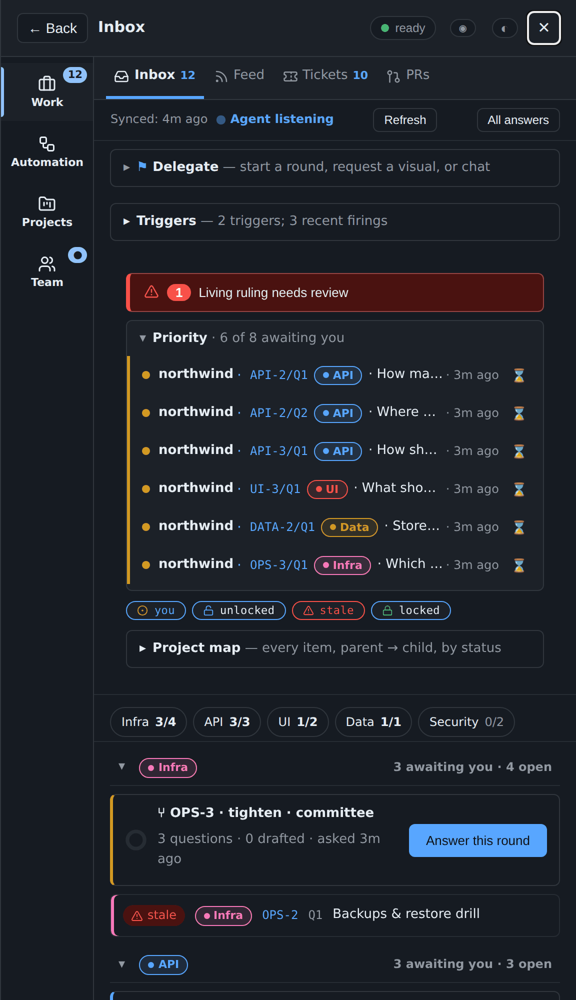

- **Grouped by lane (1.49).** Below the Priority list, which stays the
  one list of everything awaiting you across projects, the questions sit in
  a group per lane. Each group's heading shows the lane's chip, how many of
  its questions await you and how many are open; press it to fold the group.
  Lanes with questions awaiting you come first (the most first), then the
  most open, then by name; items with no lane are under **Other**. A round is
  in its item's lane, and a row in its own lane's group does not repeat the
  lane's chip. Folded groups are remembered in this browser, per project. A
  link to a question in a folded group, the outline or `j` / `k` opens it for
  this visit to the Inbox (it stays open through live updates, and is folded
  again once you leave the Inbox and come back), without changing what is
  remembered; only pressing the heading does.
  Each row works as before: open, snooze, filter, Mine, the palette and
  links.

  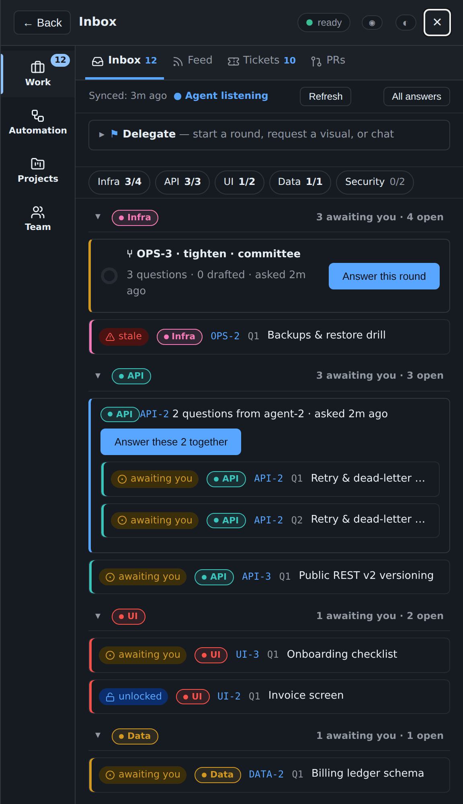

- **The outline and j / k (1.49).** The outline of the groups stays at the
  top as you scroll ("2/3": awaiting you / open, as its legend says; a
  control is named "Infra 3/4: 3 awaiting you, 4 open"), and
  `j` / `k` walk the questions waiting for you
  across them; see [Moving through a long Inbox](navigation.md#moving-through-a-long-inbox-149).
- **Filter chips (1.1).** A row of four chips sits above the Inbox's
  groups: **you** (waiting on you), **unlocked** (answered, not yet
  locked), **stale** and **locked** (the "Recently answered" lines under
  each item). Each chip turns its kind on or off. All are on to start.
  The choice is kept in this browser, for this project, and never
  reaches the server.
- **Living rulings badge (1.25).** When a ruling has gone stale, a badge
  at the top of the Inbox counts them: "1 Living ruling needs review".
  Press it and the chips narrow to stale, and the first stale ruling
  scrolls into view. The stale banner on the card itself is tagged
  **Living ruling**.
- **Priority's count (1.49).** "6 of 8 awaiting you" names the projects
  only when there are several ("across 2 projects"). With one project its
  rows do not repeat the project's name either: each starts at the question's
  id, which leaves the question room on a phone.
- **Snooze (0.26).** Each row of the Priority ribbon has a ⌛ button
  with three choices: **1h**, **til tmrw** (9:00 tomorrow, local time)
  and **1w**. A snoozed question leaves the ribbon at once and comes back
  when its time is up. **Snoozed · N** at the bottom of the Inbox lists
  every snooze, when it wakes, and an **Unsnooze** button. Snoozes live
  in this browser only, so another browser or a private window does not
  see them.

  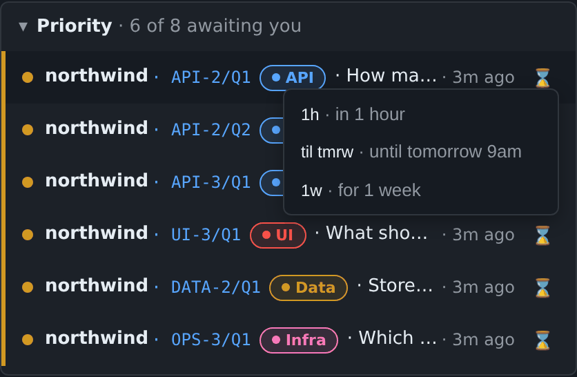

- **Links to one place (0.25).** The address bar follows you: `#item=ID`
  opens an item, `#qid=ID/Q3` opens the item that owns the question, and
  a tab's name (`#feed`, `#prs`, `#chat`, …) opens that tab. A link you
  bookmark or send opens exactly there. In the command palette,
  **Alt+Enter** on a row copies its link. Only this console reads the
  link; anyone you send it to still needs their own way in.
- **Drafts follow you (1.19).** What you type and have not sent (an
  answer, a chat message, a visual brief, a Launch Idea pitch) is saved
  to the console's machine a moment after you stop typing, and appears
  in your other browsers. Text you have not yet saved is never replaced
  by an older copy. Since 1.41 each login has its own drafts.
- **Export today's rulings (0.28).** **⤓ Export today** on the Feed tab
  opens every ruling locked since midnight as Markdown, grouped by item,
  with **Copy**. It is built in your browser from the Feed; nothing is
  sent anywhere.

  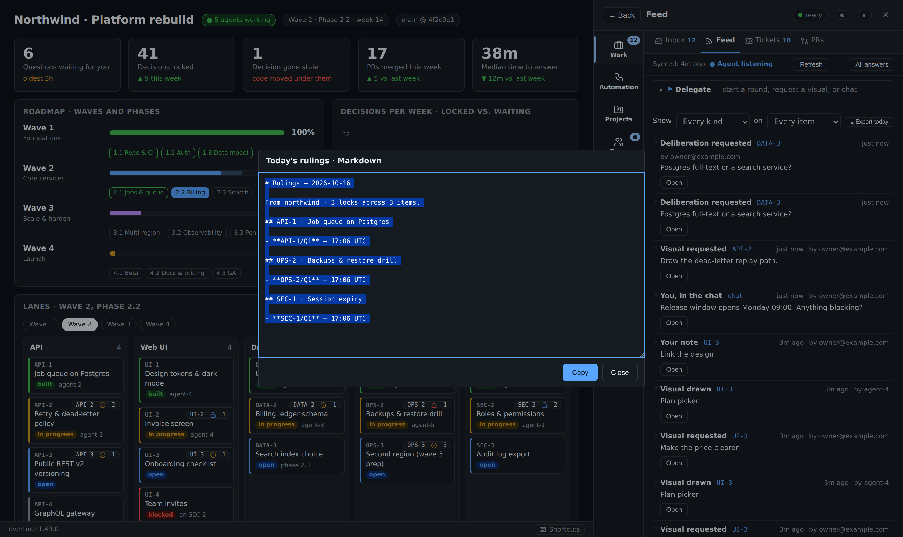

## Keep rulings honest as the code moves

A question says what must stay true for its answer to stand (`valid_if`):
cited text (an `excerpt`), a whole file (`file_sha256`), a definition
(`symbol`, 1.54), or an item's status. When that stops holding, the answer reads **stale** and **What
changed?** names which check failed, with a diff of the cited text against
the file as it is now.

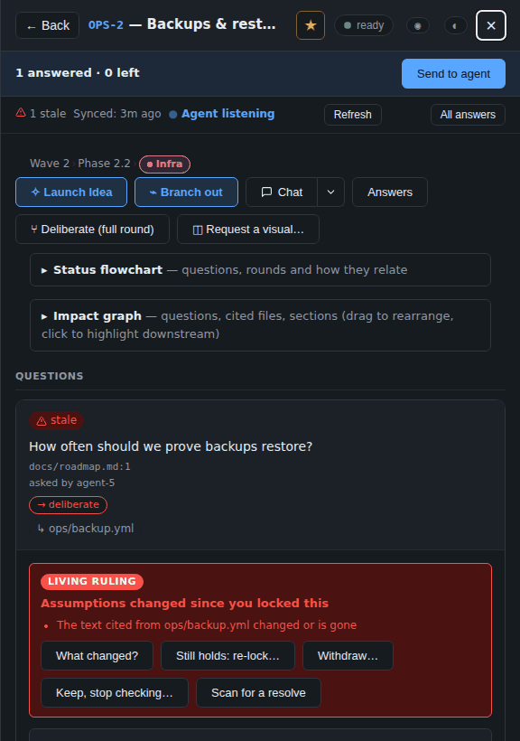

- **Still holds: re-lock…** keeps your answer and re-checks it against the
  files as they are now.
- **`agent.py reanchor`** (the steward runs it, `--dry-run` first) turns a
  stale whole-file hash into an excerpt only with evidence: the question
  names a line range in that file, the steward's pushed history holds the
  version it was locked against, and those lines are still in the file
  exactly once. Anything else stays stale, with the reason listed.
- **Withdraw…**: the ruling no longer applies, and you give a reason.
- **Keep, stop checking…**: the ruling stands, but is no longer checked
  against the files.
- **Confirm a proposed anchor.** The steward proposes new lines for the
  ruling to rest on, the server reads them itself, and nothing changes
  until you press Confirm.
- **Replace.** A new question is linked to the stale one. The old ruling
  stands until you lock the new answer.
- **Scan for a resolve (0.8.17).** Every stale answer has a **Scan for a
  resolve** button, and the Inbox has **Scan all stale (N)**. A scan asks
  the steward to find out whether each ruling still applies, and it answers
  each one way: a proposed new anchor, a replacement question, or advice
  (a ★ on Withdraw or Keep, with its evidence) shown beside your own
  buttons. Nothing changes until you press one. One scan runs at a time,
  and it is done once every ruling in it was answered or settled.

Only the owner can do any of these, and only on a stale answer. Nothing is
deleted: each act is recorded in a file beside the store, and the fold
records the outcome in your project. New questions are refused a whole-file
hash where an excerpt fits, which is what made most rulings go stale.

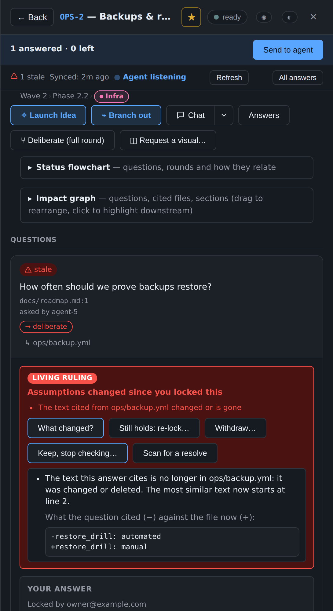

## Rulings before an agent edits (1.52)

The CI check (1.36) catches a broken ruling on the pull request. This
catches it before the agent writes the line. Before Claude edits a file in a
registered project, a PreToolUse hook adds the rulings on that file to its
context:

- **holds on this file (this edit can break it)**: a condition that decides the ruling (its excerpt,
  or its file hash) is on this file, so an edit can break it;
- **cites this file (its condition is elsewhere; context)**: the question's source or evidence points at it, but
  nothing on it decides the ruling, so it is context.

If the edit would break one (its excerpt would be gone, or a file hash would
change), the agent reads a warning naming that ruling, why, and what to do:
keep what the ruling rests on, or ask you to re-lock it. Only a condition that
holds now and fails after the edit counts. The edit is **never blocked**: it goes through your normal permission prompt, and the CI check
still guards the merge. A stale ruling is listed and marked stale; a ruling
you withdrew, stopped checking or replaced is not listed.

The rulings come from the running console, so a lock you made a minute ago
counts. When the console does not answer within 1.5 s (or answers 401, 403
or a server error), the committed rulings (`.overture.json` `fold.locked`)
answer instead, and the note says "from the committed rulings"; a damaged
ruling file is skipped and named. Only the registered checkout's rulings are
shown, and its verified agent worktrees'. A file's rulings are shown once
per session, and again when they change. A would-break warning is shown every time.

Other ways to ask:

    agent.py rulings --path src/pay.py --path docs/    # a folder ends in /
    agent.py rulings --path src/pay.py --json

and the MCP server's `rulings` tool, `{"paths": ["src/pay.py"]}`, for Cursor,
Codex and other MCP clients ([MCP and CI](mcp-and-ci.md)).

## Rulings on a definition (1.54)

A ruling can rest on one function, method or class instead of a whole file
or a line of text (K1–K3 in
[OPEN-DECISIONS.md](../proposals/OPEN-DECISIONS.md)). An agent writes
`"src/pay.py::Invoice.total"` in `valid_if`, and the console fills in the
hash when the question is asked.

- **What counts as a change (K2).** The ruling holds while the
  definition's body is the same. Comments and spacing don't count, and
  neither do edits elsewhere in the file. A real change to that body makes
  the ruling stale.
- **Renames and moves (K3).** When the definition is renamed or moved, the
  CI check and the lookup before an agent edits search the changed files for
  the same body. If they find exactly one, the ruling holds, and they name
  the new place: `src/pay.py::Invoice.total -> src/billing.py::Bill.total`.
  The console shows the ruling as stale until you confirm the new anchor,
  which the steward proposes. Nothing is rewritten without you.
- **Languages (K1).** Python is read exactly. JavaScript, TypeScript, Go,
  Rust, Java and C# are read by their definition lines. A definition the kit
  can't read with certainty (two with the same name, an unusual layout, a
  file over 1 MiB) is reported as *unchecked* rather than guessed. With
  `--strict`, the CI check fails on it. When the file read cleanly at the
  pull request's base and no longer parses, it is *broken*.
- **What it doesn't see.** The kit reads definitions by their lines; it
  doesn't run the code. It misses a JavaScript function or method replaced
  by destructuring (`[f] = …`), `Object.defineProperty`, `Object.assign` on
  a prototype, a static `A.m = …` or `window.f = …`, and a Python name
  rebound from another module. Such a change can leave a ruling holding, so
  a reviewer should treat any of them near a ruled definition as a change
  to it.

To turn a question's source lines into the definition that holds them:

    agent.py symbol-at src/pay.py:12-30    # prints src/pay.py::Invoice.total

## Lessons: what you settled stays settled (1.33–1.34)

When you **Withdraw…** a ruling or **Keep, stop checking…** it, the reason
you give becomes a **lesson**. Lessons are how the project remembers *why*
something was dropped, so the next agent doesn't bring it back.

- **Every new session is told.** The SessionStart hook adds one line when
  lessons exist: how many, and the command to read them. It is silent when
  there are none.
- **Related past rulings on the question card.** When an agent asks
  something that looks like a ruling you already withdrew or stopped
  checking *on the same item*, the card shows **📎 N related past rulings —
  read before answering**. Open it to see the date, the ruling's id,
  whether you withdrew it or stopped checking, and the start of your
  reason. Questions you have already settled never show it.
- **Agents can check before they ask.** `agent.py lesson-match "TEXT"
  --item ITEM` prints the matching lessons and exits 0 (matches), 1
  (none) or 2 (the lessons file cannot be read), so a session can
  rephrase, or cite your reason, before it posts.
- **Read or commit them.** `agent.py lessons` prints every lesson as
  Markdown, newest first; `--fold PATH` writes the file atomically into
  your project so it travels with the code.

Matching is local and simple (shared three-letter fragments, accents and
case ignored), so it catches close rewordings, not every paraphrase. A
lesson's text never leaves your machine: the page receives at most a
400-character preview, and peers never see it.

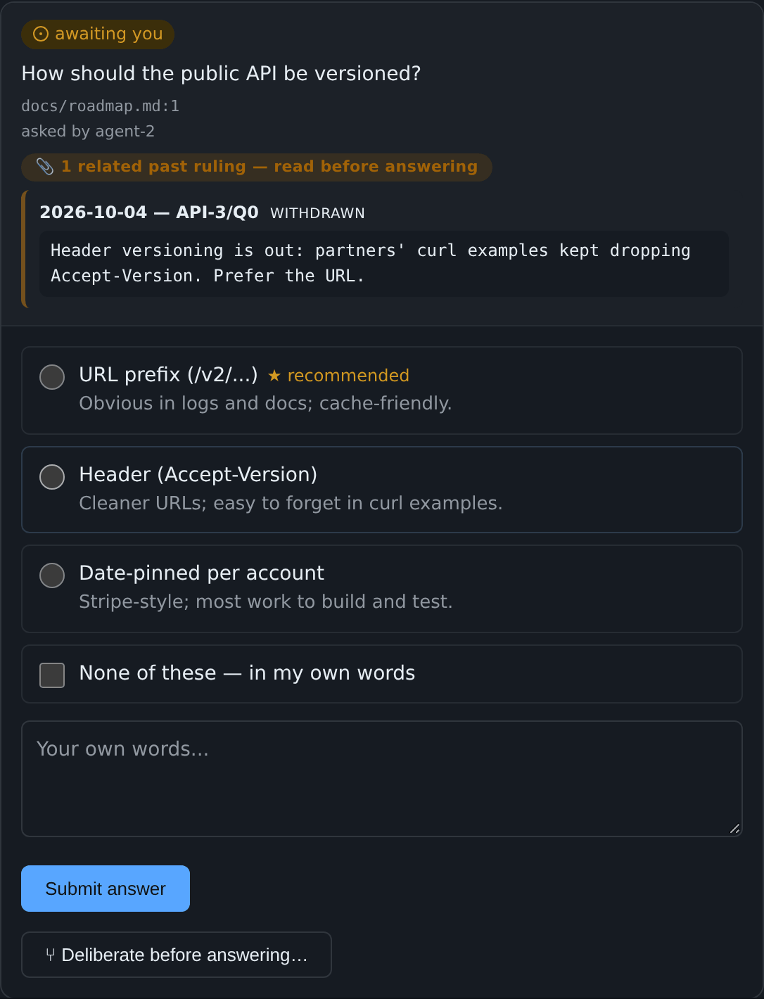

## Direction

- **Direction stays visible.** Each item in the Inbox carries a
  collapsible "N answered on this item" under its open questions, showing
  the last few locked rulings. Items whose questions are all locked
  within the last day stay on the list under **Recently answered**, so
  you can see what was asked and answered without leaving the Inbox.
