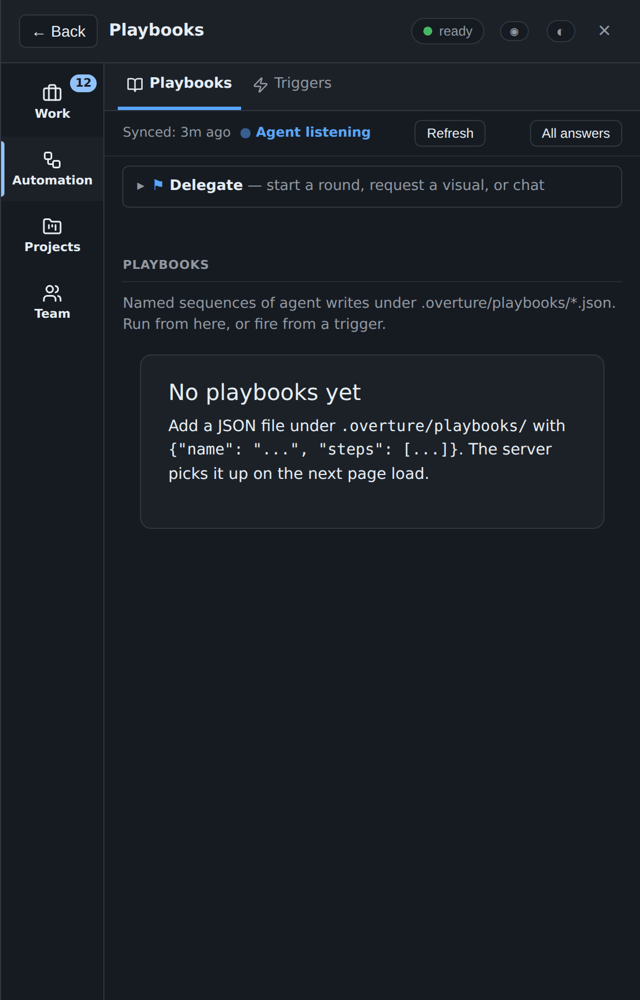
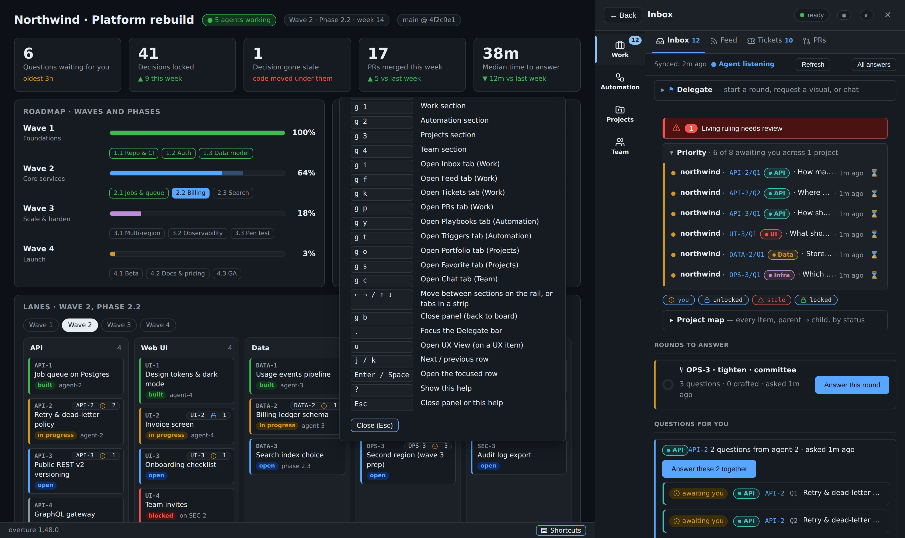
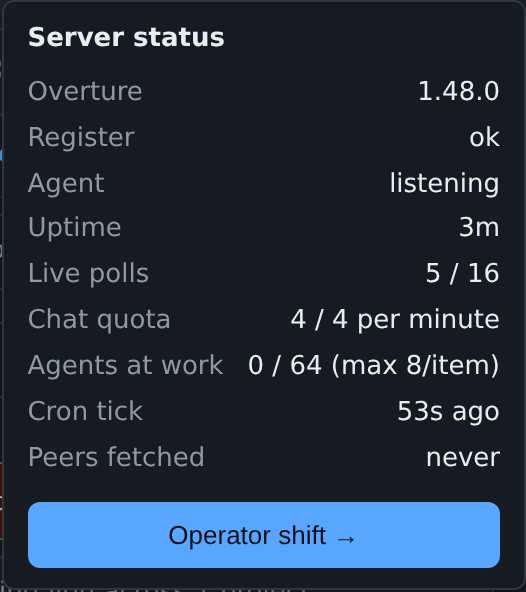
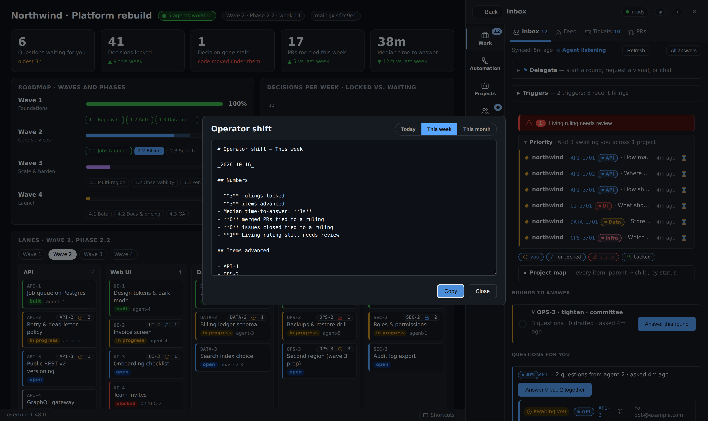
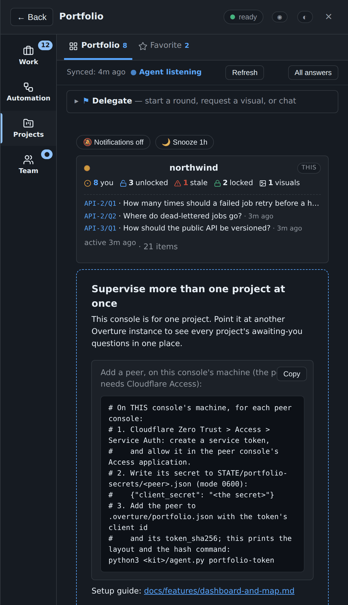
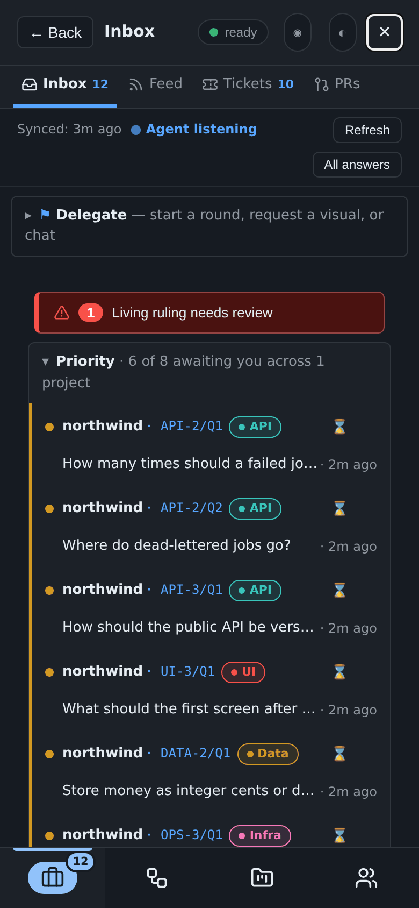

# Finding your way around

[← Back to README](../../README.md)

The live page, the sections and their tabs, the palette, the keyboard, phones, the Portfolio and the Operator Shift report.

## See what's happening

- **The page updates itself**, no reload. A box you're typing in is never
  redrawn under you.
- The **Inbox** shows what waits for you, with an unread count. The
  **Feed** shows every question, answer, lock and reply, newest first,
  filterable by kind (chat, visuals, questions, screenshots, merges) and
  item.

  

- The status bar says whether an agent session is listening right now.
- **The footer (0.8.14).** A thin bar at the bottom of the page always
  names the running kit, "overture 1.47.0", the same version `/health`
  reports, and carries a **Shortcuts** button. When the server is started
  with `--usage-file`, it also shows your Claude usage for the 5-hour and
  7-day windows.
- **The stale-board bar (0.8.14).** The dashboard page is a snapshot
  published from a commit. When the live board no longer fits that
  page's shape, the page stops refreshing its live numbers and a bar at the
  bottom says so: "The dashboard has changed since this page was
  published, so its live numbers are paused." It names the fix. If a new
  page is already staged, **Review the new page** opens it, and **Use
  this page** publishes it. Otherwise the steward has to stage one
  (`agent.py page-snapshot`). Reloading does not help, since it serves
  the same page, so the bar has no Reload and cannot be dismissed: it is
  the only sign the numbers are frozen.
- **Status chip.** A pill in the panel's top-right reflects
  `/api/status`: version, agent socket, waiters/caps, chat quota, cron
  tick age, peer freshness. Click opens a drawer; **Operator shift →**
  opens the weekly report.
- **Operator Shift view.** Today / This week / This month: rulings
  locked, items advanced, median time-to-answer, merged PRs tied to a
  ruling, closed issues tied to a ruling, Living rulings still waiting.
  Composed as Markdown with Copy. The screenshot-for-cofounder surface.
- **Several agents, one console.** Sessions can be named (`/overture:as
  agent-6`). One of them, the **steward** named in your own registry, is
  the only one that processes your requests and folds your answers. The
  others post their questions to your inbox instead of asking you
  directly. Active-agents fold on each item panel reads
  `cursor.working_by` and lists who is currently holding a mark on this
  item.
- The **PRs** tab shows each pull request as its own card. The left edge
  shows its state: blue open, amber checks running, red checks failing,
  grey draft, purple merged. Lists the project's open pull requests, then
  those merged or closed in the last 30 days (`--days` changes it), with
  checks, draft and merged badges, a link to each on GitHub, and an
  **Open** button for any item or question a title or branch names. The
  steward pushes the list (`agent.py prs-push`), and the tab says when it
  last did.

  

- **Merge from the PR tab.** An open, ready, passing pull request has a
  **Merge** button. It asks first ("Merge #214 into main?", with a link
  to the diff), then sends your request on the reserved `@prs` thread.
  The steward's own session merges with its own `gh`, pinned to the
  commit you saw (`agent.py pr-merge --project WORKTREE --request ID`).
  The console never merges anything and holds no GitHub token. If the
  pull request changed since you looked, or the request is over 24 hours
  old, nothing is merged and the steward says why.

  

- **Rulings → PRs and Rulings → Issues.** When a tracked PR or issue
  title (and issue body) mentions a ruling's qid like `A/Q7`, each
  matching PR/issue appears as a chip under the locked ruling. Merged PRs
  render filled green ("Shipped: #142"); closed issues as filled grey.
  Chips carry the author (`#142 by @alice`) so you can tell a drive-by
  mention from a trusted one.
- **The Favorite tab** lists everything you starred, grouped by item.

  

- **Chat**, for a message not tied to a question. Wakes the watching
  session. On an item, **💬 Chat ▾** jumps to that item's discussion. Its
  menu offers **Branch out**, **Grill**, **Advise** (deliberate) and
  **Delegate**, each already scoped to the item.

  

  

- **Cross-project priority ribbon.** The Inbox opens with up to six of
  the oldest awaiting questions across every console (self + each
  portfolio peer), each with a traffic-light dot (yellow < 1h, orange <
  24h, red > 24h). Click a row to jump — local items open their panel;
  peer rows open the peer in a new tab.

  

- **Command palette.** Press **Ctrl+K** / **Cmd+K** on any page to open
  a search box over items, questions, playbooks, peers, tabs and actions.
  Type a few characters, press Enter: jumps to an item, runs a playbook,
  opens a peer in a new tab, hops a tab.

  

- **Keyboard shortcuts.** Press `?`, or the **⌨ Shortcuts** button in
  the footer, for the full list. `g 1 / 2 / 3 / 4` open the Work /
  Automation / Projects / Team section, on the tab you last used there
  (1.48). `g i / f / k / p` hop to the Inbox / Feed / Tickets / PRs tab,
  `g y / t` to Playbooks / Triggers, `g o / s` to Portfolio / Favorite and
  `g c` to Chat, each in its section; `g b` closes the panel; `.` focuses
  the Delegate bar; `j / k` walk the rows; Enter / Space opens the focused
  row. Shortcuts never fire in a text input.

  

- **The Portfolio tab** lists every other console you have configured
  with its state tallies (`2 you`, `1 unlocked`, `1 stale`, `9 locked`,
  each with its state icon), last-activity, and a click that opens it in
  a new tab. A bell button opts in to desktop notifications so a sibling's
  new `?you` or `!stale` reaches you even when the tab is in the
  background; a Snooze button sets a 1-hour DND lid. Peers are declared
  in `.overture/portfolio.json`; the Cloudflare Access service-token
  secrets live in `STATE/portfolio-secrets/<peer>.json` (`agent.py
  portfolio-token` prints the layout). The home server does the
  cross-origin calls, so the browser never sees a peer's secret.
- A **Back** control sits at the top of every item view, so **discuss**
  from the dashboard always has a one-tap way home.

## Tabs, themes and reports

- **Sections (1.48).** The tabs sit in four sections, on a slim rail
  down the panel's left edge:

  | Section | Its tabs |
  |---|---|
  | **Work** | Inbox, Feed, Tickets, PRs |
  | **Automation** | Playbooks, Triggers |
  | **Projects** | Portfolio, Favorite |
  | **Team** | People, Chat, Settings |

  Press a section for its own strip of tabs; it opens on the tab you last
  used there. People shows for an administrator and Settings for an
  administrator or a director, as before; Chat keeps Team for everyone.
  "More ▾" is gone (it held what the sections now hold).

  

- **A section's badge** is the most urgent of its tabs' counts, not their
  sum: the questions open in the Inbox (Work shows the Inbox tab's count:
  those waiting for an answer, answered and not locked, or stale), then an
  agent waiting on the chat (●), then questions waiting in your other
  projects (Projects counts only those, so with no other project connected
  it stays dark rather than repeat Work's count), then new Feed events.
  Counts of things that are simply there (tickets, playbooks, triggers,
  favorites) stay on their tab. The Priority list's "of N awaiting you"
  counts only the questions not yet answered, so it can be smaller.
- **With a keyboard or a screen reader.** The rail is one Tab stop: the
  arrow keys (and Home, End) move along it and Enter or Space opens a
  section, which puts focus on that section's selected tab. In a strip the
  arrow keys move between its tabs and stop at the section's ends. Each
  rail button is a named button ("Work, 3 questions open in the Inbox"),
  the section on show is marked as the current page, and every button has
  a tooltip.
- **Motion.** A new section fades in, a new tab slides in, and the rail's
  marker slides to its section, each in under a fifth of a second. None of
  it runs if your system asks for reduced motion, and a live update never
  animates.
- **The panel's title names the tab (1.47).** The header reads
  "Inbox", "Feed", "People", "Triggers", "Playbooks" and so on, for the
  tab you are on; through 1.46 it read "Inbox" on every tab. The section
  is on the rail beside it, so the title stays short (1.48). **← Back**
  beside it returns to the board.
- **Links.** The address follows you: `#feed&section=work`. A tab's name
  alone works as a link too (`#playbooks`, `#people`, as before 1.48), and
  so do `#tab=feed` and `#section=team` (a section's first tab you can
  see, worked out again once the page has loaded if the link came first);
  `#item=ID` opens an item and `#qid=ID/Qn` the item a question is on. A
  link to a tab you do not see (`#people` for anyone but an
  administrator) opens its section's first tab you do, and says why; so
  does a tab you lose while it is open (made a viewer, say). A value the
  address cannot decode is ignored, and the rest of the link still works.

  

- **What's new since you last looked (1.16).** The Inbox opens with a
  line counting what arrived since you opened the panel: new questions,
  answers, visuals and chat. **✓ Caught up** clears it until something
  else arrives.
- **Theme and skin (1.2, 1.14).** Two buttons in the panel header. The
  theme button cycles **auto** (follows your system) → **light** →
  **dark**. The skin button cycles **Primer** (the default),
  **Solarized**, **Nord** and **High contrast**, each in light and dark.
  Both choices are kept in this browser, for this project.
- **The status chip's drawer** (Server status) lists the running
  version, whether the item register loaded, the agent, uptime, live
  polls against their cap, the chat quota per minute, agents at work
  against their caps, the age of the last cron tick and of the last
  peer fetch.

  

- **Operator Shift.** Open it from the status drawer's **Operator shift
  →** or the palette ("Operator shift"). Pick **Today**, **This week**
  or **This month**; the report is Markdown you can read, edit and
  **Copy**. It is computed in your browser; nothing is sent.

  

- **The palette searches inside things (1.18).** Beyond names and ids,
  it finds words inside item titles, question text and the newest 50
  chat messages; a chat row opens the Chat tab.

  

- **The Portfolio tab.** One card per console, with its tallies, how
  long since its oldest question started waiting (a coloured dot) and a
  peek at the top three questions waiting for you.

  

## Agent text: fragments and item refs

- **Code blocks open as fragments (1.6, 1.13).** When an agent's reply
  (chat, a round's message, a follow-up, a locked answer's note) holds a
  fenced code block, it shows as a compact 📄 button; press it to open
  the text in a viewer with **Copy** and **Close**. A fence that names a
  file (`` ```md:plan.md ``) is titled with it, and an unnamed one turns
  into a button only from 40 characters. Markdown fragments open rendered
  (headings, lists, links, with no HTML passed through), with **Raw** to
  see the source; other languages open as plain text.
- **Item refs are links (1.10, 1.15).** A dotted number like `1.2` in an
  agent's text, or in a pull request's title or branch on the PRs tab,
  opens the item that has that ref. Only real refs link, so `v0.9.3` or
  `path/1.2.html` stay plain. Refs themselves are described in
  [Dashboard and map](dashboard-and-map.md#numbered-refs-sections-and-the-items-tree).

## The panel on the page

- **Dock width (1.24, 1.48).** The panel opens 576 px wide (480 px before 1.48, which added the section rail); drag its left edge
  (or focus the edge and use ← and →, Shift for bigger steps, Home and
  End for the limits) and the width is kept for this project.
- **First run (1.24).** A console with nothing to show yet opens on a
  welcome that says what to do first, with a Copy button for the command.
- **On a phone (1.22, 1.48).** Below 640 px an open console is the whole
  screen, whatever the page under it does: a page wider than the phone no
  longer pushes it aside, and the page neither scrolls nor takes taps until
  you close the console. The sections are a bottom bar of four buttons,
  each at least 48 px and clear of the home indicator; the section's tabs
  are a strip at the top that scrolls sideways; Back and × stay in the
  header. The section on show has its icon in a filled pill, as well as
  the line above it. Below 400 px the bar shows icons only, each with its
  name for a screen reader and a tooltip, and a count sits on the corner
  of its icon. Every control is at least 36 px tall, and the Portfolio
  cards and dialogs stack to fit. In the Inbox's Priority
  list each row is two lines: which item, with its ⌛, then the question
  (with no "·" before it) and how long it has waited.

  
- **Toasts and visible confirmations (1.23).** Every confirmation and
  error the page announces to a screen reader also shows as a toast in
  the bottom-right corner, so a lock, a playbook run or a dismiss is
  confirmed where you can see it. A toast goes after 4 seconds, and the
  same message is not repeated within 1.5 seconds. Errors from a run or a
  withdrawal stay until you close them with ×. A dangerous button, such
  as **Withdraw**, asks for a second press ("Click again to withdraw")
  and disarms itself after 4 seconds. A draft that fails to save says so
  beside the box instead of claiming it was sent.
