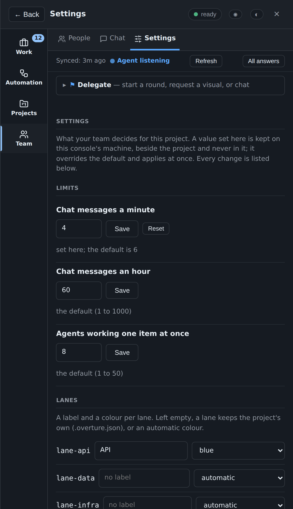
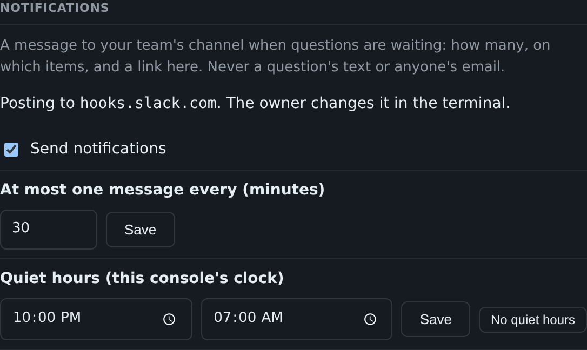

# Settings and notifications

[← Back to README](../../README.md)

The project's own choices, set in the console, and a digest of waiting questions posted to your team's channel.

**Settings (1.44).** An administrator or a director opens **Settings**
to make the project's own choices: how many chat messages a minute and
an hour, how many agents may work one item at once, each lane's label
and colour, the two-key areas (moved here from People), and the short
names committed rulings carry instead of emails. A value set there
lives beside the project on the console's machine
(`STATE/settings.json`), overrides the default, applies at once, and is
listed under **Changes**. **Reset** goes back to the default. People
stays the administrator's alone.

**Notifications (1.45).** The console can tell your team's channel when
questions are waiting. It posts at most one message every N minutes
(default 30), never during quiet hours, and each question is mentioned
only once. A message says how many questions wait, on which items, with
a link to the console. It never includes a question's text or anyone's
email. It posts to any incoming webhook that takes Slack's format:
Slack, Mattermost, or Discord's `/slack` URL. The URL works like a
password, so you set it in your own terminal and the console shows only
its host:

    agent.py --state STATE notify-url https://hooks.slack.com/services/...
    agent.py --state STATE notify-url --test     # post a test message
    agent.py --state STATE notify-url --clear

Then an administrator or a director turns notifications on under
**Settings → Notifications** and sets how often and the quiet hours.
The first message lists every question already waiting. If HTTPS_PROXY
is set, the webhook is reached through it.

**Rulings on Linear (1.64).** The console can comment on an item's
Linear issue when a ruling on that item is locked, withdrawn or kept
but no longer checked (OPEN-DECISIONS L1–L3). The comment says what was
asked, what you ruled, who locked it by the short name you set (never an
email), when, and links to the ruling file in the repository once the
steward has committed it. Words from the console are made inert first:
no markup, no mention, no bare link.

- **Which issue.** An item names its issue in a `linear` field, e.g.
  `"linear": "ENG-123"`, set where its items are set (the project's
  adapter, pushed with `items-push`). An item with none gets nothing;
  nothing is guessed. An agent can edit the adapter, so the item alone
  never decides where your words go: you name the Linear teams the
  console may post to when you set the key, and an issue in any other
  team gets nothing.
- **The key.** A Linear personal API key (Linear: Settings, Security &
  access). It can post as you, so you set it in your own terminal, where
  it is asked for and never typed on the command line:

        agent.py --state STATE linear-key --set --teams ENG --repo owner/name
        agent.py --state STATE linear-key --test ENG-123   # post a test comment
        agent.py --state STATE linear-key --clear

  `--teams` takes one or more team keys (the `ENG` of `ENG-123`).
  `--repo` is the GitHub repository the ruling link points at; without
  it the comment has no link. To change either, run `--set` again. The
  key is kept in the state folder (0600). A session cannot run the
  command, and **Settings → Linear** shows only that a key is set and
  for which teams.
- **When it posts.** Within a minute, from a queue, so a slow or failing
  Linear never holds up a lock. A failure that may pass (the network, a
  rate limit, a key Linear refused) keeps the post queued and tries again
  each minute; one that cannot pass (no such issue) is dropped and named
  under Settings. A post that keeps failing waits behind the others and
  is dropped, named, after a day of tries. If Linear made a comment but
  its answer was lost, the retry can post it twice. An issue that has
  moved to a team you did not name is not posted to. Rulings made while
  no key is set are never posted later.
  The link points at the file on the default branch, so it opens once the
  steward's export is committed. It is left out when the project's ruling
  folder is not a plain path inside the repository. HTTPS_PROXY is honoured.

**Two-key areas are the administrator's (1.46).** A director sees the
two-key areas under Settings but cannot change them; see
[Two-key locks](two-key-locks.md).

**Since 1.46**, a notification error that was logged once is logged again
if it comes back after a send went through, and a Settings redraw keeps
what you typed and have not saved.
