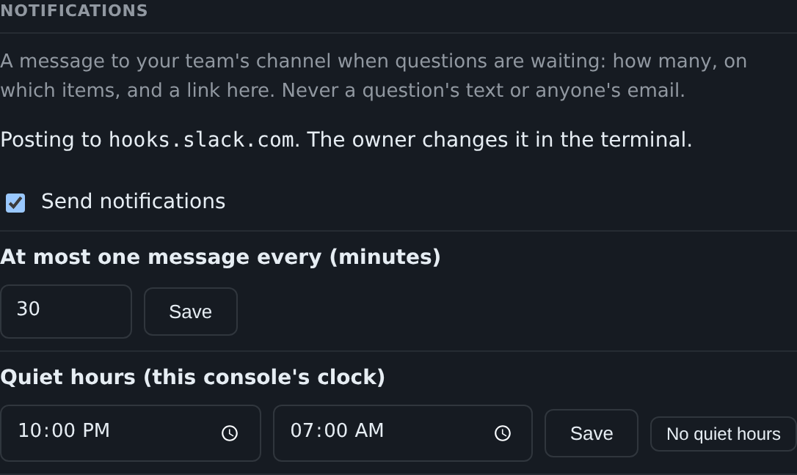

# Settings and notifications

[← Back to README](../../README.md)

The project's own choices, set in the console, and a digest of waiting questions posted to your team's channel.

**Settings (1.44).** An administrator or a director opens **Settings**
to make the project's own choices: how many chat messages a minute and
an hour, how many agents may work one item at once, each lane's label
and colour, the two-key areas (moved here from People), and the short
names committed rulings carry instead of emails. A value set there
lives beside the project on the console's machine
(`STATE/settings.json`), overrides the default, applies at once, and is
listed under **Changes**. **Reset** goes back to the default. People
stays the administrator's alone.

**Notifications (1.45).** The console can tell your team's channel when
questions are waiting. It posts at most one message every N minutes
(default 30), never during quiet hours, and each question is mentioned
only once. A message says how many questions wait, on which items, with
a link to the console. It never includes a question's text or anyone's
email. It posts to any incoming webhook that takes Slack's format:
Slack, Mattermost, or Discord's `/slack` URL. The URL works like a
password, so you set it in your own terminal and the console shows only
its host:

    agent.py --state STATE notify-url https://hooks.slack.com/services/...
    agent.py --state STATE notify-url --test     # post a test message
    agent.py --state STATE notify-url --clear

Then an administrator or a director turns notifications on under
**Settings → Notifications** and sets how often and the quiet hours.
The first message lists every question already waiting. If HTTPS_PROXY
is set, the webhook is reached through it.

**Two-key areas are the administrator's (1.46).** A director sees the
two-key areas under Settings but cannot change them; see
[Two-key locks](two-key-locks.md).

**Since 1.46**, a notification error that was logged once is logged again
if it comes back after a send went through, and a Settings redraw keeps
what you typed and have not saved.
