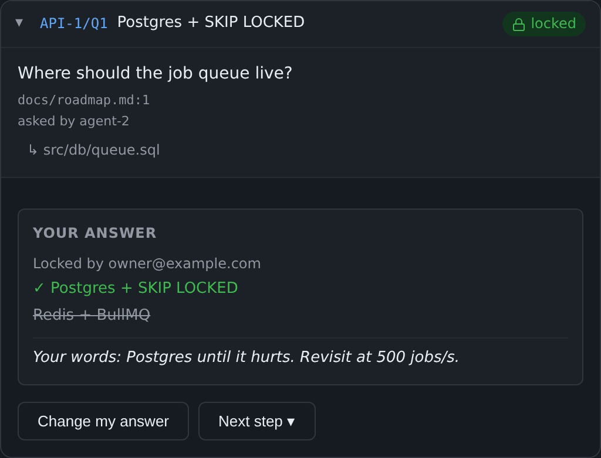
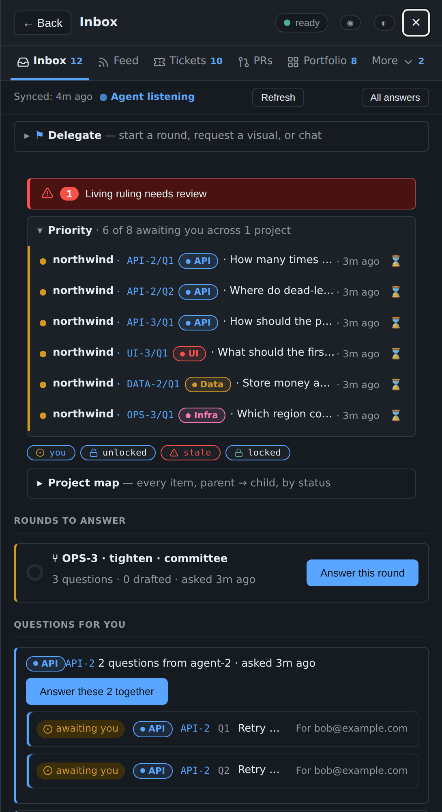
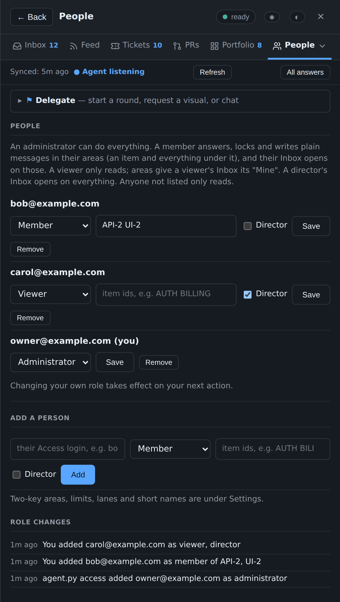

# Roles and people

[← Back to README](../../README.md)

Several people behind one console: who decided, who may decide, who each question is for, and every change to that.

## Who decided (1.38)

Several people can sit behind one console's Access policy. Each owner
decision now keeps the Access login that made it: the console reads the
email from the token it already verifies on every request, and keeps it
beside the store (`operators.jsonl`). A locked question's card says
"Locked by alice@example.com" under your answer (1.38.1), and the
**Feed** shows it on each answer, lock and message: "by
alice@example.com". Both are shown to everyone your
Access policy lets into the console (agents never see it). Agent writes,
scheduled triggers and service tokens (which carry no email) keep none.
Emails are compared in lower case.

The email never leaves the console. The ruling files committed to your
repository carry a short name only when you set one, so nothing personal
lands in a repository that may be public:

    agent.py --state STATE operator-name alice@example.com alice
    agent.py --state STATE operator-name                    # list them (emails masked inside a Claude session)
    agent.py --state STATE operator-name alice@example.com --clear

The next export then adds `"locked_by_name": "alice"` to each lock that
login took. Without a name, the files are exactly what 1.37 wrote. The
store itself is unchanged, so an older kit still starts on it.

## Who may decide (1.39–1.40)

With no roles set, everyone your Access policy lets in is the owner.
To share a console, first make yourself the **administrator** (the
owner role): open **People** (under More) and press **Make me the
administrator**. It takes the login you are signed in with, so you type
no email. Then add each person there with their role, and change or
remove them later the same way. Only an administrator sees the People
tab. It refuses to remove the last administrator.

The same from your own terminal:

    agent.py --state STATE access you@example.com owner
    agent.py --state STATE access bob@example.com member auth billing
    agent.py --state STATE access carol@example.com viewer
    agent.py --state STATE access                        # list them
    agent.py --state STATE access bob@example.com --clear

- **owner**: everything.
- **member**: answers, locks and plain messages on the named items and
  everything under them. Requests to agents (forks, merges, visuals),
  playbooks, tickets, lock-all and the synced drafts stay the owner's.
- **viewer**: reads only.

Once any role is set, a login that is not listed only reads. Changes
take effect on the next write, with no restart. The file
(`STATE/roles.json`) stays on the console's machine. Run `access`
yourself: it refuses inside a Claude Code session, and refuses to leave
the console with no owner.

**Routing (1.41).** Each question shows who it is for: the members
whose areas cover its item. An administrator sees "For bob@example.com"
on every row and card; a member sees "For you" on their own. A member's
Inbox opens on **Mine** (their areas and everything under them), with
**All** one click away. A viewer can be given areas too, for what their
Inbox opens on. Tick **Director** on a member or viewer (or pass
`--director`) and their Inbox opens on everything. Since 1.44 a director
may also change the project's Settings and the short names ruling
exports carry, as an administrator can. A director still cannot change
People (anyone's role, their own included), sign a browser out, or change
the two-key areas, which they see under Settings read-only (1.46). What
they may decide stays what their role allows. Unsent drafts are now each
login's own, so two administrators no longer overwrite each other.

**Role changes (1.42).** Under People, **Role changes** lists every
change, newest first: who made it ("You", another administrator's
login, or `agent.py access` from your terminal), whose role, and from
what to what. The log (`STATE/roles-log.jsonl`) stays on the console's
machine beside `roles.json` and keeps every line; the tab shows the
newest 50.

Since 1.43 the log also records changes to the two-key areas, since 1.44
the Settings changes, and since 1.46 every sign-in link's life: an invite
made in the terminal ("agent.py invite invited bob@example.com"), a
browser signing in, and a revoke.

## Signed-in browsers (1.46)

On a console that runs with sign-in links instead of Cloudflare Access,
People also lists the browsers signed in to this project, each with its
browser and system, when it signed in, its login, and **Revoke**. See
[Sign-in and networks](sign-in-and-networks.md#signed-in-browsers).
