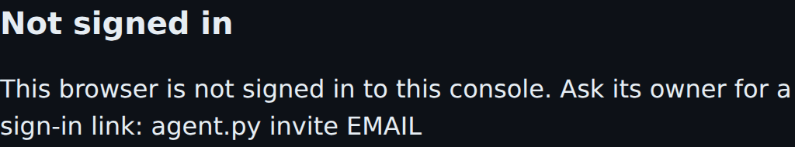
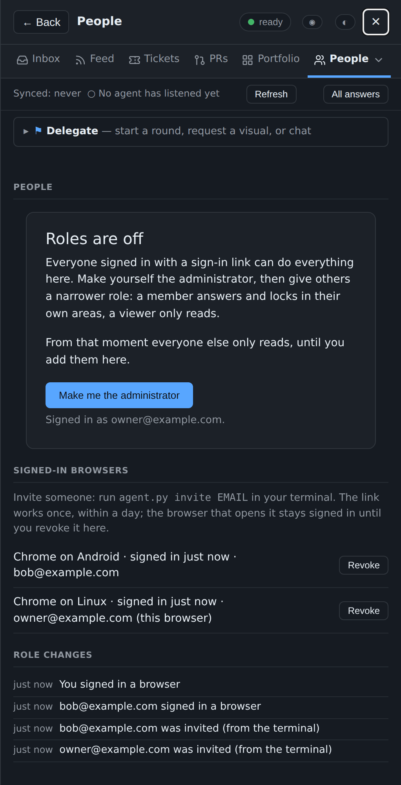

# Sign-in and networks

[← Back to README](../../README.md)

How a browser reaches the console and proves who is at it: Cloudflare Access, or sign-in links on your own network.

A console runs one way in, never both: **Cloudflare Access** (the
default, `--auth cloudflare`) or **sign-in links** (`--auth link`, 1.46).
Either way the console itself listens on `127.0.0.1`; with sign-in links
it can also listen on one ZeroTier or Tailscale address (`--listen`, 1.47).

## Behind Cloudflare Access

```
 browser ──Access login──▶ Cloudflare ──tunnel──▶ 127.0.0.1:PORT  server.py
                                                     │ checks the Access JWT (team keys + AUD)
                                                     ▼
                                              state dir: store + doorbell
                                                     ▲
 Claude session ── SessionStart hook reads the doorbell (registered projects only)
                └─ skills: console-process / console-fork / console-fold / console-ask / console-visual / console-ux ── agent.py
```

Cloudflare's login page protects the console, and a tunnel carries the
traffic to `127.0.0.1:PORT`. The server checks the Access token on every
request, against your team's keys and the application's AUD tag. Every
request without a valid Access token is refused, loopback included.
Setting up the Access application, the tunnel and DNS is in
[docs/CLOUDFLARE.md](../../plugin/kit/docs/CLOUDFLARE.md); the free
Cloudflare tier is enough.

External triggers (webhooks that fire a playbook, see
[Automation](automation.md#webhook-triggers)) pass Access with a service
token, then the trigger's own bearer token.

## Install without Cloudflare (1.46, 1.47)

Cloudflare Access is one way in; sign-in links are the other. A console
runs one or the other, never both. With links, the network decides who can
reach the console and the console itself decides who is at the browser:

    # one project's server, on this machine only
    <py> <kit>/server.py --root DIR --state STATE --auth link --port 4793
    # or the one server, for every project in server.json
    agent.py --state STATE server auth link
    agent.py --state STATE server add NAME --port 4793    # no --hostname/--aud/--team-domain

    agent.py --state STATE invite you@example.com --origin http://127.0.0.1:4793

`/overture:console-onboard` (1.47) asks first how you will reach the
console (Cloudflare, Tailscale, ZeroTier or this machine only), and runs
`onboard.py write --auth link [--listen ADDR] [--origin URL]` for you;
`onboard.py detect` lists the ZeroTier and Tailscale addresses it finds.
Onboarding then prints your own next commands: `install.sh`, `invite` in
your own terminal, and the `tailscale serve` line or the
`http://ADDR:PORT` address to open. `onboard.py verify` in link mode says
Cloudflare and the tunnel are "not used", and checks that the console
answers on each address.

`invite` prints a link once. It works once, within 24 hours, and you run
it, never a session. Open it in the browser you want signed in and press
**Sign this browser in**. That browser stays signed in until you revoke it
under **People**, or with `agent.py devices --revoke ID`. Invites,
sign-ins and revokes go in the role log. A sign-in link opens the project
it was made from, plus every project whose roles list that email; with
roles off, only the projects it was invited from. Opening another
project's link in the same browser adds that project to the same sign-in.
Each project's roles still decide what that login may do. Taking away
someone's role leaves them reading a project they were invited from; to
shut them out, revoke their browser.

- **The cookie goes to every port of the host:** browsers send cookies per
  host name, not per port, so any other program served on the same name
  (a dev server on another `127.0.0.1` port, another service on the
  tailnet name) receives the `overture-device` cookie whenever that
  browser visits it, for its 400 days. Prefer the Tailscale https name
  (`tailscale serve`) for the console, don't browse untrusted local dev
  servers on the same host name in that browser profile, and if in doubt
  revoke the browser under **People** and sign in again.
- **On a machine other people log in to** (1.47): the cookie has no
  `Secure` flag on a plain-http `--listen` address, and it is scoped to
  the host, not the port. Another local user who binds `ADDR:OTHERPORT`
  and gets your browser to visit it receives the cookie. Run `--listen`
  only on a machine whose other users you trust, or use `tailscale serve`
  (https) without `--listen`.

### Ways to reach it

- **This machine only:** the console listens on 127.0.0.1, as always. Open
  `http://127.0.0.1:PORT` on the same machine.
- **Tailscale (preferred: `tailscale serve`):** `tailscale serve --bg
  http://127.0.0.1:PORT` puts the console on your tailnet over HTTPS, and
  the console stays on 127.0.0.1. Start it with `--origin
  https://MACHINE.TAILNET.ts.net` (or `server add ... --origin` for the one
  server) so links and the same-origin checks use that address. `--listen
  100.x.y.z` (below) works too, over plain http on the tailnet. **Not
  both** (1.47): with `--listen`, an https `--origin` is refused by name,
  because `tailscale serve` forwards to 127.0.0.1, whose socket takes only
  loopback origins, so every sign-in and write through it would get 403.
  With `--listen` the origin is `http://ADDR:PORT`.
- **ZeroTier, or Tailscale directly:** `--listen ADDR`, below.
- External triggers (`/api/trigger/...`) need a signed-in browser in link
  mode, so a webhook cannot call them; keep them behind Cloudflare.

## What the browser sees

A browser with no sign-in that opens the console gets a short page
saying how to get a link. It names no project, email or path.



Opening an invite link only asks. Link previews and mail scanners open
every link, so opening it spends nothing; the button does. The page
names the login it signs in and runs no script.


The button must be pressed on the console's own page (a sign-in posted
from another site is refused), and of two presses only one signs in. The
browser then gets the `overture-device` cookie: HttpOnly, SameSite=Lax,
400 days, and Secure on an `https` origin. Each opening of the console
re-sends it, so the browser stays signed in until it is revoked. A link
works only on the console it was made from: on another project's port it
reads as used or expired, and is not spent.

## Signed-in browsers

**People** (administrators only) lists every browser this console lets
in: browser and system, when it signed in, and its login, with
**Revoke**. Revoke asks in the page first. Revoking the browser you are
using says so and signs the page out at once; any other revoke takes
effect on that browser's next request.



From the terminal, `agent.py devices` lists every browser signed in on
this machine with the projects it was invited from (emails masked inside
a Claude session), and `agent.py devices --revoke ID` signs one out.

The sign-ins live in one file for the machine,
`~/.config/overture/devices.json` (mode 0600), beside your registry: each
project's server, the one server and `agent.py` all read the same file.
Only hashes of invites and cookies are kept. A damaged file signs nobody
in, and the server log names the problem once. At most 200 invites can
wait, 500 browsers be signed in, and one browser hold 100 projects.

**The one server.** `agent.py --state STATE server auth link` switches
every project in `server.json` to sign-in links at the server's next
start (`server auth` alone shows the mode). In link mode `server add`
needs no `--hostname`, `--aud` or `--team-domain`; it takes `--origin`
when the console is reached at another address.

**Going back to 1.45.** A 1.45 kit cannot read a role log holding a
sign-in line: its People log then says "the role log cannot be read",
while roles and writes are unaffected. It ignores `"auth"` in
`server.json`, so a link-mode one server comes back behind Cloudflare
Access.

## ZeroTier and `--listen` (1.47)

**`--listen ADDR`** (link mode only; Linux and WSL): the console listens
on 127.0.0.1 **and** ADDR, the same port, never `0.0.0.0`. ADDR must be on
a ZeroTier (`zt…`) or Tailscale (`tailscale0`, 100.64/10) interface; a
public, loopback or IPv6 address, or one on `eth0`, `docker0` or a bridge,
is refused by name, and so is an address that is on a ZeroTier interface
and also on another one (an alias on `eth0`). Every address of every
interface is seen, secondary ones included. With `--auth cloudflare` the
console never listens beyond loopback, and without `--listen` nothing
changes. The address is checked when the server starts, not after: if it
later moves to another interface, restart the server.

- **One origin per address.** Loopback's is `http://127.0.0.1:PORT`, the
  overlay's `http://ADDR:PORT`. A sign-in or a write must carry the origin
  of the address it arrived on, and on ADDR a request must name ADDR in
  its Host, so a DNS-rebinding page cannot use it. A cookie is per host, so
  **sign in once per address you use**. Links and notifications name the
  overlay address.
- **The one server:** `agent.py --state STATE server listen ADDR` sets it
  for every project in `server.json` (`server listen` alone shows it,
  `--clear` removes it). It is refused inside a Claude Code session and
  needs link mode; an address ZeroTier has not brought up yet is set with
  a warning. `agent.py invite` then prints the overlay link.
- **What onboarding finds:** `onboard.py detect` lists each ZeroTier and
  Tailscale address on this machine, and warns about any other network that
  overlaps one:

```text
$ onboard.py detect
zerotier ztexample0 10.147.17.10/16
tailscale tailscale0 100.101.102.103/32
```

### ZeroTier inside WSL

A common setup: ZeroTier runs inside WSL2, beside the console, on an
interface like `ztexample0` with an address like `10.147.17.10/16`.

    onboard.py detect                        # zerotier ztexample0 10.147.17.10/16
    <py> <kit>/server.py --root DIR --state STATE --auth link --port 4793 \
        --listen 10.147.17.10                # origin: http://10.147.17.10:4793
    agent.py --state STATE invite you@example.com --origin http://10.147.17.10:4793

- **Join WSL's own ZeroTier node to the network**, not Windows': WSL2 in NAT
  mode sits behind Windows on an address that changes at every restart, so
  a Windows ZeroTier would need a port proxy that breaks each time. With
  ZeroTier inside WSL, the address is the network's and stays put.
- **If ZeroTier starts after the console**, the console waits up to 2
  minutes for the address, saying so in one line, then exits for the
  service to start it again. See
  [Hosting](hosting.md#the-link-mode-unit-and-the-wait-for-zerotier-147).
- **Docker:** its bridges take 172.17–28 by default, and one on the
  ZeroTier range can take its route. The console names any interface whose
  network overlaps ZeroTier's at start (and `onboard.py detect` does too);
  move the ZeroTier network to another range, or set Docker's
  `default-address-pools` in `/etc/docker/daemon.json`.
- **Plain http is right here:** ZeroTier encrypts every packet end to end
  and only members of your network reach the address, so the console's
  origin is `http://ADDR:PORT`. That one IP is the only http origin taken
  beside loopback.

**Going back to 1.46.** A 1.46 kit refuses `--listen` (no such flag), so a
unit with it does not start; it ignores `"listen"` in `server.json`, so the
one server comes back on loopback only.
