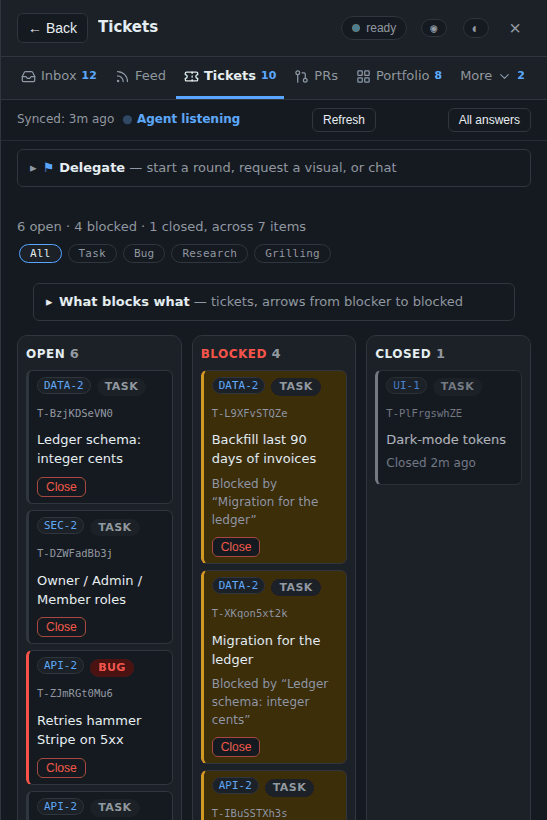
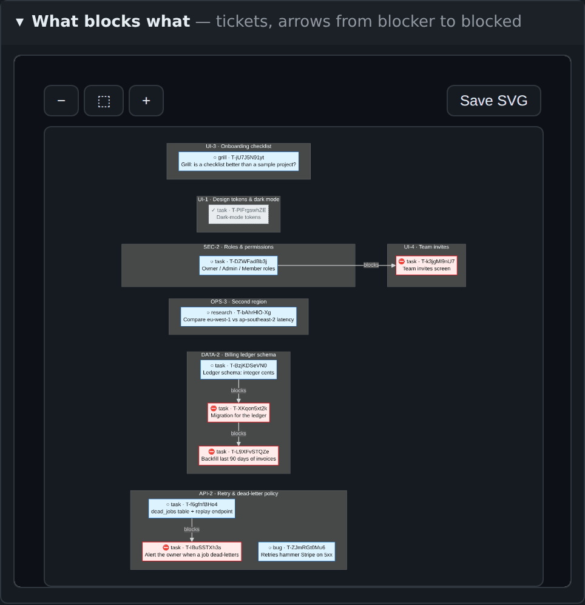
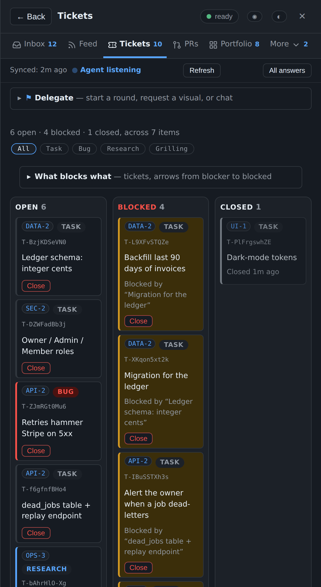
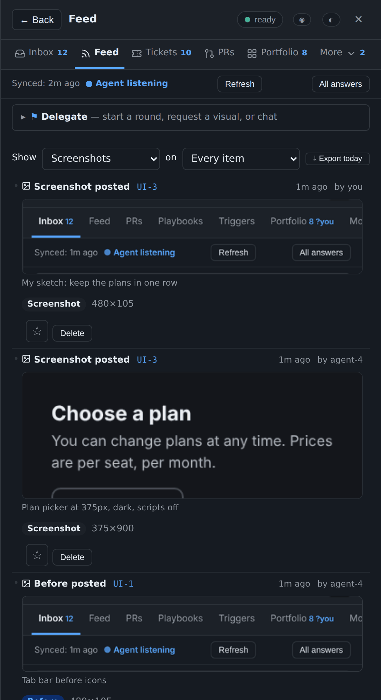
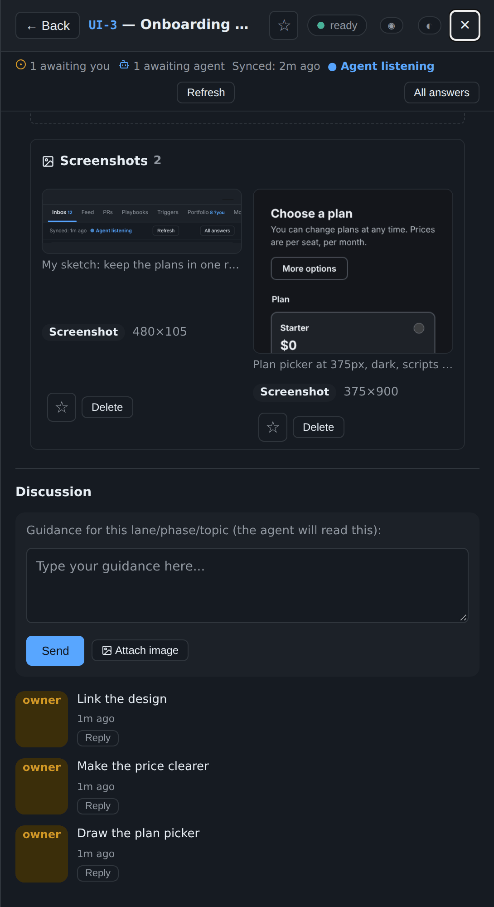
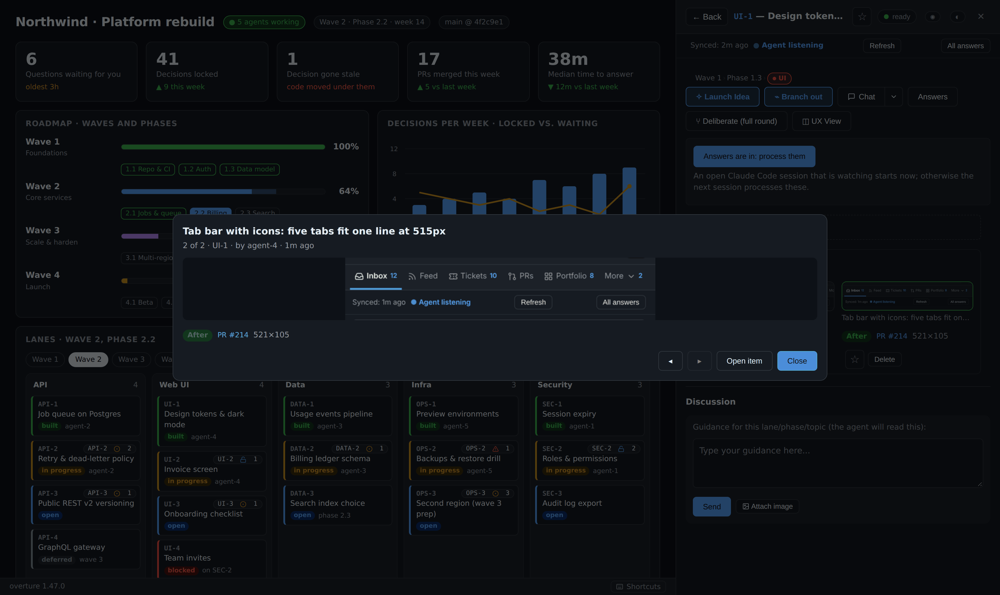
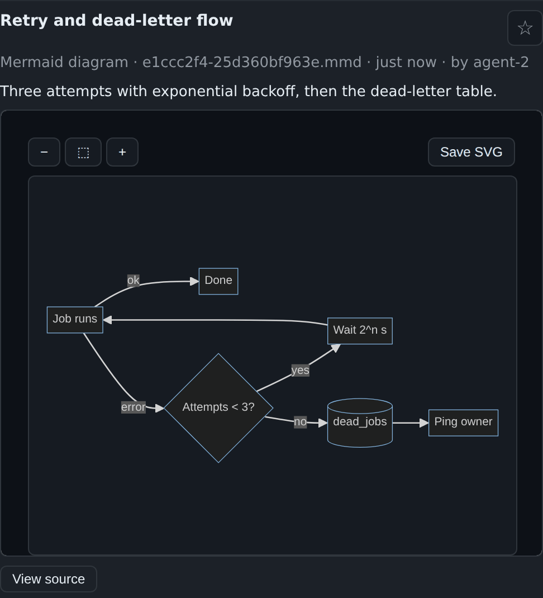
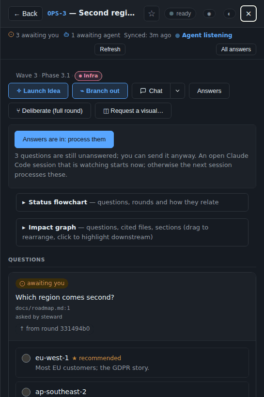
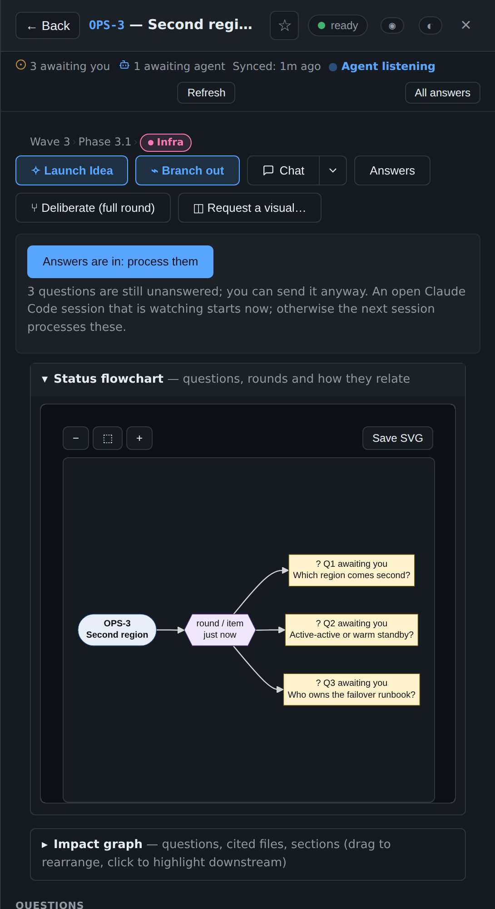
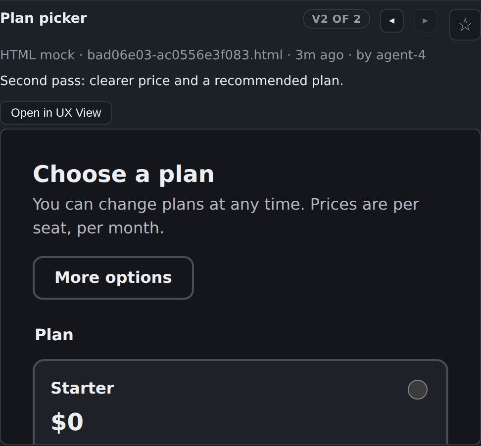

# Tickets, screenshots and visuals

[← Back to README](../../README.md)

Small units of work on an item, what agents changed as before and after screenshots, and diagrams drawn on request.

## Track work as tickets

Tickets are small units of work that belong to an item: a **task**, a
**bug**, a **research** question, or a **grilling** note. You create them
on an item's panel; Launch Idea and Branch Out create them for you.

- **Blocking.** A ticket can be blocked by other tickets. Circular
  blocking is refused by name. When a blocker closes, everything it
  blocked unblocks.
- **The Tickets tab** (`g k`) is a board across every item, with Open,
  Blocked and Closed columns and a filter by kind. Each card names its
  item, opens it with a click, and says what blocks it by title.
- **What blocks what** draws the chains as a diagram, grouped by item.
  There for the whole project on the Tickets tab, and for one item on
  that item's panel.

Only you create and close tickets. Agents cannot write them yet; that
waits on the capability gate.

## See what agents changed, as screenshots

When an agent changes something you can see, it posts a **before** and an
**after** screenshot on the item:

    agent.py asset UI-1 --file after.png --caption "Tabs with icons" --kind after --pr 214

They show up in the **Feed**, where a before and after appear side by side
and the **Screenshots** filter shows only them, and in a **Screenshots**
fold on the item. Click one to open a full-size viewer, and step through
the others with ◂ ▸ or the arrow keys.

**Attach your own too (1.32).** In an item's Discussion box, **Attach
image** (or paste an image) puts your picture on that item, shown as "you",
beside the agents' screenshots. Rate-limited separately from an agent's
budget.

- **Formats:** PNG, JPEG, WebP or GIF. The format is decided from the
  file's own bytes, never its name, and SVG is refused because it can
  carry script.
- **Size limits:** 2 MiB for a still image, 8 MiB for a GIF, 8000 px on
  a side.
- **Storage:** files are kept in the server's state directory, never in
  your project.
- **When space runs short** (100 per item, 3000 or 300 MiB per project),
  the oldest screenshots that aren't starred or linked to a PR are
  removed. The Feed says so.
- **Your controls:** star a screenshot to keep it, or delete it (press
  twice).
- **Reduced motion:** with reduced motion turned on, a GIF waits for you
  to press play.

## Visuals and diagrams

- **Request a visual** on an item. The agent answers with a Mermaid
  diagram (rendered inside a sandboxed frame — the vendored lib runs in
  an opaque origin and cannot touch the console's cookies, storage or
  network; **View source** still shows the raw `.mmd`), or with an HTML
  mock shown the same way, scripts off entirely.

  

- **A short chime when a visual arrives**, the drawn item surfaces at the
  top of the Inbox under **New visuals**, and the Feed row says "Visual
  drawn". The badge on the inbox button and the Feed tab counts it too,
  until you look.
- **Save SVG** on every chart and Mermaid visual. The rendered SVG is sent
  back to the parent and downloaded as a plain file; nothing goes back to
  the server.
- **Status flowchart on every item.** Each item view carries a collapsible
  **Status flowchart** that the server builds from your questions and
  rounds: the item at the left, open/stale/locked questions coloured,
  rounds as their own shape, dotted edges where a newer question
  supersedes an older one or a round follows up on an earlier one. Lazy
  (nothing loads until you expand it); renders inside the same sandboxed
  Mermaid frame. **Click a node** to jump straight to that question.

  

- **Versions side by side (1.29).** When an item has more than one
  visual, each title bar shows which one it is ("v1 of 2") with ◂ and ▸
  to step to the item's other visuals, oldest first.

  

- **HTML is cleaned before it is stored (1.29).** Script, style, frames,
  forms, embedded objects, event-handler attributes and `javascript:` or
  `data:` links are stripped from an HTML visual when it is written. The
  sandboxed frame, with scripts off, still applies on top.
