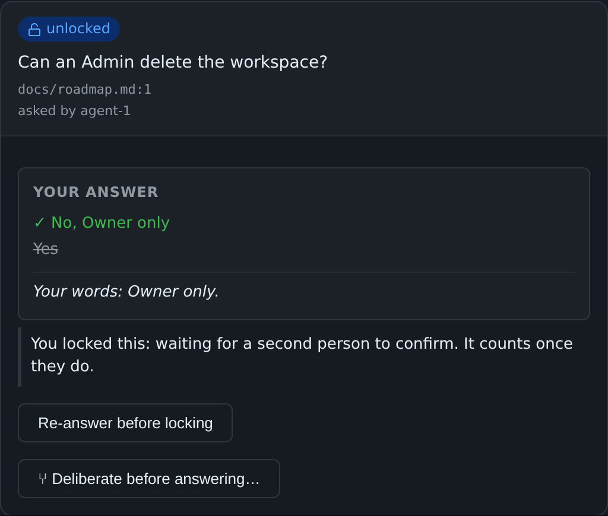

# Two-key locks

[← Back to README](../../README.md)

Areas where one person may not lock alone: a second login confirms the lock.

**Two-key locks (1.43).** Under Settings, **Two-key areas** names the
items (each with everything under it) where one person may not lock
alone. A lock there waits, shown on the card as "You locked this:
waiting for a second person", until a second login that may lock there
(another administrator, or a member of that area) confirms it by locking
the same answer. Only then is it a ruling: until then agents, the
process request and the ruling export see an unlocked answer. The card
then says "Locked by A, confirmed by B". Re-lock and **Lock all** follow
the same rule. Two-key areas need roles on.

When the second key turns, the card names both logins:

**Who sets the areas (1.46).** Only an administrator changes the two-key
areas, under **Settings → Two-key areas**. A director sees them there,
read-only, and the server refuses a change from anyone else.
