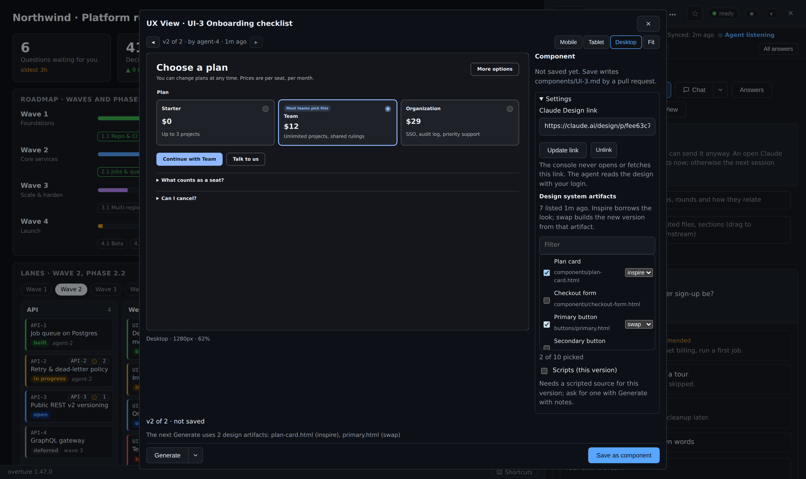

# UX View

[← Back to README](../../README.md)

A full-screen workspace for an item's UI component: versions, sizes, Generate, and Save as component by pull request.

## Design UI components in UX View (1.32)

On a UI/UX item (one marked `"ux": true` in `.overture.json`'s lane
settings), **◫ UX View** (or the `u` key) opens a full-screen workspace
over the item's HTML mock-ups. See each version in a sandbox at Mobile,
Tablet, Desktop or Fit width, step through versions with ◂ ▸ (or `[` and
`]`), and press **Generate** for another. **Save as component** asks the
steward to land the version as `components/<item>.md` by pull request; a
replaced component is kept in `components/.history/`.

Settings, in the same window, hold the rest:

- **Claude Design link.** Link the item to its Claude Design project
  (`https://claude.ai/design/p/<id>`). The console never opens or fetches
  it; the agent reads the design with your login. A link you are typing in
  no longer disappears when the console refreshes (1.32 fix).
- **Design-system artifacts.** An agent lists the design's artifacts
  (`agent.py design-inventory`). You filter, tick up to 10, and mark each
  **inspire** (borrow the look) or **swap** (build the new version from
  that artifact); **Generate** carries your picks. A swap is always a new
  version, never an overwrite. Without a list, **Ask an agent to list it**
  posts the request on the item.
- **Scripts (this version).** Off by default. An agent may store a
  scripted source beside the script-free version (`agent.py
  component-source`, write-once); only your switch lets it run, in a
  sealed frame with `allow-scripts` only (no same-origin, no forms, no
  popups, no top navigation) under `default-src 'none'; connect-src
  'none'`. The modal shows "⚡ Scripts on", and a save with it on lands
  the scripted source with `scripts: true`.

